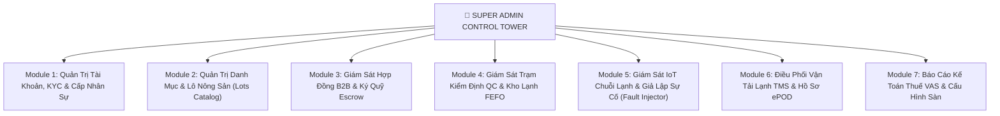

# 👑 TÀI LIỆU ĐẶC TẢ CHI TIẾT PHÂN HỆ QUẢN TRỊ TOÀN QUYỀN (SUPER ADMIN SUBSYSTEM)
## Dự Án: HoNa Fresh B2B (AgriB2B Platform & Cold-Chain Management)

---

## 📌 1. TỔNG QUAN & VAI TRÒ CỦA PHÂN HỆ ADMIN

### 1.1. Vị Trí Cốt Lõi Của Phân Hệ Admin
Trong mô hình **Modular Monolith** của sàn **HoNa Fresh B2B**, tài khoản **Quản Trị Viên Tối Cao (`ROLE_ADMIN`)** đóng vai trò là "Tháp điều khiển trung tâm (Control Tower)". Phân hệ này không chỉ làm các tác vụ CRUD thông thường mà còn nắm quyền giám sát, can thiệp và điều phối toàn bộ 4 nhánh nghiệp vụ B2B khép kín:
1. **Nông trại (FARMER):** Kiểm duyệt vùng trồng PUC, giấy chứng nhận VietGAP, nguồn cung lô hàng.
2. **Thương lái (BUYER):** Giám sát hồ sơ pháp lý, các phiên đàm phán RFQ sỉ.
3. **Kế toán Sàn (ACCOUNTANT):** Giám sát tài khoản trung gian ký quỹ Escrow (TK 3388, TK 112) và chứng từ thuế nông sản (Mẫu 01/TNDN, Hóa đơn KCT, Hóa đơn GTGT).
4. **Vận hành Trạm & Chuỗi lạnh (WAREHOUSE_QC & DRIVER):** Giám sát kiểm định tại trạm trung chuyển, phân loại FEFO, cảm biến IoT buồng lạnh và đội xe tải lạnh.

### 1.2. Kiến Trúc Kỹ Thuật Phân Hệ Admin
* **Frontend:** Next.js 16 (App Router), TailwindCSS, Shadcn/UI, Lucide Icons, Recharts (Vẽ đồ thị IoT & dòng tiền), WebSocket Client (Nhận cảnh báo nhiệt độ tức thì).
* **Backend:** Spring Boot 3 (Java 21), Spring Security RBAC (`hasRole('ADMIN')`), Hibernate JPA, WebSocket STOMP.
* **Database:** PostgreSQL (Lưu trữ quan hệ + pgvector cho tìm kiếm thông minh).

---

## 🏛️ 2. MA TRẬN 7 KHỐI CHỨC NĂNG CỐT LÕI (CORE MODULES)



---

### MODULE 1: QUẢN TRỊ TÀI KHOẢN, DUYỆT KYC & CẤP QUYỀN NHÂN SỰ
*Mục tiêu: Đảm bảo toàn bộ đối tác trên sàn là thực thể pháp lý có thật và nhân sự nội bộ được cấp quyền chính xác.*

1. **Quản trị Người dùng Tổng hợp:**
   * Tìm kiếm, phân trang, lọc theo Role: `FARMER`, `BUYER`, `WAREHOUSE_QC`, `DRIVER`, `ACCOUNTANT`, `ADMIN`.
   * Lọc theo trạng thái tài khoản: *Hoạt động (`enabled = true`)* hoặc *Bị khóa (`enabled = false`)*.
   * Xem hồ sơ chi tiết (Tên công ty, MST, địa chỉ kho, số điện thoại, ngày tạo).
2. **Duyệt Hồ Sơ Pháp Lý Đối Tác (KYC Verification Center):**
   * **Duyệt Nông trại / HTX:** Xem trước ảnh chụp Giấy chứng nhận VietGAP/GlobalGAP, Mã số vùng trồng (PUC), Xác minh loại hình (*Hộ nông dân cá thể* hay *HTX/Doanh nghiệp*).
   * **Duyệt Thương lái / Doanh nghiệp thu mua:** Xác minh Mã số thuế trên cổng Tổng cục Thuế, địa chỉ kho bãi tiếp nhận hàng.
   * Thao tác: Bấm **[Phê duyệt (VERIFIED)]** hoặc **[Từ chối (REJECTED)]** kèm lý do gửi email tự động cho người dùng.
3. **Cấp Tài Khoản Nhân Sự Nội Bộ (Internal Staff Provisioning):**
   * Admin có form modal riêng để tạo tài khoản nhân sự:
     * Cấp tài khoản **Kế toán sàn** (`ROLE_ACCOUNTANT`).
     * Cấp tài khoản **Kỹ thuật viên QC trạm** (`ROLE_WAREHOUSE_QC`).
     * Cấp tài khoản **Tài xế xe lạnh** (`ROLE_DRIVER`).
   * Hệ thống tự động gửi thông tin đăng nhập ban đầu vào email nhân sự.
4. **Kiểm Soát An Ninh Tài Khoản:**
   * Nút bật/tắt khóa tài khoản khẩn cấp (`toggle-status`) khi phát hiện vi phạm.
   * Cưỡng chế thu hồi phiên làm việc (Revoke toàn bộ Refresh Token của tài khoản đó).

---

### MODULE 2: QUẢN TRỊ DANH MỤC & LÔ NÔNG SẢN CHÀO BÁN (HARVEST LOTS)
*Mục tiêu: Quản lý nguồn cung nông sản sỉ chất lượng cao, chuẩn hóa dữ liệu vùng trồng.*

1. **Quản lý Danh mục Ngành hàng (Categories CRUD):**
   * Quản lý nhóm sản phẩm: *Rau ăn lá, Rau củ quả ăn củ, Nông sản sấy lạnh, Trái cây xuất khẩu...*
   * Quản lý tên ngành hàng, mô tả và hình ảnh đại diện của nhóm nông sản.
2. **Kiểm Duyệt Lô Nông Sản Vụ Mùa (`harvest_lots`):**
   * Xem danh sách tất cả các lô do Nông dân chào bán.
   * Kiểm tra thông số lô:
     * Mã Lô (Lot Code: ví dụ `LOT-LD-2026-001`).
     * Mã số vùng trồng (PUC Code), tiêu chuẩn chứng nhận (VietGAP/GlobalGAP).
     * Sản lượng tổng (kg) & Sản lượng còn lại (kg).
     * Bảng giá sỉ phân tầng (Tier Pricing JSON: ví dụ `≥500kg: 15.000đ`, `≥2000kg: 13.500đ`).
     * Dải nhiệt độ bảo quản yêu cầu ($T_{min} - T_{max}$, ví dụ $2.0^\circ\text{C} - 6.0^\circ\text{C}$).
   * Thao tác: Bấm duyệt công khai (`OPEN`), từ chối hoặc tạm khóa nếu phát hiện lô hàng có khiếu nại dư lượng thuốc BVTV.
3. **Quản Trị Vector Embeddings & Trợ Lý AI:**
   * Xem trạng thái đồng bộ vector pgvector của các sản phẩm.
   * Nút bấm **"Tái tạo Vector Search Index"** để cập nhật dữ liệu huấn luyện cho trợ lý ảo Gemini tư vấn tự động.

---

### MODULE 3: GIÁM SÁT HỢP ĐỒNG B2B & DÒNG TIỀN KÝ QUỸ ESCROW
*Mục tiêu: Đóng vai trò bảo chứng trung gian, đảm bảo an toàn tuyệt đối cho dòng tiền và quyền lợi đôi bên.*

1. **Pipeline Giám Sát Vòng Đời Hợp Đồng (B2B Contract Flow):**
   * Hiển thị bảng Kanban hoặc Table theo dõi hợp đồng theo 7 trạng thái:
     1. `RFQ_SENT`: Bên mua gửi yêu cầu đàm phán giá.
     2. `AGREED`: Hai bên đã chốt khối lượng và đơn giá sỉ.
     3. `DEPOSIT_PAID`: Bên mua đã quét VietQR chuyển cọc 30% vào tài khoản Sàn.
     4. `AT_HUB_QC`: Nông sản đã về trạm trung chuyển, QC đang kiểm định.
     5. `IN_TRANSIT`: Hàng đã xếp lên xe tải lạnh đang giao đến kho bên mua.
     6. `DELIVERED`: Bên mua đã ký nhận điện tử ePOD và chuyển 70% còn lại.
     7. `SETTLED`: Kế toán sàn đã quyết toán hoa hồng 3%, cước xe và giải ngân cho nông dân.
2. **Bảng Theo Dõi Quỹ Tạm Giữ Escrow (Tài khoản 3388):**
   * **Số dư quỹ Escrow hiện tại:** Tổng số tiền cọc 30% Sàn đang giữ hộ bảo chứng.
   * **Dòng tiền chờ giải ngân:** Các hợp đồng đã hoàn tất giao hàng đang chờ lệnh chuyển tiền.
   * **Tổng phí dịch vụ sàn đã thu:** Phí hoa hồng sàn 3% tích lũy.
3. **Trung Tâm Xử Lý Tranh Chấp & Khiếu Nại (Dispute Resolution Center):**
   * Tiếp nhận các biên bản sự cố khi tỷ lệ dập nát kiểm định tại trạm vượt quá mức cho phép ($>5\%$) hoặc xe lạnh gặp sự cố nhiệt độ.
   * Thẩm quyền Admin: Quyết định hủy hợp đồng, ra lệnh hoàn cọc 30% cho bên mua hoặc trích quỹ bảo hiểm sàn đền bù cho nông dân.

---

### MODULE 4: QUẢN TRỊ TRẠM TRUNG CHUYỂN & KHO LẠNH FEFO
*Mục tiêu: Quản lý trạm tiếp nhận hàng hóa tập trung (Cross-docking Hub) và tối ưu thời hạn nông sản.*

1. **Quản lý Buồng Lạnh Tại Trạm (`cold_assets` - Loại `COLD_ROOM`):**
   * Danh sách buồng bảo quản: Room A1 (Rau ăn lá), Room A2 (Củ quả), Room B1 (Trái cây)...
   * Sức chứa thiết kế (kg), tải trọng thực tế đang lưu trữ, nhiệt độ & độ ẩm hiện thời.
2. **Giám Sát Thuật Toán Xuất Kho FEFO (First Expired, First Out):**
   * Hệ thống tự động xếp thứ tự ưu tiên các lô nông sản trong buồng lạnh dựa trên `expiry_date` và `fefo_priority_score`.
   * Cảnh báo các lô cận hạn sử dụng ($< 2$ ngày) cần ưu tiên bốc dỡ lên xe tải giao ngay.
3. **Nhật Ký Kiểm Định QC Trạm (`hub_inspections`):**
   * Tra cứu báo cáo của nhân viên QC: Mã lô, khối lượng nhập, khối lượng đạt chuẩn, khối lượng phế phẩm loại trả lại nhà vườn.
   * Xem các chỉ số lý hóa đo được: Độ ngọt Brix, độ ẩm (%), ghi chú cảm quan.

---

### MODULE 5: GIÁM SÁT IOT CHUỖI LẠNH & BẢNG GIẢ LẬP SỰ CỐ (DEMO CENTER)
*Mục tiêu: Đảm bảo chuỗi lạnh không bị đứt gãy ($2^\circ\text{C} - 6^\circ\text{C}$) và phục vụ trình diễn bảo vệ đồ án.*

1. **Dashboard Đo Lường IoT Thời Gian Thực (Real-time Telemetry):**
   * Biểu đồ đường (Line Chart) cập nhật liên tục nhiệt độ và độ ẩm của:
     * Tất cả các buồng bảo quản tại trạm trung chuyển.
     * Thùng xe của tất cả các xe tải lạnh đang lăn bánh trên đường.
   * Ngưỡng hiển thị màu:
     * 🟢 Xanh lá: $2^\circ\text{C} - 6^\circ\text{C}$ (An toàn tối ưu).
     * 🟡 Vàng: $6.1^\circ\text{C} - 8^\circ\text{C}$ (Cảnh báo chú ý).
     * 🔴 Đỏ: $> 8^\circ\text{C}$ hoặc $< 1^\circ\text{C}$ (Báo động nguy cấp).
2. **Bảng Điều Khiển Giả Lập Sự Cố (IoT Fault Injector Panel):**
   * *Được tích hợp trực tiếp trên giao diện Admin để người thuyết trình bấm trực quan:*
     * 🔴 **Nút "Kích hoạt Tăng vọt Nhiệt độ lên 15°C"**: Mô phỏng sự cố xe tải bị chết máy lạnh giữa đường $\rightarrow$ Kích hoạt chuông còi hú trên UI, đổi toàn bộ viền xe sang màu đỏ nhấp nháy, đẩy WebSocket cảnh báo khẩn cấp cho tài xế và Admin.
     * ⚠️ **Nút "Giả lập Cửa buồng lạnh hở"**: Mô phỏng nhân viên quên đóng kín buồng $\rightarrow$ Độ ẩm tụt, nhiệt độ tăng từ từ.
     * 🟢 **Nút "Phục hồi về Bình thường"**: Reset cảm biến về $4.0^\circ\text{C}$ và $85\%$ độ ẩm.
     * 📄 **Nút "Sinh Biên bản Sự cố Chuỗi lạnh Tự động"**: Tự động tính toán thiệt hại và chuyển hợp đồng sang diện bồi thường.

---

### MODULE 6: ĐIỀU PHỐI VẬN TẢI LẠNH & QUẢN LÝ BIÊN BẢN ePOD (LOGISTICS TMS)
*Mục tiêu: Số hóa hoàn toàn khâu giao nhận hàng đường dài, nói không với chứng từ giấy.*

1. **Quản lý Đội Xe Lạnh (`cold_assets` - Loại `REFRIGERATED_TRUCK`):**
   * Quản lý thông tin phương tiện: Biển số xe (ví dụ `49C-123.45`), tải trọng (tấn), tài xế phụ trách (`driver_id`), trạng thái (`NORMAL`, `IN_TRANSIT`, `MAINTENANCE`).
2. **Theo dõi Chuyến Vận Chuyển (`shipments`):**
   * Lộ trình từ Trạm trung chuyển đến kho của Thương lái.
   * Trạng thái chuyến: Đang bốc hàng, Đang trên đường, Đã đến điểm giao, Hoàn tất.
3. **Kho Lưu Trữ Biên Bản Giao Nhận Điện Tử (ePOD Records):**
   * Xem chi tiết từng biên bản giao nhận:
     * Khối lượng thực nhận tại kho của Thương lái.
     * Khối lượng hao hụt/hư hỏng trên đường vận chuyển.
     * **Ảnh chụp chứng minh** hiện trạng hàng hóa lúc bàn giao tại cửa xe.
     * **Chữ ký số cảm ứng (Digital Signature)** của Thương lái xác nhận trên màn hình điện thoại.

---

### MODULE 7: BÁO CÁO KẾ TOÁN THUẾ VAS & THIẾT LẬP THAM SỐ TOÀN SÀN
*Mục tiêu: Tự động hóa chuẩn mực kế toán Việt Nam (VAS) và cấu hình vận hành hệ thống.*

1. **Báo Cáo Tài Chính & Dòng Tiền Sàn:**
   * Doanh thu phí hoa hồng sàn (mặc định 3% giá trị hợp đồng).
   * Doanh thu cước dịch vụ vận chuyển xe lạnh và phí lưu trạm kiểm định.
   * Biểu đồ tăng trưởng tổng giá trị giao dịch nông sản qua sàn (GMV).
2. **Giám Sát Bộ Chứng Từ Kế Toán Chuẩn Việt Nam (VAS Rules):**
   * **Bảng kê thu mua hàng hóa nông sản Mẫu 01/TNDN:** Xuất PDF bảng kê cho các hợp đồng ký với Hộ nông dân cá thể (thuộc diện miễn thuế thu nhập cá nhân/GTGT).
   * **Hóa đơn KCT (Không chịu thuế):** Xuất chứng từ cho hợp đồng ký với Hợp tác xã/Doanh nghiệp nông nghiệp bán sản phẩm trồng trọt chưa qua chế biến.
   * **Hóa đơn GTGT Dịch vụ Sàn:** Quản lý hóa đơn xuất phí dịch vụ sàn thu từ bên mua/bên bán (thuế suất GTGT $8\%$ hoặc $10\%$).
3. **Cấu Hình Tham Số Vận Hành Toàn Sàn (System Settings):**
   * *Tỷ lệ phí sàn:* Cho phép điều chỉnh từ $1\%$ đến $5\%$ (Mặc định: $3\%$).
   * *Tỷ lệ cọc ký quỹ:* Mặc định $30\%$.
   * *Ngưỡng nhiệt độ an toàn:* $T_{min} = 2.0^\circ\text{C}$, $T_{max} = 6.0^\circ\text{C}$.
   * *Cấu hình Gmail SMTP & OTP:* Thời gian sống OTP (300 giây), thời gian sống Access Token (1800 giây).

---

## 🔌 3. DANH SÁCH ENDPOINTS BACKEND CHO PHÂN HỆ ADMIN

Tất cả các API này đều nằm dưới context path `/api/v1/admin/**` và yêu cầu quyền `hasRole('ADMIN')`:

| Phương thức | Endpoint URI | Mô tả chức năng |
| :--- | :--- | :--- |
| `GET` | `/api/v1/admin/dashboard/stats` | Lấy các chỉ số KPI tổng quan (GMV, người dùng, quỹ Escrow, số xe đang chạy). |
| `GET` | `/api/v1/admin/users` | Lấy danh sách người dùng có phân trang và bộ lọc role. |
| `POST` | `/api/v1/admin/users/provision` | Cấp tài khoản nhân sự nội bộ (QC, Tài xế, Kế toán). |
| `PATCH` | `/api/v1/admin/users/{id}/toggle-status` | Khóa hoặc mở khóa tài khoản người dùng. |
| `PATCH` | `/api/v1/admin/users/{id}/kyc-status` | Duyệt hồ sơ KYC (VERIFIED / REJECTED) kèm ghi chú. |
| `GET` | `/api/v1/admin/harvest-lots` | Lấy danh sách toàn bộ các lô vụ mùa nông dân chào bán. |
| `PATCH` | `/api/v1/admin/harvest-lots/{id}/status` | Duyệt mở bán (`OPEN`) hoặc khóa lô nông sản. |
| `GET` | `/api/v1/admin/contracts` | Lấy danh sách hợp đồng B2B và trạng thái luồng Escrow. |
| `POST` | `/api/v1/admin/contracts/{id}/resolve-dispute` | Xử lý phán quyết tranh chấp hợp đồng (hoàn tiền hoặc đền bù). |
| `GET` | `/api/v1/admin/cold-assets` | Lấy trạng thái tất cả buồng lạnh và xe tải lạnh. |
| `POST` | `/api/v1/admin/iot/inject-fault` | Kích hoạt giả lập sự cố nhiệt độ phục vụ demo báo cáo. |
| `POST` | `/api/v1/admin/iot/reset-fault` | Reset trạng thái cảm biến IoT về bình thường. |
| `GET` | `/api/v1/admin/shipments` | Lấy danh sách điều phối chuyến xe lạnh và xem chứng từ ePOD. |
| `GET` | `/api/v1/admin/accounting/vas-reports` | Xuất báo cáo kế toán thuế, doanh thu phí sàn và bảng kê 01/TNDN. |
| `PUT` | `/api/v1/admin/settings` | Cập nhật cấu hình tham số sàn (phí sàn, ngưỡng nhiệt độ). |

---

## 🖥️ 4. KIẾN TRÚC GIAO DIỆN PHÍA FRONTEND (NEXT.JS UI/UX)

### 4.1. Cấu Trúc Bố Cục Trang Admin (`/admin`)
* **Thanh Điều Hướng Trái (Collapsible Sidebar):**
  * 📊 **Tổng quan**: KPI Dashboard, biểu đồ GMV & Dòng tiền.
  * 👥 **Quản lý Tài khoản & KYC**: Danh sách đối tác, Duyệt hồ sơ, Cấp nhân viên nội bộ.
  * 🥦 **Nguồn cung Lô Nông sản**: Danh mục sản phẩm, Lô vụ mùa chờ duyệt, Giá sỉ phân tầng.
  * 🤝 **Hợp đồng & Ký quỹ Escrow**: Pipeline hợp đồng 7 bước, Tài khoản giữ hộ 3388, Xử lý khiếu nại.
  * 🔬 **Trạm QC & Kho FEFO**: Buồng bảo quản lạnh, Nhật ký kiểm định chất lượng nông sản.
  * 🌡️ **Giám sát Chuỗi Lạnh IoT**: Biểu đồ nhiệt độ thời gian thực, **Bảng Điều Khiển Giả Lập Sự Cố (Demo)**.
  * 🚚 **Đội Xe Lạnh & ePOD**: Giám sát chuyến xe tải lạnh, Xem ảnh chụp & chữ ký số giao nhận.
  * 📑 **Kế toán Thuế VAS & Cài đặt**: Bảng kê 01/TNDN, Hóa đơn sàn, Cấu hình tỷ lệ phí sàn.
* **Thanh Tiêu Đề Trên (Top Navbar):**
  * Nút chuyển nhanh chế độ Demo Giả lập Sự cố (Nút khẩn cấp viền đỏ).
  * Chuông thông báo âm thanh (Còi hú cảnh báo khi nhiệt độ chuỗi lạnh vượt $6^\circ\text{C}$).
  * Thông tin Admin và nút Đăng xuất an toàn.

---

## 🚀 5. KẾ HOẠCH TRIỂN KHAI PHÂN HỆ ADMIN (SPRINT TASKS)

```
[Sprint 1: Nền Tảng Dữ Liệu & Quản Trị Tài Khoản / KYC]
├── 1. Viết API /admin/users (Lọc role, xem chi tiết, toggle khóa tài khoản)
├── 2. Viết API /admin/users/provision (Tạo nhân sự QC, Driver, Kế toán)
├── 3. Xây dựng UI Duyệt hồ sơ KYC đối tác (Xem mã PUC, chứng nhận VietGAP, MST)
└── 4. Tái cấu trúc trang /admin với Sidebar 7 phân khu chuyên nghiệp

[Sprint 2: Quản Trị Lô Nông Sản & Giám Sát Escrow]
├── 5. Viết API /admin/harvest-lots (Duyệt lô vụ mùa, kiểm tra Tier Pricing)
├── 6. Xây dựng giao diện Pipeline Hợp đồng B2B & Bảng giám sát Quỹ Ký Quỹ Escrow (TK 3388)
└── 7. Xây dựng giao diện Xử lý Tranh chấp hợp đồng

[Sprint 3: Giám Sát Chuỗi Lạnh IoT, Giả Lập Sự Cố & Logistics ePOD]
├── 8. Xây dựng Bảng Giả lập Sự cố IoT Fault Injector trực tiếp trên Web UI
├── 9. Tích hợp Recharts vẽ biểu đồ nhiệt độ buồng lạnh và xe tải thời gian thực
├── 10. Xây dựng trang xem chi tiết Chuyến xe và Biên bản giao nhận điện tử ePOD
└── 11. Xây dựng Tab Báo cáo Kế toán Thuế VAS (Bảng kê 01/TNDN, Hóa đơn sàn)
```
