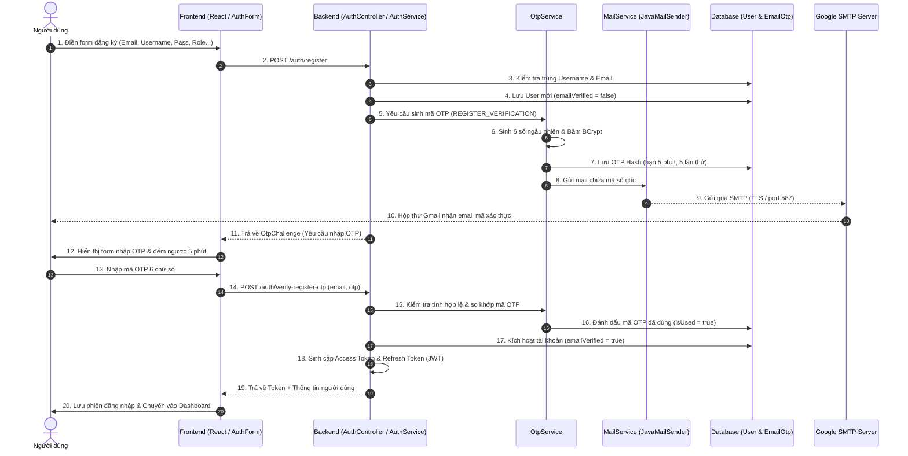

# Quy Trình Đăng Ký Tài Khoản Bằng Gmail Nhận Mã OTP
**Dự án:** HoNa Fresh - Hệ thống Sàn Nông Sản B2B Trung Gian Ký Quỹ & Logistics Chuỗi Lạnh  
**Công nghệ:** Spring Boot 3 (Java 21) + React (Next.js/TypeScript) + Gmail SMTP + MySQL

---

## 1. Sơ đồ tuần tự tổng quan (Sequence Diagram)



---

## 2. Chi tiết các bước thực hiện

### Bước 1: Người dùng điền thông tin đăng ký (Client)
- Người dùng vào trang đăng ký tại `AuthForm.tsx`.
- Cung cấp các thông tin bắt buộc:
  - **Tài khoản**: `username`, `password`, `confirmPassword`.
  - **Thông tin liên lạc**: `email` (Gmail cá nhân/doanh nghiệp), `fullName`, `phone`.
  - **Thông tin vai trò B2B**: `FARMER` (Nông dân/Hợp tác xã) hoặc `BUYER` (Doanh nghiệp thu mua, siêu thị, nhà hàng), mã vùng trồng PUC, mã số thuế...
- Frontend kiểm tra định dạng và so khớp mật khẩu trước khi gửi yêu cầu.

### Bước 2: Gửi yêu cầu đăng ký (API Call)
- Frontend gọi endpoint:
  ```http
  POST /auth/register
  Content-Type: application/json
  ```
- Dữ liệu gửi đi bao gồm toàn bộ payload đăng ký tài khoản.

### Bước 3: Backend xử lý đăng ký & Khởi tạo mã OTP
Tại `AuthService.java` và `OtpService.java`:
1. **Kiểm tra hợp lệ:**
   - Kiểm tra định dạng `username` theo regex `[a-z0-9_.-]{3,50}`.
   - Kiểm tra xem `username` hoặc `email` đã tồn tại trong database chưa (`ACCOUNT_EXISTS`).
   - Kiểm tra độ mạnh mật khẩu và tính đầy đủ của hồ sơ B2B theo vai trò.
2. **Khởi tạo bản ghi người dùng:**
   - Băm mật khẩu bằng thuật toán **BCrypt** (`PasswordEncoder`).
   - Lưu thông tin người dùng vào bảng `users` với cờ `emailVerified = false`.
3. **Sinh mã OTP bảo mật:**
   - Sử dụng `java.security.SecureRandom` tạo ngẫu nhiên chuỗi **6 chữ số** (từ `000000` đến `999999`).
   - Băm mã OTP bằng BCrypt (`otpCodeHash`) trước khi lưu vào bảng `email_otps`.
   - Thiết lập thời gian sống: **5 phút** (`expiresAt = Instant.now().plusSeconds(300)`).
   - Thiết lập số lần nhập sai tối đa: **5 lần**.
   - Hủy bỏ các mã OTP cũ chưa sử dụng của email đó.
4. **Gửi email qua Gmail SMTP:**
   - `MailService` sử dụng `JavaMailSender` với template HTML chuẩn giao diện nông sản xanh.
   - Gửi qua máy chủ `smtp.gmail.com:587` (STARTTLS).
   - *(Cơ chế phòng ngừa: Backend ghi log mã OTP ra console máy chủ để hỗ trợ kiểm thử local ngay cả khi chưa cấu hình App Password).*
5. **Phản hồi Client:**
   - Trả về đối tượng thách thức (`OtpChallenge`):
     ```json
     {
       "email": "user@gmail.com",
       "requireOtp": true,
       "otpType": "REGISTER_VERIFICATION",
       "otpExpirySeconds": 300,
       "resendAfterSeconds": 60
     }
     ```

### Bước 4: Người dùng nhận mã & Nhập OTP
- Người dùng mở ứng dụng Gmail (hoặc thư mục Spam/Quảng cáo nếu có bộ lọc).
- Giao diện Frontend chuyển sang trạng thái chờ nhập mã:
  - Hiển thị đồng hồ đếm ngược **5 phút**.
  - Hiển thị nút "Gửi lại mã" kèm bộ đếm ngược chống spam **60 giây** (`resendAfterSeconds = 60`).
- Người dùng nhập 6 chữ số OTP và bấm **"Xác thực"**.

### Bước 5: Xác thực OTP tại Backend
- Frontend gọi endpoint:
  ```http
  POST /auth/verify-register-otp
  Content-Type: application/json

  {
    "email": "user@gmail.com",
    "otp": "123456",
    "type": "REGISTER_VERIFICATION"
  }
  ```
- `OtpService` tiến hành kiểm tra:
  1. Kiểm tra mã mới nhất theo `email` và loại `REGISTER_VERIFICATION`.
  2. Kiểm tra xem mã đã bị dùng chưa (`isUsed == true`), đã hết hạn chưa (`now > expiresAt`), hoặc đã vượt quá 5 lần thử sai chưa.
  3. So khớp mã người dùng gửi lên với chuỗi hash BCrypt trong database bằng `encoder.matches(code, otp.getOtpCodeHash())`.
  4. **Nếu nhập sai:** Tăng biến đếm `attempts += 1`. Nếu đạt 5 lần thì đánh dấu `isUsed = true` (khóa mã vĩnh viễn) và báo lỗi còn lại bao nhiêu lượt thử.
  5. **Nếu nhập đúng:** Đánh dấu `isUsed = true`.
- `AuthService` hoàn tất kích hoạt:
  1. Cập nhật trạng thái người dùng: `u.setEmailVerified(true)`.
  2. Ghi nhật ký vào bảng kiểm toán `auth_audits` (`LOGIN_REGISTER_VERIFICATION`).
  3. Tự động cấp bộ token JWT (Access Token & Refresh Token) qua `TokenService.issue()`.

### Bước 6: Hoàn tất và Đăng nhập tự động
- Backend trả về kết quả đăng nhập thành công kèm Access Token.
- Frontend lưu Access Token vào bộ nhớ/trình duyệt và tự động điều hướng người dùng vào hệ thống mà không cần người dùng phải đăng nhập lại lần 2.

---

## 3. Các cơ chế bảo mật tiêu chuẩn áp dụng trong hệ thống

| Tiêu chí | Cơ chế bảo vệ | Mục đích |
|---|---|---|
| **Lưu trữ OTP** | Băm một chiều bằng **BCrypt** | Bảo vệ mã OTP nếu cơ sở dữ liệu bị lộ |
| **Giới hạn thử sai (Brute-force)** | Khóa mã sau tối đa **5 lần thử sai** | Ngăn chặn kẻ tấn công dò mã từ 000000 đến 999999 |
| **Chống Spam (Rate Limit)** | Cooldown **60 giây** giữa các lần gửi lại | Ngăn chặn spam gửi email liên tục gây nghẽn SMTP |
| **Thời gian hiệu lực (TTL)** | Hết hạn sau **5 phút (300 giây)** | Giảm thiểu cửa sổ tấn công |
| **Xác thực phiên (Idempotency)** | Đánh dấu `isUsed = true` ngay khi xác minh thành công | Ngăn chặn tấn công lặp lại (Replay Attack) |
| **Khóa dòng dữ liệu (Row Lock)** | `users.lockByEmail()` (Pessimistic Write Lock) | Chống Race Condition khi xác thực đồng thời |
