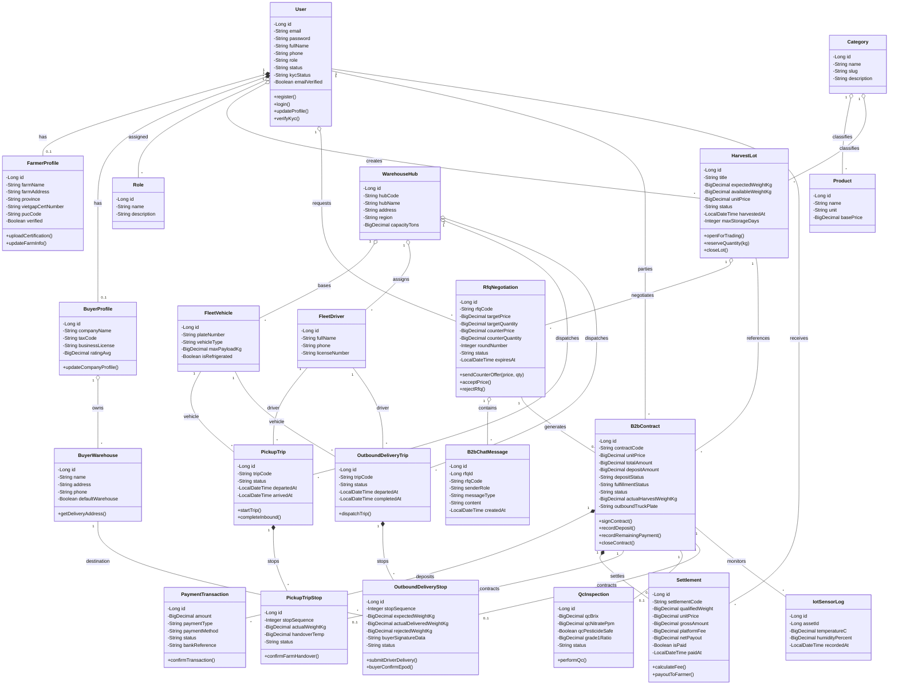

# 3.3. SƠ ĐỒ LỚP CHI TIẾT (UML CLASS DIAGRAM) — NỀN TẢNG B2B HONA FRESH

> **Tài liệu phân tích thiết kế hệ thống:** Sơ đồ lớp chi tiết của hệ sinh thái HONA FRESH  
> **Tệp tin HTML xem trực quan:** [class_diagram.html](file:///e:/HOCTAP/WWW/BTL_WebBanRau/docs/diagrams/class_diagram.html)

---

## 1. SƠ ĐỒ LỚP ĐỒ HỌA UML (MERMAID)

---

## 2. NỘI DUNG VĂN BẢN TRÌNH BÀY CHO BÁO CÁO

### 3.3. Sơ đồ lớp (Class Diagram)
Sơ đồ lớp (UML Class Diagram) của nền tảng B2B HONA FRESH mô hình hóa cấu trúc tĩnh của hệ thống, bao gồm các lớp thực thể (Entity Classes) trong kiến trúc backend Spring Data JPA, các thuộc tính dữ liệu, các phương thức nghiệp vụ và mối quan hệ ràng buộc ngữ nghĩa giữa các đối tượng. Hệ thống gồm 22 lớp thực thể chính được tổ chức thành 4 phân hệ gói (Packages) nghiệp vụ cốt lõi:

#### 3.3.1. Phân hệ Định danh & Quản lý đối tác (Identity & Profile Package)
- **Lớp `User`:** Lớp thực thể người dùng trung tâm, quản lý định danh tài khoản, cơ chế băm mật khẩu BCrypt, vai trò hệ thống (Role) và trạng thái xét duyệt KYC. Quan hệ kết tập mạnh (Composition) 1-1 với lớp `FarmerProfile` (hồ sơ nông trại, chứng chỉ VietGAP, mã số vùng trồng PUC) và lớp `BuyerProfile` (hồ sơ doanh nghiệp, giấy phép kinh doanh, điểm uy tín).
- **Lớp `BuyerWarehouse`:** Quản lý danh mục các địa chỉ kho tiếp nhận hàng của thương lái, có quan hệ n-1 với `BuyerProfile` để hỗ trợ giao hàng đa điểm kho.

#### 3.3.2. Phân hệ Chợ sỉ & Đàm phán RFQ (Marketplace & RFQ Package)
- **Lớp `Category` & `Product`:** Quản lý cây phân loại danh mục nông sản (rau ăn lá, củ quả, nấm ăn) và thông tin mặt hàng chuẩn.
- **Lớp `HarvestLot`:** Đại diện cho từng đợt nông sản xuất vườn của nhà vườn, lưu trữ sản lượng dự kiến (`expectedWeightKg`), sản lượng khả dụng (`availableWeightKg`), đơn giá chào bán và ngày thu hoạch. Lớp này chứa các phương thức nghiệp vụ quan trọng như `reserveQuantity()` để giữ hàng khi chốt hợp đồng và `closeLot()` khi kết thúc mùa vụ.
- **Lớp `RfqNegotiation`:** Mô hình hóa phiên đàm phán giá và số lượng hai chiều, lưu trữ các bước trả giá đối ứng (`counterPrice`, `counterQuantity`), số vòng đàm phán (`roundNumber`), trạng thái máy hữu hạn (`status`) và hạn định phản hồi (`expiresAt`). Quan hệ 1-n với `B2bChatMessage` để lưu trữ lịch sử tin nhắn trao đổi.

#### 3.3.3. Phân hệ Hợp đồng & Kế toán Escrow (Contract & Finance Package)
- **Lớp `B2bContract`:** Thực thể pháp lý kinh tế số, được tự động sinh ra khi RFQ đạt trạng thái `ACCEPTED`. Lưu trữ mã hợp đồng duy nhất, tổng giá trị, số tiền cọc 30% bảo chứng Escrow (`depositAmount`), trạng thái thực thi (`fulfillmentStatus`) và các tham chiếu logistics. Quan hệ 1-n với `PaymentTransaction` để ghi nhận các giao dịch cọc 30% và thanh toán 70% còn lại.
- **Lớp `Settlement`:** Quản lý quyết toán tài chính cuối cùng sau khi hoàn tất giao nhận ePOD, tự động khấu trừ tỷ lệ phí dịch vụ sàn (`platformFee`) và hạch toán số tiền giải ngân thực nhận cho nhà vườn (`netPayout`).

#### 3.3.4. Phân hệ Logistics Chuỗi lạnh & Quản lý Trạm Hub (Logistics & Cold Chain Package)
- **Lớp `WarehouseHub`:** Quản lý các trạm trung chuyển nông sản, liên kết trực tiếp với danh sách xe tải lạnh (`FleetVehicle`) và đội ngũ tài xế (`FleetDriver`) được biên chế tại trạm.
- **Lớp `PickupTrip` & `PickupTripStop`:** Điều phối tuyến xe tải lạnh đi gom nông sản tại nhiều vườn nông dân (Inbound Logistics), ghi nhận khối lượng thực tế và nhiệt độ bàn giao tại vườn.
- **Lớp `QcInspection`:** Quản lý kết quả kiểm nghiệm KCS chất lượng tại trạm Hub: độ ngọt quang học (`qcBrix`), dư lượng phân bón Nitrat (`qcNitratePpm`) và an toàn thuốc bảo vệ thực vật, quyết định tỷ lệ phân loại Grade 1 của lô hàng.
- **Lớp `OutboundDeliveryTrip` & `OutboundDeliveryStop`:** Điều phối chuyến xe tải lạnh giao hàng chặng cuối từ Hub đến kho của từng Buyer. Lớp `OutboundDeliveryStop` ghi nhận biên bản giao nhận điện tử ePOD có đính kèm ảnh chụp hiện trường và chữ ký số cảm ứng của người nhận.
- **Lớp `IotSensorLog`:** Lưu trữ chuỗi dữ liệu telemetry cảm biến nhiệt độ (`temperatureC`) và độ ẩm (`humidityPercent`) theo thời gian thực để cảnh báo vi phạm dải bảo quản lạnh an toàn.
