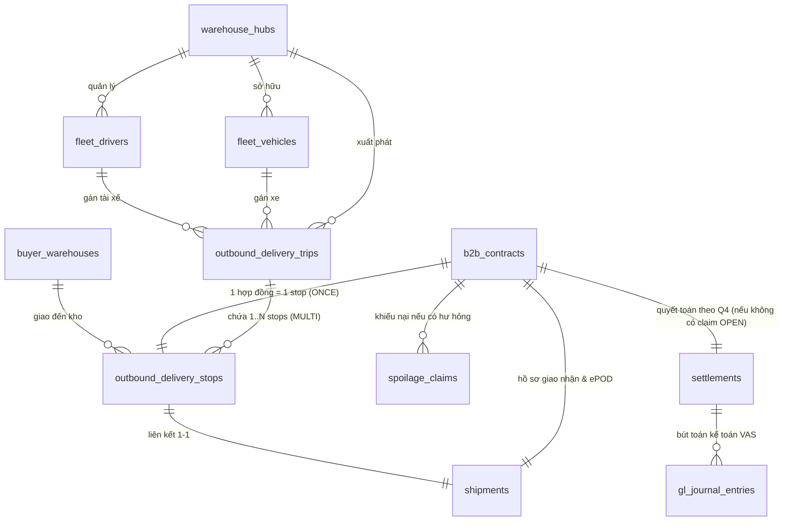

# BÁO CÁO KẾT QUẢ KHẢO SÁT HỆ THỐNG — PHASE 0 DISCOVERY
## ĐỐI CHIẾU THỰC TẾ POSTGRESQL SCHEMA, BACKEND JAVA VÀ THIẾT KẾ OUTBOUND V2.1

> **Dự án:** HONA FRESH  
> **Tài liệu căn cứ:** [Ke_hoach_ky_thuat_HONA_FRESH_Outbound_V2.1.md](file:///e:/HOCTAP/WWW/BTL_WebBanRau/docs/plans/Ke_hoach_ky_thuat_HONA_FRESH_Outbound_V2.1.md)  
> **Ngày thực hiện:** 18/11/2026  
> **Trạng thái:** HOÀN THÀNH PHASE 0 — SẴN SÀNG TRIỂN KHAI PHASE 1  

---

## 1. KẾT QUẢ RÀ SOÁT FLYWAY SCHEMA HISTORY

Khảo sát trực tiếp bảng `flyway_schema_history` trong PostgreSQL container `webbanrau_postgres`:

| Installed Rank | Version | Script | Installed On | Execution Time | Success |
| :---: | :---: | :--- | :--- | :---: | :---: |
| 24 | **26** | `V26__enhance_pickup_trips_and_warehouse_receiving.sql` | 2026-11-18 01:40:31 | 39ms | **true** |
| 23 | **25** | `V25__create_fleet_and_inbound_dispatch_schema.sql` | 2026-11-18 01:09:02 | 64ms | **true** |
| 22 | **24** | `V24__add_packaging_approved_fields.sql` | 2026-11-18 00:04:59 | 48ms | **true** |

👉 **Kết luận xác nhận 100%:** Version cao nhất hiện tại là **26**. Migration kế tiếp chính xác là **`V27`**!

---

## 2. KẾT QUẢ KHẢO SÁT ENTITY & SOURCE CODE LIÊN QUAN

### 2.1. Bảng `shipments` và cách sử dụng hiện tại
- **Thực tế Database**: Bảng `shipments` đã có sẵn trong DDL với các cột:
  - `id`, `shipment_code`, `contract_id` (UNIQUE), `truck_id`, `driver_id`, `loaded_weight_kg`, `delivered_weight_kg`, `damaged_weight_kg`, `natural_shrinkage_kg`, `epod_signature_name`, `epod_photo_url`, `epod_signature_data`, `departed_at`, `delivered_at`, `status`.
- **Thực tế Backend Java**:
  - Không có JPA Entity `Shipment.java` mà bảng này được truy vấn và cập nhật trực tiếp qua `JdbcTemplate` trong [AdminBusinessService.java](file:///e:/HOCTAP/WWW/BTL_WebBanRau/backend/src/main/java/com/btl/webbanrau/service/AdminBusinessService.java) và [BuyerWorkflowService.java](file:///e:/HOCTAP/WWW/BTL_WebBanRau/backend/src/main/java/com/btl/webbanrau/service/BuyerWorkflowService.java).
  - `shipments.contract_id` có ràng buộc `UNIQUE`: Đúng với quyết định **ONCE** (mỗi hợp đồng chỉ có 1 hồ sơ giao nhận).
  - Điểm hạn chế hiện tại: `truck_id` và `driver_id` cũ trong `shipments` đang trỏ legacy vào `cold_assets` và `users`, không gắn với đội xe `fleet_vehicles` và `fleet_drivers` của Hub.
- **Giải pháp thiết kế**:
  - Giữ nguyên `shipments` làm hồ sơ giao nhận theo Hợp đồng ($Q_4$ delivered weight, damaged weight, chữ ký/ảnh ePOD).
  - Tạo bảng mới `outbound_delivery_trips` và `outbound_delivery_stops` để quản lý chuyến xe đa điểm (`MULTI`), liên kết trực tiếp với `fleet_vehicles` và `fleet_drivers`.

### 2.2. Bảng `spoilage_claims` và cơ chế Khóa Quyết toán (Decision 5 - BLOCK)
- Trong [AdminBusinessService.java](file:///e:/HOCTAP/WWW/BTL_WebBanRau/backend/src/main/java/com/btl/webbanrau/service/AdminBusinessService.java), hệ thống đã có sẵn logic:
  ```java
  if (db.queryForObject("select count(*) from spoilage_claims where contract_id=? and status='OPEN'", Integer.class, id) > 0)
      bad("Còn tranh chấp chưa xử lý");
  ```
  Khi tài xế giao hàng ghi nhận có hàng hư hỏng (`damaged_weight_kg > 0`), hàm `epod()` tự động sinh một bản ghi `spoilage_claims` với `status = 'OPEN'`.
- 👉 **Khớp 100% với Quyết định 5**: Khi có bất kỳ Claim nào ở trạng thái `OPEN`, toàn bộ thao tác Settlement của hợp đồng bị khóa chặt.

### 2.3. Bảng `settlements` và Căn cứ Q4 (Decision 3 - Q4)
- Đã có JPA Entity [Settlement.java](file:///e:/HOCTAP/WWW/BTL_WebBanRau/backend/src/main/java/com/btl/webbanrau/model/Settlement.java) và [SettlementRepository.java](file:///e:/HOCTAP/WWW/BTL_WebBanRau/backend/src/main/java/com/btl/webbanrau/repository/SettlementRepository.java).
- Các trường cốt lõi:
  - `contract` (OneToOne UNIQUE)
  - `qualifiedWeight`: Hiện đang nhận từ QC trạm, nhưng theo **Quyết định 3**, giá trị này sẽ được cập nhật từ **$Q_4$ (khối lượng Buyer thực nhận và chấp nhận)** từ ePOD.
  - `unitPrice`, `grossAmount`, `platformFee` (3%), `payoutAmount`.
  - `bankAccount`, `bankName`, `bankAccountName`, `bankReference`, `isPaid`, `paidAt`.
  - `taxFormType`: Mặc định `"FORM_01_TNDN"` (Bảng kê thu mua Mẫu 01) hoặc `"HOA_DON_KCT"`.
- Đã có sẵn hệ thống hạch toán bút toán kép VAS (`gl_journal_entries`, `gl_journal_lines`) với các tài khoản kế toán chuẩn:
  - TK 112: Tiền gửi ngân hàng.
  - TK 3388: Tiền giữ Escrow ký quỹ B2B.
  - TK 5113: Doanh thu phí sàn HONA FRESH (3%).
  - TK 811: Chi phí bồi thường hao hụt.

### 2.4. Bảng `buyer_warehouses`
- Đã có JPA Entity [BuyerWarehouse.java](file:///e:/HOCTAP/WWW/BTL_WebBanRau/backend/src/main/java/com/btl/webbanrau/model/BuyerWarehouse.java) liên kết với [BuyerProfile.java](file:///e:/HOCTAP/WWW/BTL_WebBanRau/backend/src/main/java/com/btl/webbanrau/model/BuyerProfile.java).
- Lưu trữ: `name`, `address`, `phone`, `default_warehouse`.
- Khi điều phối chuyến Outbound, mỗi điểm dừng (`outbound_delivery_stops`) sẽ trỏ đến đúng `buyer_warehouse_id` và chụp snapshot địa chỉ kho Buyer để giao hàng.

### 2.5. Cổng SePay và Chống trùng giao dịch (Idempotency)
- Trong [SepayServiceImpl.java](file:///e:/HOCTAP/WWW/BTL_WebBanRau/backend/src/main/java/com/btl/webbanrau/service/impl/SepayServiceImpl.java), SePay webhook hiện đã bắt regex `HD-...` để cập nhật `DEPOSIT_PAID`.
- Để hoàn thiện cho Outbound & Quyết toán:
  - Cần mở rộng SePay webhook nhận diện thanh toán số dư còn lại (`FINAL_PAYMENT` / `BALANCE_PAID`) sau khi Buyer ký ePOD.
  - Bổ sung bảng lưu lịch sử giao dịch webhook SePay (`payment_transactions`) hoặc kiểm tra `reference_code` để đảm bảo chống ghi nhận trùng lặp (Idempotency).

---

## 3. SƠ ĐỒ QUAN HỆ THỰC THỂ (ERD) OUTBOUND V2.1



---

## 4. MA TRẬN CHUYỂN TRẠNG THÁI HỢP ĐỒNG B2B (STATE MACHINE)

| Trạng thái hiện tại | Sự kiện kích hoạt | Trạng thái mới | Điều kiện kiểm tra (Guard Condition) |
| :--- | :--- | :--- | :--- |
| `AT_HUB_QC` | QC kết luận đạt | `READY_FOR_OUTBOUND` | `qc_status = 'PASSED'`, `qualified_weight > 0` |
| `READY_FOR_OUTBOUND` | Điều phối viên xác nhận chuyến | `OUTBOUND_DISPATCHED` | Xe & Tài xế cùng Hub, không quá tải kg/m³, chưa có chuyến Outbound nào khác |
| `OUTBOUND_DISPATCHED` | Tài xế Outbound bấm xuất bến | `OUTBOUND_ON_DELIVERY` | Chuyến xe ở trạng thái `ASSIGNED` |
| `OUTBOUND_ON_DELIVERY` | Tài xế đến kho & nộp biên bản | `DELIVERY_PENDING_BUYER_CONFIRMATION` | Đã nhập khối lượng thực nhận, hàng dập nát, ảnh biên bản |
| `DELIVERY_PENDING_BUYER_CONFIRMATION` | Buyer đăng nhập Portal bấm xác nhận | `DELIVERED` | Khóa số liệu $Q_4$ (accepted weight). Nếu có hàng hỏng $\rightarrow$ tự động mở Claim `spoilage_claims` |
| `DELIVERED` | Buyer thanh toán xong phần còn lại | `PENDING_SETTLEMENT` | Không còn Claim nào ở trạng thái `OPEN` (`status != 'OPEN'`) |
| `PENDING_SETTLEMENT` | Kế toán duyệt và bấm Payout | `SETTLED` | Đã chi trả thành công cho Nhà vườn, xuất bảng kê Mẫu 01/TNDN hoặc Hóa đơn KCT |

---

## 5. THIẾT KẾ MIGRATION V27 CHO PHASE 1

Dựa trên cấu trúc đã khảo sát, file migration **`V27__create_outbound_delivery_schema.sql`** sẽ bao gồm:
1. Tạo bảng `outbound_delivery_trips`:
   - `id`, `trip_code` (UNIQUE), `hub_id` (FK `warehouse_hubs`), `vehicle_id` (FK `fleet_vehicles`), `driver_id` (FK `fleet_drivers`), `status`, `planned_departure_at`, `departed_at`, `completed_at`, `total_loaded_weight_kg`, `notes`, `created_by`, `created_at`, `updated_at`.
2. Tạo bảng `outbound_delivery_stops`:
   - `id`, `trip_id` (FK `outbound_delivery_trips`), `contract_id` (FK `b2b_contracts`, **UNIQUE** để đảm bảo quy tắc ONCE), `buyer_warehouse_id` (FK `buyer_warehouses`), `shipment_id` (FK `shipments`, UNIQUE), `stop_sequence`, `delivery_address_snapshot`, `contact_name_snapshot`, `contact_phone_snapshot`, `expected_weight_kg`, `status`, `arrived_at`, `driver_submitted_at`, `buyer_confirmed_at`, `created_at`, `updated_at`.
3. Bổ sung các cột xác nhận 2 chiều vào bảng `shipments` (nếu chưa có):
   - `driver_submitted_weight_kg`, `buyer_accepted_weight_kg`, `buyer_signer_name`, `buyer_signer_phone`, `buyer_confirmed_at`, `confirmation_status`.
4. Tạo bảng lưu giao dịch thanh toán chống trùng `payment_transactions`:
   - `id`, `provider` ('SEPAY'), `transaction_id` (UNIQUE), `contract_id`, `amount`, `payment_type` ('DEPOSIT', 'BALANCE'), `payload`, `created_at`.

---

## 6. KẾT LUẬN & ĐỀ XUẤT BƯỚC TIẾP THEO

Phase 0 Discovery đã hoàn tất thành công 100%. Mọi nghi vấn về phiên bản migration, quan hệ thực thể, cơ chế khóa claim, hạch toán VAS và chống trùng SePay đều đã được làm sáng tỏ và chứng minh trực tiếp từ codebase.

**Đề xuất tiếp theo:** Bắt đầu triển khai **Phase 1 — Outbound Domain**:
1. Tạo migration `V27__create_outbound_delivery_schema.sql` và nạp an toàn vào database.
2. Viết các JPA Entity, Repository và DTOs tương ứng trong backend Spring Boot.
3. Viết Service tạo và xác nhận chuyến Outbound đa điểm (`AdminOutboundDispatchService`).
