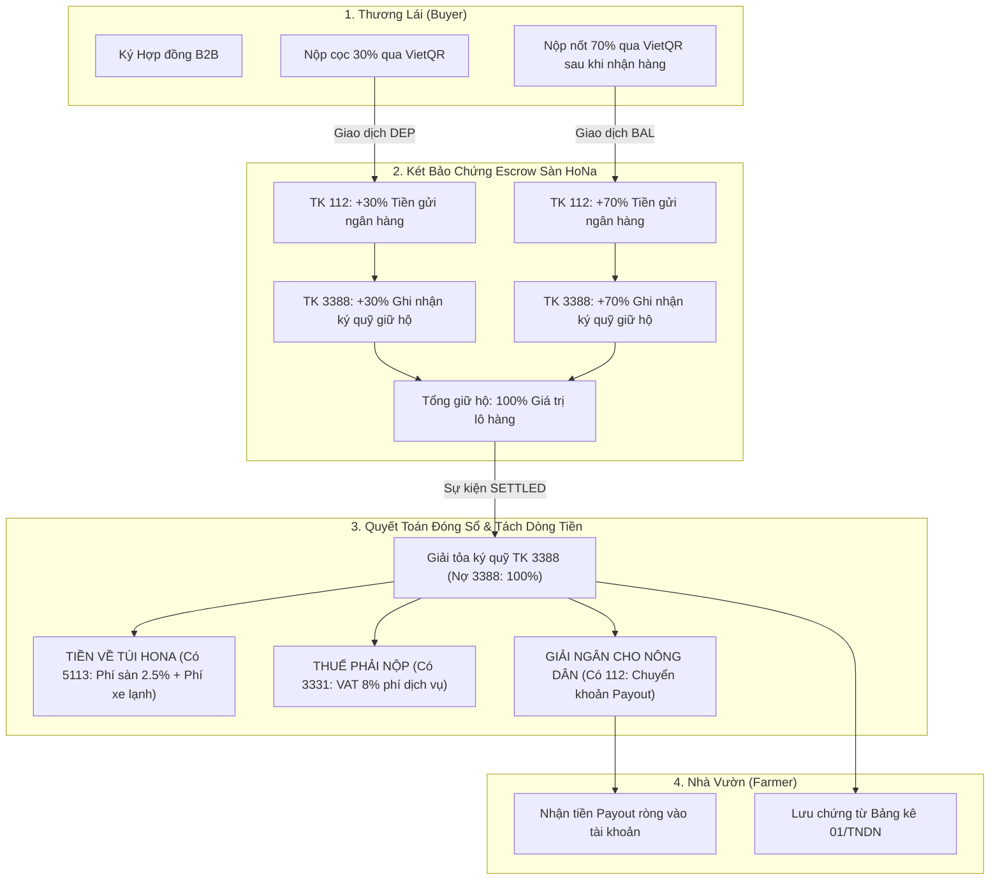

# KẾ HOẠCH TRIỂN KHAI PHẦN KẾ TOÁN CƠ BẢN & KIỂM SOÁT DÒNG TIỀN VỀ TÚI HONA FRESH

> **TÊN CHỨC NĂNG:** Module Kế Toán Dòng Tiền & Bảng Đối Soát Doanh Thu Thực Nhận HoNa Fresh (B2B Platform Cashflow & Settlement Accounting)  
> **MÃ KẾ HOẠCH:** `PLAN_BASIC_ACCOUNTING_AND_CASHFLOW`  
> **NGÀY KHỞI TẠO:** 18/11/2026  
> **PHIÊN BẢN:** 1.0  
> **PHẠM VI:** Full-stack (Spring Boot + ReactJS Tailwind CSS + VAS Double-entry Ledger)  

---

## A. TỔNG QUAN (OVERVIEW)

### 1. Mục tiêu kinh doanh
Mục tiêu cốt lõi của sàn thương mại điện tử nông sản B2B **HoNa Fresh** là đóng vai trò trung gian bảo chứng thanh toán (Escrow) kết nối Thương lái (Buyer) và Nhà vườn (Farmer), đồng thời thu phí dịch vụ vận hành và phí logistics.

Để chủ doanh nghiệp và kế toán trưởng HoNa Fresh kiểm soát minh bạch **"Dòng tiền nào thực sự về túi HoNa, dòng tiền nào là tiền giữ hộ Escrow, và dòng tiền nào phải giải ngân cho nông dân"**, module Kế toán cơ bản cần cung cấp:
1. **Kiểm soát dòng tiền về túi HoNa (Platform Net Take)**:
   - **Phí hoa hồng sàn (Platform Fee 2.5% - 3.0%)**: Thu từ giá trị hàng hóa giao dịch thành công.
   - **Phí dịch vụ vận chuyển lạnh (Logistics Fee)**: Thu từ việc điều phối xe tải lạnh chuyên dụng của sàn.
   - **Thuế GTGT dịch vụ (VAT 8%)**: Thuế sàn thu hộ để nộp ngân sách nhà nước.
2. **Kiểm soát dòng tiền bảo chứng Escrow (Account 3388)**:
   - Tiền cọc 30% ký quỹ và tiền thanh toán nốt 70% của Buyer được giữ an toàn tại tài khoản ngân hàng sàn (TK 112) và ghi nhận Nợ 112 / Có 3388.
   - Giám sát số dư Escrow đang giữ hộ theo thời gian thực (chưa hoàn tất giao hàng thì tuyệt đối không được hạch toán vào doanh thu của HoNa).
3. **Kiểm soát dòng tiền giải ngân Payout cho Nhà vườn (Account 112 Outflow)**:
   - Theo dõi số tiền đã chuyển khoản cho nông dân sau khi khấu trừ phí sàn và phí vận chuyển.
4. **Bảng đối soát dòng tiền chi tiết theo từng Hợp đồng B2B (Contract Settlement Ledger)**:
   - Minh bạch từng hợp đồng: Tổng tiền hàng $\rightarrow$ Buyer đã nộp bao nhiêu $\rightarrow$ HoNa giữ lại bao nhiêu về túi $\rightarrow$ Nông dân thực nhận bao nhiêu $\rightarrow$ Trạng thái chốt sổ.
5. **Sổ Nhật ký chung & Bút toán kép VAS (Accounts 112, 3388, 5113, 3331, 811)**:
   - Tuân thủ chuẩn mực kế toán Việt Nam (VAS), hỗ trợ xuất bảng kê thu mua 01/TNDN và in phiếu chứng từ kế toán.

---

## B. KIẾN TRÚC HIỆN TẠI & TÁI SỬ DỤNG (CURRENT ARCHITECTURE)

### 1. Cơ sở dữ liệu hiện có
Hệ thống đã có sẵn cấu trúc bảng kế toán kép và trường tài chính trong database:
- **`gl_journal_entries`**: Bảng sổ nhật ký chung ghi nhận các sự kiện tài chính (`id`, `contract_id`, `event`, `reference`, `created_at`).
  - `event = 'DEPOSIT'`: Thu cọc 30% của Buyer.
  - `event = 'BALANCE'`: Thu nốt 70% tiền hàng còn lại khi giao hàng.
  - `event = 'SETTLEMENT'`: Quyết toán giải ngân cho Farmer và kết chuyển doanh thu sàn.
  - `event = 'COMPENSATION'`: Bồi thường hư hỏng nông sản.
  - `event = 'REFUND'`: Hoàn cọc khi hủy đơn.
- **`gl_journal_lines`**: Bảng bút toán chi tiết định khoản Nợ / Có (`id`, `entry_id`, `account`, `debit`, `credit`).
  - **TK 112**: Tiền gửi ngân hàng (Tài khoản thanh toán của Sàn HoNa Fresh).
  - **TK 3388**: Tiền ký quỹ Escrow bảo chứng trung gian.
  - **TK 5113**: Doanh thu cung cấp dịch vụ Sàn HoNa Fresh (Phí sàn + Phí vận chuyển lạnh).
  - **TK 3331**: Thuế GTGT dịch vụ sàn phải nộp (8%).
  - **TK 811**: Chi phí khác (Bồi thường sự cố).
- **`b2b_contracts`**: Đã lưu trữ đầy đủ các cột tài chính:
  - `total_goods_amount`, `deposit_30_amount`, `deposit_received`, `balance_received`, `remaining_amount`.
  - `platform_fee_rate`, `platform_fee_amount`, `logistics_fee_amount`, `service_vat_rate`.
  - `payout_amount`, `farmer_payout_amount`, `payout_ref`, `settled_at`, `bank_transfer_ref`.
- **`platform_settings`**: `platform_fee_rate`, `deposit_rate`, `service_vat_rate`, `temp_min`, `temp_max`.

### 2. Thành phần Backend hiện có
- `AdminBusinessService.java`: Đã có các hàm `stats()`, `reports()`, `settlementQuote()`, `journal()`, `line()`, `held()`, `updateSettings()`.
- `AdminBusinessController.java`: Đã có endpoint `GET /admin/dashboard/stats`, `GET /admin/accounting/vas-reports`, `PUT /admin/settings`.

### 3. Thành phần Frontend hiện có
- `frontend/src/app/admin/accounting/page.tsx`: Hiện tại chỉ hiển thị bảng dữ liệu thô (raw data table) của `documents`, `entries`, `lines`, chưa có dashboard dòng tiền, chưa phân tích tiền về túi HoNa, chưa có bộ lọc và biểu đồ trực quan.

---

## C. PHẠM VI TRIỂN KHAI (IMPLEMENTATION SCOPE)

### 1. Backend (Spring Boot)
Nâng cấp và bổ sung logic kế toán dòng tiền trong `AdminBusinessService.java` và `AdminBusinessController.java`:
- Thêm endpoint `GET /api/v1/admin/accounting/cashflow-summary`:
  - **`kpi`**:
    - `totalBankBalance`: Số dư tài khoản ngân hàng HoNa (TK 112) = $\sum(\text{debit} - \text{credit})$.
    - `totalHonaRevenue`: **Tiền thực tế về túi HoNa** (TK 5113) = $\sum(\text{credit} - \text{debit})$.
    - `totalEscrowHeld`: Tiền ký quỹ đang giữ hộ (TK 3388) = $\sum(\text{credit} - \text{debit})$.
    - `totalVatPayable`: Thuế GTGT dịch vụ thu hộ (TK 3331) = $\sum(\text{credit} - \text{debit})$.
    - `totalFarmerPayouts`: Tổng tiền mặt sàn đã giải ngân chuyển khoản cho nông dân.
    - `totalGmv`: Tổng giá trị giao dịch nông sản qua sàn.
  - **`contractLedger`**: Danh sách đối soát dòng tiền chi tiết của toàn bộ hợp đồng B2B có phát sinh giao dịch:
    - Mã hợp đồng, Bên mua (Buyer), Bên bán (Farmer), Tên nông sản.
    - Tổng giá trị đơn hàng thực tế (Q4).
    - Tiền cọc 30% đã thu (`deposit_received`).
    - Tiền thanh toán 70% đã thu (`balance_received`).
    - **Tổng tiền Buyer đã nộp cho HoNa** (`total_buyer_paid`).
    - **Tiền về túi HoNa (Platform Net Take)**: Phí sàn (`platform_fee_amount`) + Phí xe tải lạnh (`logistics_fee_amount`) + Thuế VAT (`service_vat_amount`).
    - **Tiền nông dân thực nhận (Farmer Payout)** (`farmer_payout_amount`).
    - Trạng thái dòng tiền:
      - `DEPOSIT_HELD`: Đang giữ cọc 30% Escrow.
      - `FULL_HELD`: Đã thu đủ 100%, đang chờ kiểm nhận kho.
      - `SETTLED`: Đã quyết toán xong (Tiền về túi HoNa + Nông dân đã nhận payout).
      - `DISPUTED`: Đang xử lý bồi thường tranh chấp.
  - **`dailyCashflow`**: Dòng tiền biến động vào/ra theo từng ngày (TK 112).

### 2. Frontend (ReactJS / Tailwind CSS)
Tái cấu trúc và nâng cấp toàn diện trang `/admin/accounting` thành **"Trung Tâm Kiểm Soát Kế Toán & Dòng Tiền HoNa Fresh"**:
1. **Header & Thao Tác Nhanh**:
   - Nút Xuất Báo Cáo Kế Toán Excel/CSV.
   - Nút In Bảng Đối Soát / Chứng Từ PDF.
   - Nút Cấu Hình Tham Số Tỷ Lệ Sàn (Phí hoa hồng 2.5%, Cọc 30%, Thuế 8%).
2. **Khối Thống Kê Dòng Tiền Về Túi HoNa (5 Thẻ KPI Tài Chính Nổi Bật)**:
   - 💰 **TIỀN VỀ TÚI THẬT CỦA HONA (TK 5113)**: Phí sàn + Phí vận chuyển lạnh (với tỷ lệ tăng trưởng).
   - 🏦 **SỐ DƯ TIỀN TẠI NGÂN HÀNG SÀN (TK 112)**: Tổng tiền mặt trong tài khoản Sàn.
   - 🔒 **TIỀN KÝ QUỸ ESCROW ĐANG GIỮ HỘ (TK 3388)**: Tiền cọc & tiền hàng chờ giao (An toàn tuyệt đối).
   - 🌾 **TIỀN ĐÃ GIẢI NGÂN CHO NHÀ VƯỜN**: Tổng tiền đã chuyển khoản cho nông dân / HTX.
   - 📑 **THUẾ GTGT DỊCH VỤ PHẢI NỘP (TK 3331)**: Thuế VAT 8% sàn chuẩn bị kê khai.
3. **Tab 1: Bảng Đối Soát Dòng Tiền Từng Hợp Đồng (Contract Cashflow Ledger)**:
   - Bộ lọc tìm kiếm nhanh theo mã hợp đồng, tên khách hàng, trạng thái dòng tiền (`Tất cả`, `Đang giữ cọc`, `Đã thu đủ 100%`, `Đã quyết toán hoàn tất`).
   - Bảng trực quan từng dòng:
     - Mã HĐ & Tên nông sản.
     - Buyer & Farmer.
     - Tiền Buyer nộp sàn (Cọc 30% / Nốt 70%).
     - **Tiền về túi HoNa (Hiển thị rõ phí sàn + phí vận chuyển)**.
     - Tiền Payout giải ngân cho nông dân.
     - Huy hiệu trạng thái dòng tiền rõ ràng.
     - Nút "Chi Tiết Bút Toán" & "In Phiếu Thu/Chi".
4. **Tab 2: Sổ Nhật Ký Chung & Bút Toán Kế Toán Kép (VAS Double-entry Journal)**:
   - Hiển thị danh sách nghiệp vụ định khoản Nợ / Có theo từng sự kiện `DEPOSIT`, `BALANCE`, `SETTLEMENT`.
   - Đối chiếu tính cân bằng kế toán ($\sum\text{Nợ} = \sum\text{Có}$).
5. **Tab 3: Bảng Kê Thu Mua 01/TNDN & Hóa Đơn Sàn**:
   - Danh sách bảng kê nội bộ phục vụ thanh tra thuế và lưu trữ hồ sơ kế toán VAS.

### 3. Database
- Tận dụng 100% cấu trúc bảng và dữ liệu hiện có (`gl_journal_entries`, `gl_journal_lines`, `b2b_contracts`, `platform_settings`).
- Không thêm bảng mới, không chạy migration phức tạp.

---

## D. API CONTRACT

### 1. `GET /api/v1/admin/accounting/cashflow-summary`
**Quyền truy cập:** `hasRole('ADMIN')` hoặc `hasRole('ACCOUNTANT')`

**Response Structure (200 OK):**
```json
{
  "code": 200,
  "message": "Thành công",
  "result": {
    "kpi": {
      "totalBankBalance": 6750000.00,
      "totalHonaRevenue": 168750.00,
      "totalEscrowHeld": 0.00,
      "totalVatPayable": 13500.00,
      "totalFarmerPayouts": 6567750.00,
      "totalGmv": 6750000.00
    },
    "contractLedger": [
      {
        "contractId": 17,
        "contractCode": "HD-2026-A14F",
        "buyerName": "Nachy Cosmetics",
        "farmerName": "Trang Trại Rau Củ Quả Đà Lạt",
        "productName": "Lá É Phú Yên VietGAP",
        "totalGoodsAmount": 6750000.00,
        "depositReceived": 2025000.00,
        "balanceReceived": 4725000.00,
        "totalBuyerPaid": 6750000.00,
        "platformFeeAmount": 168750.00,
        "logisticsFeeAmount": 0.00,
        "serviceVatAmount": 13500.00,
        "honaRealPocket": 182250.00,
        "farmerPayoutAmount": 6567750.00,
        "status": "SETTLED",
        "cashflowStatus": "SETTLED_COMPLETED",
        "settledAt": "2026-11-18T04:25:36",
        "bankTransferRef": "BAL-12345"
      }
    ],
    "dailyCashflow": [
      {
        "day": "2026-11-18",
        "incoming": 6750000.00,
        "outgoing": 6567750.00,
        "net": 182250.00
      }
    ]
  }
}
```

---

## E. LUỒNG NGHIỆP VỤ DÒNG TIỀN (BUSINESS FLOW)



---

## F. CÁC BƯỚC THỰC HIỆN THEO THỨ TỰ (IMPLEMENTATION STEPS)

1. **Bước 1 — Backend Cashflow API**:
   - Trong `AdminBusinessService.java`: Viết hàm `cashflowSummary()` truy vấn và tổng hợp các số liệu KPI, danh sách đối soát hợp đồng và dòng tiền theo ngày.
   - Trong `AdminBusinessController.java`: Mở endpoint `@GetMapping("/accounting/cashflow-summary")`.
2. **Bước 2 — Frontend API Service**:
   - Trong `frontend/src/services/adminApi.ts` hoặc `auth.ts`: Thêm hàm gọi API `getCashflowSummary()`.
3. **Bước 3 — Nâng cấp Giao diện `/admin/accounting`**:
   - Thiết kế 5 thẻ KPI tài chính cao cấp (Tiền về túi HoNa, Tiền ngân hàng, Ký quỹ Escrow, Tiền giải ngân nông dân, Thuế VAT).
   - Thiết kế Tab 1: **Bảng đối soát dòng tiền từng hợp đồng** kèm thanh tìm kiếm, bộ lọc trạng thái và nút xem chi tiết.
   - Thiết kế Tab 2: **Sổ nhật ký chung & Bút toán kế toán kép** trực quan, màu sắc phân biệt Nợ (Debit) / Có (Credit).
   - Thiết kế Tab 3: **Bảng kê chứng từ thuế VAS & Mẫu 01/TNDN** kèm tính năng in PDF và xuất CSV.
   - Tích hợp Modal xem chi tiết bút toán dòng tiền của từng hợp đồng cụ thể.
4. **Bước 4 — Kiểm thử tĩnh (Static Verification)**:
   - Chạy `gradle compileJava` để đảm bảo không lỗi cú pháp backend.
   - Chạy `npx tsc --noEmit` để đảm bảo type-safe 100% frontend.

---

## G. RỦI RO & LƯU Ý (RISKS & CONSIDERATIONS)

1. **Không làm sai lệch số liệu kế toán kép**:
   - Tất cả dữ liệu hiển thị trên Dashboard dòng tiền đều được tính toán từ các bảng chuẩn `gl_journal_lines`, `gl_journal_entries` và `b2b_contracts`, đảm bảo nguyên tắc bất di bất dịch: $\sum\text{Nợ} = \sum\text{Có}$.
2. **Bảo vệ tài nguyên RAM/CPU**:
   - Truy vấn SQL sử dụng aggregation `SUM()`, `GROUP BY` tối ưu, không load toàn bộ dữ liệu thô vào bộ nhớ Java.
   - Phân trang hoặc giới hạn 500 bản ghi đối soát gần nhất.
3. **Phân biệt rõ ràng tiền của HoNa và tiền của khách hàng**:
   - Tiền ký quỹ Escrow (TK 3388) phải luôn được phân loại riêng biệt với Doanh thu sàn (TK 5113) để chủ sàn không bị nhầm lẫn giữa doanh số dòng tiền qua sàn (GMV) và lợi nhuận thực tế thu về túi.

---

## H. TIÊU CHÍ CHẤP THUẬN (ACCEPTANCE CRITERIA)

1. Màn hình `/admin/accounting` có giao diện chuẩn mực, chuyên nghiệp, hiển thị rõ ràng 5 chỉ số tài chính trọng yếu.
2. Thể hiện chính xác số tiền **Tiền về túi HoNa** (Doanh thu phí sàn + phí vận chuyển) của toàn sàn và của từng hợp đồng cụ thể (như hợp đồng `HD-2026-A14F`).
3. Thể hiện rõ số tiền đang giữ hộ trong két Escrow (TK 3388) và số tiền đã chuyển khoản cho nông dân (Payout).
4. Có bảng đối soát chi tiết từng hợp đồng với bộ lọc tìm kiếm linh hoạt.
5. Sổ nhật ký chung và các bút toán định khoản Nợ / Có hiển thị đầy đủ, cân bằng 100%.
6. Xuất báo cáo CSV và In chứng từ hoạt động ổn định.
