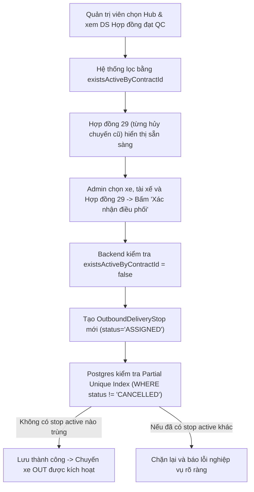

# Kế Hoạch Triển Khai: Khắc Phục Lỗi Trùng Ràng Buộc `uq_outbound_stop_contract` Khi Điều Phối Xe Outbound

> **Mã kế hoạch:** `PLAN_FIX_OUTBOUND_STOP_CONTRACT_CONSTRAINT`  
> **Module liên quan:** Logistics Hub & Outbound Dispatch  
> **Mức độ:** Complex Task (Thay đổi cấu trúc ràng buộc Database & Entity JPA)  
> **Thời gian tạo:** 2026-11-24  

---

## A. Overview (Tổng Quan)

- **Tên chức năng:** Đồng bộ ràng buộc tính duy nhất của điểm giao hàng Outbound giữa Database PostgreSQL và Backend Spring Boot.
- **Mục tiêu:** 
  - Khắc phục triệt để lỗi `duplicate key value violates unique constraint "uq_outbound_stop_contract" Detail: Key (contract_id)=(29) already exists.` khi xác nhận điều phối xe giao hàng.
  - Cho phép tái điều phối (re-dispatch) các hợp đồng B2B đã từng nằm trong chuyến xe bị hủy (`CANCELLED`) sang chuyến xe mới.
  - Giữ vững quy tắc nghiệp vụ cốt lõi **ONCE**: Tuyệt đối không cho phép 1 hợp đồng xuất hiện trong 2 điểm dừng đang hoạt động cùng lúc.
- **Kết quả mong muốn:** Quản trị viên điều phối xe xuất kho giao Buyer thành công, không phát sinh lỗi 500 do xung đột ràng buộc cơ sở dữ liệu.

---

## B. Current Architecture (Kiến Trúc Hiện Tại)

1. **Backend Service (`OutboundDispatchService.java` & `OutboundDeliveryStopRepository.java`):**
   - Nghiệp vụ Java quy định: Chặn phân công lặp đối với các điểm dừng **đang hoạt động** thông qua query:
     ```java
     @Query("SELECT COUNT(s) > 0 FROM OutboundDeliveryStop s WHERE s.contract.id = :contractId AND s.status != 'CANCELLED'")
     boolean existsActiveByContractId(@Param("contractId") Long contractId);
     ```
   - Khi chuyến xe bị hủy (`cancelOutboundTrip`), các điểm dừng được gán `status = 'CANCELLED'` và hợp đồng được trả về trạng thái `AT_HUB_QC` để sẵn sàng điều phối lại.
   - Khi lấy danh sách hợp đồng đủ điều kiện (`getEligibleContracts`), hợp đồng có stop `CANCELLED` vẫn được trả về giao diện để điều phối.

2. **Cơ sở dữ liệu (`V27__create_outbound_delivery_schema.sql`):**
   - Hiện tại đang định nghĩa ràng buộc cứng trên toàn bảng:
     ```sql
     CONSTRAINT uq_outbound_stop_contract UNIQUE (contract_id)
     ```
   - Ràng buộc này không phân biệt trạng thái (`status`), do đó khi bản ghi `CANCELLED` vẫn tồn tại trong bảng, PostgreSQL sẽ chặn đứng mọi thao tác tạo stop mới cho cùng hợp đồng đó.

3. **Entity Model (`OutboundDeliveryStop.java`):**
   - Đang khai báo `@JoinColumn(name = "contract_id", nullable = false, unique = true)` gây cứng nhắc trong ánh xạ quan hệ.

---

## C. Implementation Scope (Phạm Vi Triển Khai)

### 1. Backend (Spring Boot)
- **Tạo migration mới:** `backend/src/main/resources/db/migration/V30__allow_redispatch_outbound_stops_on_cancelled.sql`
  - Xóa ràng buộc unique tuyệt đối `uq_outbound_stop_contract`.
  - Tạo **Partial Unique Index** có điều kiện:
    ```sql
    CREATE UNIQUE INDEX uq_outbound_stop_contract 
    ON outbound_delivery_stops (contract_id) 
    WHERE status != 'CANCELLED';
    ```
- **Cập nhật Entity:** `backend/src/main/java/com/btl/webbanrau/model/OutboundDeliveryStop.java`
  - Bỏ thuộc tính `unique = true` ở annotation `@JoinColumn(name = "contract_id")` để đồng bộ với Partial Index.
- **Cập nhật Canonical Database:** `database/hona_fresh_db.sql`
  - Đồng bộ định nghĩa index partial cho bảng `outbound_delivery_stops`.

### 2. Frontend (Next.js / React)
- Giữ nguyên, không cần chỉnh sửa giao diện vì API contract không thay đổi.

### 3. Database
- Bảng ảnh hưởng: `outbound_delivery_stops`.
- Không xóa dữ liệu, không đổi kiểu dữ liệu cột, đảm bảo tương thích 100% dữ liệu lịch sử.

---

## D. API Contract

- **Endpoint:** `POST /api/admin/outbound-dispatch/confirm-trip?hubId={hubId}`
- **Request Body:**
  ```json
  {
    "vehicleId": 1,
    "driverId": 2,
    "notes": "Chuyến xe xuất kho sáng",
    "stops": [
      {
        "contractId": 29,
        "buyerWarehouseId": 3,
        "deliveryAddress": "Kho Mega Market Bình Phú",
        "contactName": "Nguyễn Văn A",
        "contactPhone": "0901234567",
        "stopSequence": 1
      }
    ]
  }
  ```
- **Response thành công:** `200 OK` kèm đối tượng `OutboundDeliveryTrip`.
- **Response khi vi phạm (chọn hợp đồng đang có chuyến xe hoạt động):** `400/409 Bad Request / Conflict` với thông điệp:
  `"Hợp đồng ... đã được phân công chuyến Outbound trước đó (Quy tắc ONCE)."`

---

## E. Business Flow (Luồng Nghiệp Vụ)



---

## F. Implementation Steps (Các Bước Thực Hiện)

1. **Bước 1 — Tạo Migration V30:**
   - Tạo file `backend/src/main/resources/db/migration/V30__allow_redispatch_outbound_stops_on_cancelled.sql`.
   - Viết lệnh `ALTER TABLE outbound_delivery_stops DROP CONSTRAINT IF EXISTS uq_outbound_stop_contract;` và `CREATE UNIQUE INDEX IF NOT EXISTS uq_outbound_stop_contract ON outbound_delivery_stops (contract_id) WHERE status != 'CANCELLED';`.
2. **Bước 2 — Cập nhật Entity `OutboundDeliveryStop.java`:**
   - Bỏ `unique = true` ở trường `contract`.
3. **Bước 3 — Cập nhật `database/hona_fresh_db.sql`:**
   - Cập nhật định nghĩa constraint / index tương ứng.
4. **Bước 4 — Kiểm tra tĩnh (Static Analysis):**
   - Kiểm tra cú pháp SQL và biên dịch các class Java liên quan.

---

## G. Risks & Considerations (Rủi Ro & Biện Pháp Giảm Thiểu)

- **Rủi ro mất dữ liệu:** Không có. Lệnh chỉ thay đổi cách kiểm tra tính duy nhất, không drop bảng hoặc truncate dữ liệu.
- **Rủi ro hiệu năng:** Partial Unique Index chỉ lập chỉ mục cho các dòng có `status != 'CANCELLED'`, giúp giảm kích thước index và tăng tốc độ truy vấn so với full index.
- **Tính nhất quán:** Bảo toàn quy tắc ONCE (mỗi hợp đồng chỉ có tối đa 1 stop đang giao tại cùng 1 thời điểm).

---

## H. Acceptance Criteria (Điều Kiện Nghiệm Thu)

1. Migration `V30` sẵn sàng để Flyway thực thi khi backend khởi động.
2. Khi hợp đồng #29 có stop cũ ở trạng thái `CANCELLED`, hệ thống cho phép tạo chuyến Outbound mới thành công mà không gặp lỗi `duplicate key value violates unique constraint "uq_outbound_stop_contract"`.
3. Nếu hợp đồng #29 đang nằm trong chuyến xe có trạng thái `ASSIGNED`, `ARRIVED`, `DRIVER_SUBMITTED`, hoặc `BUYER_CONFIRMED`, hệ thống tiếp tục chặn không cho tạo thêm chuyến xe khác.
