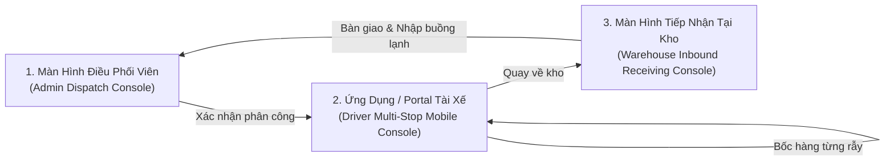
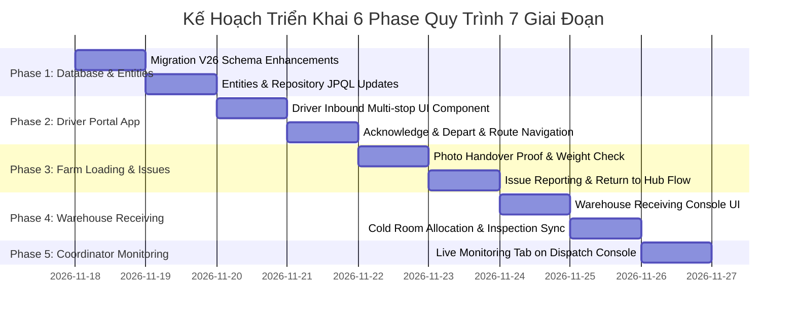

# KẾ HOẠCH TRIỂN KHAI: QUY TRÌNH 7 GIAI ĐOẠN THỰC THI VẬN CHUYỂN THU GOM VÀ TIẾP NHẬN NHẬP KHO – HONA FRESH

> **TÀI LIỆU DỰ ÁN:** HONA FRESH – NỀN TẢNG B2B NÔNG SẢN SỈ  
> **TÊN TÀI LIỆU:** Inbound Logistics Execution & Warehouse Receiving Lifecycle  
> **PHIÊN BẢN:** 1.0 (Quy trình khép kín từ Điều phối xe $\rightarrow$ Tài xế lấy hàng đa điểm $\rightarrow$ Tiếp nhận nhập kho)  
> **NGÀY LẬP:** 18/11/2026  
> **TRẠNG THÁI:** CHỜ PHÊ DUYỆT (PENDING REVIEW)

---

## A. OVERVIEW (TỔNG QUAN)

### 1. Mục tiêu nghiệp vụ
Xác nhận điều phối xe không phải là điểm kết thúc của quy trình, mà là **thời điểm bắt đầu chuỗi vận chuyển lạnh khép kín** thu gom nông sản từ các nhà vườn về trạm trung chuyển.

Hệ thống triển khai chuẩn hóa **Quy trình 7 giai đoạn liên hoàn**:
1. **Giai đoạn 1 — Xác nhận điều phối (Admin Dispatch Confirmation)**: Điều phối viên phân công xe & tài xế, khởi tạo chuyến xe chính thức.
2. **Giai đoạn 2 — Tài xế tiếp nhận chuyến (Driver Trip Acknowledgement)**: Tài xế đăng nhập portal, xem chi tiết hành trình, danh sách nhà vườn, thứ tự điểm dừng và xác nhận tiếp nhận nhiệm vụ.
3. **Giai đoạn 3 — Xuất phát đến nhà vườn (Departure to Farms)**: Tài xế kích hoạt xuất phát, chuyến xe chuyển sang `ON_TRIP`, hệ thống thông báo cho các nhà vườn xe đang trên đường đến.
4. **Giai đoạn 4 — Đến nhà vườn & Bốc hàng (Farm Arrival & Multi-Stop Loading)**: Tại từng điểm rẫy, tài xế xác nhận đến nơi, kiểm đếm số kiện, cân khối lượng thực tế, chụp ảnh biên bản bàn giao và xác nhận đã bốc hàng lên xe lạnh.
5. **Giai đoạn 5 — Hoàn thành các điểm lấy hàng (Route Progression & Issue Reporting)**: Theo dõi tiến độ thời gian thực từng điểm dừng (ví dụ: đã bốc 3/5 điểm). Nếu có sự cố (đường cấm tải, thời tiết, nhà vườn dời giờ), tài xế gửi báo cáo sự cố để điều phối viên xử lý ngay.
6. **Giai đoạn 6 — Xe quay về kho (Return to Hub)**: Sau khi hoàn tất lấy hàng tại rẫy cuối cùng, tài xế bấm "Quay về kho" (`RETURNING`), hệ thống tự động thông báo bộ phận tiếp nhận tại kho chuẩn bị bến đỗ và buồng lạnh.
7. **Giai đoạn 7 — Kho tiếp nhận & Kết thúc chuyến (Warehouse Inbound & Completion)**: Xe về tới cổng kho (`ARRIVED_AT_WAREHOUSE`), nhân viên kho kiểm đếm thực nhận, đối chiếu biên bản bàn giao, ghi nhận sai lệch nếu có, chuyển hàng vào buồng lạnh kiểm định QC và đóng chuyến xe (`COMPLETED`), giải phóng phương tiện & tài xế về lại `AVAILABLE`.

### 2. Yêu cầu trọng tâm: Giám sát liên tục trên màn hình Điều phối
> [!IMPORTANT]
> **Sau khi ấn điều phối xe đi, màn hình Điều phối viên vẫn phải hiển thị các lô hàng và chuyến xe đó để kiểm soát toàn bộ tiến độ thu gom.** Các lô hàng không được biến mất khỏi tầm nhìn quản trị cho đến khi đã nhập kho an toàn.

---

## B. CURRENT ARCHITECTURE & INTEGRATION (KIẾN TRÚC HIỆN TẠI)

1. **Phase 1 đã hoàn thiện**:
   - Quản lý danh mục 5 Hubs trung chuyển (`warehouse_hubs`).
   - Quản lý Đội xe (`fleet_vehicles`) và Tài xế (`fleet_drivers`) theo từng kho.
   - Hàng chờ điều phối lọc chính xác các hợp đồng đã duyệt đóng gói (`packaging_approved = true`, `pickup_truck_plate IS NULL`).
   - Bảng `pickup_trips` và `pickup_trip_stops` đã được khởi tạo qua migration `V25`.

2. **Các thành phần tiếp nhận kho hiện có cần liên kết (Không tạo mới trùng lặp)**:
   - **Bảng `hub_inspections`**: Lưu biên bản kiểm định QC tại trạm (đã có ràng buộc khóa ngoại tới `b2b_contracts`, `cold_assets` và kiểm tra `received_weight_kg = qualified_weight_kg + rejected_weight_kg`).
   - **Bảng `cold_assets`**: Quản lý buồng lạnh lưu trữ (`COLD_ROOM`) duy trì dải nhiệt độ 2°C - 6°C.
   - **Trạng thái hợp đồng `b2b_contracts`**: Đã có sẵn các mốc nghiệp vụ `PACKAGING_APPROVED` $\rightarrow$ `PICKUP_DISPATCHED` $\rightarrow$ `IN_TRANSIT_HUB` $\rightarrow$ `AT_HUB_QC`.

---

## C. CẤU TRÚC 3 MÀN HÌNH CHÍNH (THREE SYSTEM CONSOLES)



### 1. Khu vực A: Màn hình Điều phối viên kho (Admin Dispatch Console)
- **Đường dẫn**: `/admin/inbound-dispatch`
- **Các phân hệ hiển thị**:
  - **Tab Hàng Chờ Lấy Hàng (`WAITING`)**: Các lô mới duyệt đóng gói, chờ gán xe.
  - **Tab Giám Sát Chuyến Đang Chạy (`LIVE_DISPATCHED`)**:
    - **Theo dõi toàn diện các lô đã điều phối**: Hiển thị hợp đồng nào đang ở trên xe nào, tài xế nào chở.
    - **Thanh tiến độ từng điểm dừng**: Hiển thị trực quan tiến độ (VD: `3/5 rẫy đã bốc hàng`, `Điểm 4: Xe đang tới`, `Điểm 5: Đang chờ`).
    - **Cảnh báo sự cố tức thời**: Nhấp nháy đỏ khi tài xế báo sự cố (`ISSUE_REPORTED`) tại rẫy kèm số điện thoại liên hệ nhanh.
    - **Nhiệt độ thùng xe realtime**: Giám sát nhiệt độ bảo quản lạnh 2°C - 6°C trong suốt hành trình.
  - **Tab Lịch Sử Hoàn Thành (`HISTORY`)**: Các chuyến đã giao hàng về kho an toàn.

### 2. Khu vực B: Ứng dụng / Portal Tài xế (Driver Inbound Pickup Console)
- **Đường dẫn**: `/portal/driver` (Tích hợp phân hệ Inbound Multi-Stop Pickup)
- **Giao diện tối ưu thao tác trên di động / máy tính bảng**:
  - **Thẻ thông tin chuyến xe**: Biển số xe lạnh, loại xe, nhiệt độ thùng, trạm xuất phát.
  - **Danh sách điểm lấy hàng theo thứ tự tối ưu (Stop 1 $\rightarrow$ Stop N)**:
    - Tên chủ vườn, số điện thoại bấm gọi ngay (`tel:`).
    - Địa chỉ rẫy, hướng dẫn đường vào (xe tải vào được hay phải trung chuyển).
    - Loại nông sản, khối lượng dự kiến, số kiện đóng thùng.
  - **Thao tác 1 chạm tuần tự**:
    1. Bấm **"Tiếp Nhận Chuyến Xe"** (`ACKNOWLEDGED`).
    2. Bấm **"Bắt Đầu Xuất Phát"** (`ON_TRIP`).
    3. Tại từng rẫy:
       - Bấm **"Đã Đến Rẫy"** (`ARRIVED`).
       - Nhập **Số kiện thực tế** và **Khối lượng cân tại rẫy** (kg).
       - Chụp ảnh **Nông sản / Biên bản bàn giao tại rẫy** (tải ảnh lên Cloudinary).
       - Bấm **"Xác Nhận Đã Nhận Hàng"** (`LOADED`).
       - Hoặc bấm **"Báo Sự Cố Tại Rẫy"** (`ISSUE_REPORTED`): chọn lý do (mưa lớn, nông dân hoãn, đường lún...).
    4. Sau khi hoàn thành điểm cuối: Bấm **"Bắt Đầu Quay Về Kho"** (`RETURNING`).

### 3. Khu vực C: Màn hình Tiếp nhận hàng tại kho (Warehouse Inbound Receiving Console)
- **Đường dẫn**: `/portal/warehouse-qc` (Mục Tiếp nhận xe về trạm)
- **Chức năng nghiệp vụ**:
  - Danh sách xe đang quay về kho (`RETURNING`) kèm thời gian dự kiến tới.
  - Khi xe tới cổng: Nhân viên bấm **"Xác Nhận Xe Đã Đến"** (`ARRIVED_AT_WAREHOUSE`).
  - **Bảng đối chiếu kiểm đếm bàn giao (Inbound Handover Sheet)**:
    - Hiển thị từng hợp đồng trên chuyến: Khối lượng xuất rẫy vs Khối lượng cân tại trạm (Gross / Tare / Net).
    - Số lượng thùng thực nhận, kiểm tra tem niêm phong còn nguyên vẹn hay không.
    - Ghi nhận hao hụt tự nhiên hoặc hàng hư hỏng dập nát (nếu có).
    - Nhập kết quả đo nhanh QC: Độ ẩm (%), độ ngọt Brix, nhiệt độ tâm sản phẩm.
    - Chỉ định Buồng lạnh lưu trữ (`cold_assets`) và Vị trí kệ lưu kho (`hub_rack_bin`).
  - Bấm **"Xác Nhận Hoàn Tất Nhập Kho"**:
    - Chuyến xe chuyển sang **`COMPLETED`**.
    - Xe và tài xế tự động chuyển sang **`AVAILABLE`**, sẵn sàng nhận chuyến mới.
    - Hợp đồng chuyển sang **`AT_HUB_QC`** / **`QC_PASSED`**, sẵn sàng lưu kho chờ thương lái nhận hàng.

---

## D. MA TRẬN TRẠNG THÁI HỆ THỐNG (STATE MACHINE MATRIX)

| Thực thể | Các trạng thái trong vòng đời | Mô tả chi tiết |
| :--- | :--- | :--- |
| **Chuyến xe (`pickup_trips`)** | `ASSIGNED` | Đã phân công xe và tài xế, chờ tài xế xác nhận nhận nhiệm vụ. |
| | `ON_TRIP` | Tài xế đã xuất phát từ kho đi đến các nhà vườn. |
| | `RETURNING` | Đã bốc hàng xong tất cả các điểm, xe đang trên đường quay về kho. |
| | `ARRIVED_AT_WAREHOUSE` | Xe đã về đến cổng kho, chờ nhân viên kho mở cửa bốc dỡ kiểm đếm. |
| | `COMPLETED` | Đã hoàn tất kiểm đếm nhập kho, giải phóng tài nguyên. |
| | `CANCELLED` | Chuyến bị hủy (trước khi hoàn tất). |
| **Điểm dừng rẫy (`pickup_trip_stops`)** | `PENDING` | Chờ xe tới lấy hàng. |
| | `ARRIVED` | Xe đã tới rẫy, đang kiểm đếm đóng gói với nông dân. |
| | `LOADED` | Đã bốc hàng lên thùng lạnh thành công, có ảnh bàn giao. |
| | `ISSUE_REPORTED` | Rẫy gặp sự cố không lấy được hàng, cần điều phối viên xử lý. |
| | `SKIPPED` | Điểm dừng được điều phối viên cho phép bỏ qua để xe về kho. |
| | `CANCELLED` | Điểm dừng bị hủy do chuyến hủy. |
| **Phương tiện (`fleet_vehicles`)** | `AVAILABLE` $\rightarrow$ `ASSIGNED` $\rightarrow$ `ON_TRIP` $\rightarrow$ `AVAILABLE` (hoặc `MAINTENANCE`) |
| **Tài xế (`fleet_drivers`)** | `AVAILABLE` $\rightarrow$ `ASSIGNED` $\rightarrow$ `ON_TRIP` $\rightarrow$ `AVAILABLE` (hoặc `OFF_DUTY`) |
| **Hợp đồng (`b2b_contracts`)** | `PACKAGING_APPROVED` $\rightarrow$ `PICKUP_DISPATCHED` $\rightarrow$ `IN_TRANSIT_HUB` $\rightarrow$ `AT_HUB_QC` |

---

## E. QUY TRÌNH KỸ THUẬT VÀ API CONTRACT

### 1. Database Schema Migration (`V26`)
Bổ sung các trường quản lý hành trình và tiếp nhận kho:
```sql
-- V26__enhance_pickup_trips_and_warehouse_receiving.sql

-- 1. Bổ sung các mốc thời gian và tiếp nhận trên bảng pickup_trips
ALTER TABLE pickup_trips 
ADD COLUMN IF NOT EXISTS acknowledged_at TIMESTAMP,
ADD COLUMN IF NOT EXISTS returning_time TIMESTAMP,
ADD COLUMN IF NOT EXISTS arrived_warehouse_time TIMESTAMP,
ADD COLUMN IF NOT EXISTS actual_total_weight_kg NUMERIC(10, 2),
ADD COLUMN IF NOT EXISTS actual_total_packages INT,
ADD COLUMN IF NOT EXISTS receiving_staff_id BIGINT REFERENCES users(id),
ADD COLUMN IF NOT EXISTS receiving_notes TEXT;

-- 2. Bổ sung trường bàn giao thực tế tại rẫy trên pickup_trip_stops
ALTER TABLE pickup_trip_stops
ADD COLUMN IF NOT EXISTS actual_weight_kg NUMERIC(10, 2),
ADD COLUMN IF NOT EXISTS actual_package_count INT,
ADD COLUMN IF NOT EXISTS handover_photo_url TEXT,
ADD COLUMN IF NOT EXISTS handover_signature_data TEXT,
ADD COLUMN IF NOT EXISTS issue_reason VARCHAR(100),
ADD COLUMN IF NOT EXISTS issue_notes TEXT;
```

---

### 2. Chi tiết các REST API Endpoints

#### Giai đoạn 2: Tài xế tiếp nhận chuyến
- **`POST /api/driver/pickup-trips/{tripId}/acknowledge`**
- **Quyền hạn**: `ROLE_DRIVER`, `ROLE_ADMIN`
- **Xử lý**: Ghi nhận `acknowledged_at = NOW()`. Bắn WebSocket thông báo chuyến đã được tài xế xác nhận.

#### Giai đoạn 3: Tài xế xuất phát đi lấy hàng
- **`POST /api/driver/pickup-trips/{tripId}/depart`**
- **Request**: `{ "odometerStart": 45200, "currentTemp": 3.8 }`
- **Xử lý**:
  - Chuyển chuyến sang `ON_TRIP`, ghi nhận `departure_time = NOW()`.
  - Chuyển xe và tài xế sang `ON_TRIP`.
  - Bắn WebSocket STOMP tới tất cả các nhà vườn có tên trong chuyến: *"Xe tải lạnh [Biển số] đang trên đường tới rẫy của bạn!"*.

#### Giai đoạn 4: Tài xế đến rẫy & bốc hàng
- **`POST /api/driver/pickup-trips/stops/{stopId}/arrive`**
  - Chuyển điểm dừng sang `ARRIVED`, ghi nhận `arrived_at = NOW()`.
- **`POST /api/driver/pickup-trips/stops/{stopId}/load`**
  - **Request**:
    ```json
    {
      "actualWeightKg": 1520.5,
      "actualPackageCount": 76,
      "handoverPhotoUrl": "https://res.cloudinary.com/.../handover-proof.jpg",
      "handoverSignature": "data:image/png;base64,...",
      "handoverTemp": 4.1
    }
    ```
  - **Xử lý Backend**:
    - Cập nhật điểm dừng: `status = 'LOADED'`, `loaded_at = NOW()`, lưu số cân thực tế và link ảnh.
    - Đồng bộ sang Hợp đồng: Cập nhật `actual_harvest_weight_kg`, `package_count`, `farm_handover_temp`, `farm_pickup_signed_at`, chuyển hợp đồng sang `IN_TRANSIT_HUB`.
    - Bắn thông báo realtime cho Điều phối viên và Nông dân.

#### Giai đoạn 5: Báo sự cố tại rẫy (nếu có)
- **`POST /api/driver/pickup-trips/stops/{stopId}/report-issue`**
  - **Request**: `{ "issueReason": "ĐƯỜNG_MƯA_LẦY_XE_KHÔNG_VÀO_ĐƯỢC", "notes": "Cần xe ba gác tăng bo hoặc nhà vườn chở ra ngã ba" }`
  - **Xử lý**: Đổi trạng thái điểm dừng sang `ISSUE_REPORTED`. Gửi cảnh báo khẩn cấp lên màn hình Điều phối viên.

#### Giai đoạn 6: Xe quay về kho
- **`POST /api/driver/pickup-trips/{tripId}/return-to-hub`**
  - **Xử lý**: Chuyển chuyến xe sang `RETURNING`, ghi nhận `returning_time = NOW()`. Bắn WebSocket tới cổng kho: *"Chuyến xe [Mã chuyến] đang chở [Tổng kg] kg nông sản quay về trạm"*.

#### Giai đoạn 7: Tiếp nhận & Kiểm đếm nhập kho hoàn tất
- **`POST /api/warehouse/receiving/trips/{tripId}/confirm-arrival`**
  - Chuyển chuyến sang `ARRIVED_AT_WAREHOUSE`, ghi nhận `arrived_warehouse_time = NOW()`.
- **`POST /api/warehouse/receiving/trips/{tripId}/complete`**
  - **Request**:
    ```json
    {
      "receivingNotes": "Hàng về đủ số lượng, bao bì nguyên vẹn, dải nhiệt thùng 3.8°C",
      "coldRoomId": 1,
      "contracts": [
        {
          "contractId": 17,
          "receivedGrossWeightKg": 1550.0,
          "tareWeightKg": 30.0,
          "receivedNetWeightKg": 1520.0,
          "qualifiedWeightKg": 1520.0,
          "rejectedWeightKg": 0.0,
          "receivedPackageCount": 76,
          "brixDegree": 12.5,
          "moisturePercent": 85.0,
          "warehouseZone": "Zone A (Lạnh mát 2-6°C)",
          "rackBin": "Kệ R-02 Ô C-04",
          "maxStorageDays": 5
        }
      ]
    }
    ```
  - **Xử lý Backend (`@Transactional`)**:
    1. Kiểm tra toàn bộ hợp đồng thuộc chuyến.
    2. Tự động lập bản ghi `hub_inspections` cho từng hợp đồng (liên kết chuẩn xác với `cold_room_id` và nhân viên kho `qc_staff_id`).
    3. Cập nhật hợp đồng: Chuyển sang `AT_HUB_QC`, `qc_status = 'QC_PASSED'`, lưu vị trí lưu kho kệ buồng lạnh.
    4. Cập nhật chuyến xe: `status = 'COMPLETED'`, `completion_time = NOW()`.
    5. **Giải phóng tài nguyên**: Chuyển Xe và Tài xế về lại **`AVAILABLE`**, sẵn sàng điều động cho ca tiếp theo.
    6. Bắn thông báo hoàn tất tới Thương Lái (Buyer) và Nhà Vườn (Farmer).

---

## F. KẾ HOẠCH TRIỂN KHAI THEO PHASES (IMPLEMENTATION ROADMAP)



- **Phase 1 (Database & Models)**: Nâng cấp Migration `V26`, bổ sung các trường thời gian, ảnh chứng từ và trọng lượng thực tế.
- **Phase 2 (Ứng dụng Tài xế - Nhận chuyến & Lộ trình)**: Xây dựng giao diện tài xế xem danh sách rẫy, hướng dẫn đường đi, nút xác nhận nhận chuyến và bắt đầu xuất bến.
- **Phase 3 (Bốc hàng tại rẫy & Xử lý phát sinh)**: Thao tác cân thực tế, tải ảnh biên bản bàn giao, chữ ký điện tử và gửi cảnh báo sự cố.
- **Phase 4 (Tiếp nhận hàng tại kho & Nhập buồng lạnh)**: Giao diện nhân viên kho đối chiếu thực nhận, lập biên bản kiểm định QC và chuyển hàng vào buồng lạnh.
- **Phase 5 (Giám sát hành trình trên màn hình Điều phối)**: Hoàn thiện tab giám sát thời gian thực trên màn hình Điều phối viên để kiểm soát liên tục các lô hàng đang trên đường gom.

---

## G. TIÊU CHÍ NGHIỆM THU (ACCEPTANCE CRITERIA)

- [ ] Lô hàng sau khi điều phối xe **vẫn hiển thị rõ ràng trên màn hình Điều phối viên** tại tab "Giám Sát Chuyến Đang Chạy", không bị biến mất.
- [ ] Tài xế đăng nhập portal xem được đầy đủ danh sách các nhà vườn, địa chỉ, SĐT, loại hàng và số lượng cần lấy theo đúng thứ tự tối ưu.
- [ ] Tài xế có thể thực hiện tuần tự: Nhận chuyến $\rightarrow$ Bắt đầu xuất phát $\rightarrow$ Đến rẫy $\rightarrow$ Nhập số cân/kiện thực tế $\rightarrow$ Tải ảnh bàn giao $\rightarrow$ Bốc hàng thành công.
- [ ] Cho phép tài xế gửi báo cáo sự cố tại rẫy (`ISSUE_REPORTED`) kèm lý do cụ thể và hiển thị cảnh báo tức thời lên màn hình Điều phối viên.
- [ ] Sau khi bốc xong rẫy cuối cùng, tài xế bấm "Quay về kho" và màn hình kho nhận được thông báo xe đang trên đường về.
- [ ] Nhân viên kho xác nhận xe về cổng, nhập số liệu kiểm đếm thực nhận và chọn buồng lạnh lưu trữ.
- [ ] Khi bấm hoàn tất tiếp nhận tại kho: Chuyến xe chuyển `COMPLETED`, xe & tài xế được trả về `AVAILABLE`, hợp đồng chuyển tiếp an toàn sang trạng thái kiểm định QC (`AT_HUB_QC`).

---

*Tài liệu kế hoạch đã tích hợp trọn vẹn 7 giai đoạn thu gom và giải quyết triệt để yêu cầu kiểm soát lô hàng liên tục của bạn.*
