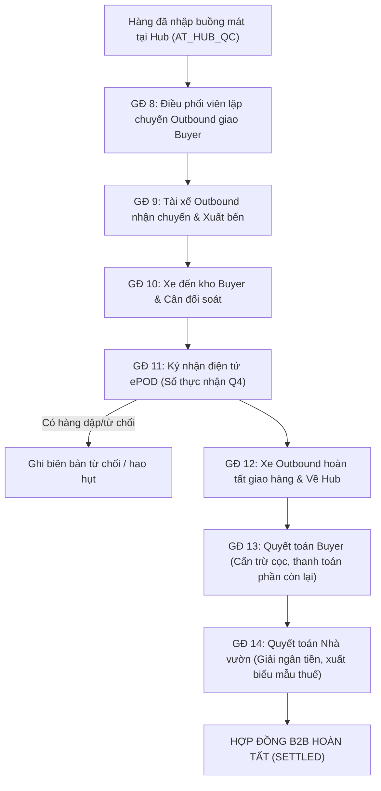

# KẾ HOẠCH TRIỂN KHAI HOÀN THIỆN VÒNG ĐỜI B2B HONA FRESH (V2.0)
## QUY TRÌNH OUTBOUND LOGISTICS (HUB → BUYER), KÝ NHẬN EPOD VÀ QUYẾT TOÁN TÀI CHÍNH HAI ĐẦU

> **Dự án:** HONA FRESH  
> **Kiến trúc:** ReactJS (Next.js) + Java Spring Boot + PostgreSQL  
> **Kế thừa:** Đã hoàn thành 100% Phân hệ Inbound Logistics & Receiving Hub (Giai đoạn 1 → 7)  
> **Trạng thái:** Chờ người dùng phê duyệt trước khi thực hiện  

---

## A. OVERVIEW — TỔNG QUAN

### 1. Mục tiêu
Nối tiếp toàn bộ thành quả của phân hệ **Inbound Logistics & Cổng tiếp nhận Hub** (đã vận hành từ rẫy về Hub, kiểm đếm và lưu buồng mát), kế hoạch này giải quyết trọn vẹn nửa sau của chuỗi giá trị nông sản B2B:
1. **Outbound Dispatch & Cross-docking**: Điều phối xe lạnh từ 5 Hub trung chuyển vận chuyển hàng đến kho của Thương lái (Buyer).
2. **Tài xế giao hàng & Ký nhận điện tử ePOD**: Giao hàng tận kho Buyer, xác nhận khối lượng thực nhận, chụp ảnh biên bản bàn giao, ghi nhận hàng thiếu/từ chối nếu có.
3. **Đối soát số liệu 4 bước (Multi-stage Reconciliation)**: Hợp đồng ($Q_1$) → Thực lấy tại rẫy ($Q_2$) → Cân nhận tại Hub ($Q_3$) → Thực nhận tại kho Buyer ($Q_4$).
4. **Quyết toán tài chính 2 đầu (Two-way Settlement & Escrow)**:
   - **Phía Buyer**: Chốt tiền theo $Q_4$, cấn trừ tiền cọc Escrow, thanh toán phần còn lại qua QR SePay.
   - **Phía Nhà vườn**: Giải ngân tiền bán nông sản sau khi trừ hao hụt/lỗi, xuất bảng kê chi trả VAS/Thuế (Mẫu 01-TNDN, hóa đơn KCT).
   - **Đóng Hợp đồng**: Đạt trạng thái `SETTLED` / `COMPLETED` toàn diện.

---

## B. CURRENT ARCHITECTURE & ĐỐI CHIẾU THỰC TẾ

### 1. Phân tích điểm sai lệch của tài liệu `Ke_hoach_tong_the_nghiep_vu_HONA_FRESH.md`
- **Sai lệch về Mô hình Kinh doanh**:
  - Tài liệu đề xuất mô hình *Buy-to-Stock* (mua đứt nông sản về kho tích trữ rồi mới mở bán cho Buyer tạo đơn và giữ tồn).
  - Thực tế HONA FRESH là mô hình *B2B Contract Cross-docking*: Hàng hóa thu gom từ rẫy đã có chủ sở hữu đích danh là Buyer (đã ký HĐ B2B và đặt cọc Escrow). Tại Hub, hàng chỉ lưu kho mát tạm thời (6 - 24 giờ) để kiểm định QC rồi bốc lên xe Outbound giao ngay tới kho của Buyer.
- **Sai lệch về Hiện trạng Hệ thống**:
  - Tài liệu giả định Inbound chưa làm. Trong thực tế, hệ thống HONA FRESH **đã hoàn thành toàn bộ Inbound (Giai đoạn 1 đến 7)**: 5 Hub chính thức, đội xe, tài xế, thuật toán auto-optimize, portal tài xế lấy hàng, cổng tiếp nhận kiểm đếm nhập buồng mát.
- **Nguyên tắc kế thừa**: Không tạo các bảng WMS phức tạp không cần thiết (`inventory_ledgers`, `pick_lists`, `reservations`); tập trung hoàn thiện module **Outbound Delivery**, **ePOD** và **Settlement** dựa trên các thực thể hiện hữu.

---

## C. IMPLEMENTATION SCOPE — PHẠM VI TRIỂN KHAI

### 1. Backend (Spring Boot)
- **Database & Migration (`V27__create_outbound_delivery_and_epod_schema.sql`)**:
  - Bảng `outbound_delivery_trips`: Chuyến xe giao hàng từ Hub đến kho Buyer (mã chuyến, kho xuất phát, xe, tài xế, trạng thái `ASSIGNED`, `ON_DELIVERY`, `COMPLETED`, `CANCELLED`, tổng khối lượng, thời gian xuất bến, hoàn tất).
  - Bảng `outbound_delivery_stops`: Điểm dừng giao hàng theo từng hợp đồng/kho Buyer (`contract_id`, `buyer_warehouse_id`, `delivery_address`, `contact_phone`, `expected_weight_kg`, `actual_delivered_weight_kg`, `rejected_weight_kg`, `rejection_reason`, `epod_signature_url`, `epod_photo_url`, `status`).
- **Models & Repositories**:
  - `OutboundDeliveryTrip.java`, `OutboundDeliveryStop.java`.
  - `OutboundDeliveryTripRepository.java`, `OutboundDeliveryStopRepository.java`.
- **Services**:
  - `OutboundDispatchService.java`: Lấy danh sách các lô hàng đang nằm tại buồng mát của Hub (`AT_HUB_QC` / `HUB_DELIVERED`) để đề xuất và xác nhận chuyến giao Buyer.
  - `OutboundDeliveryExecutionService.java`: Vòng đời giao hàng (Tài xế nhận chuyến → Xuất bến → Đến kho Buyer → Ký ePOD bàn giao → Hoàn tất chuyến).
  - `B2bFinancialSettlementService.java`: Tự động tính toán đối soát tài chính 2 đầu (cấn trừ cọc Escrow, thanh toán số dư, giải ngân cho nhà vườn, lập chứng từ thuế).
- **Controllers**:
  - `AdminOutboundDispatchController.java`: API điều phối xe giao hàng từ Hub (`/admin/outbound-dispatch/*`).
  - `DriverOutboundDeliveryController.java`: API cho tài xế giao hàng và upload ePOD (`/driver/outbound-trips/*`).
  - `BuyerEpodConfirmationController.java`: API cho Buyer ký nhận và xác nhận biên bản giao hàng.
  - `B2bSettlementController.java`: API quyết toán công nợ và giải ngân (`/accounting/settlements/*`).

### 2. Frontend (Next.js / ReactJS)
- **Màn hình Điều phối Outbound (`/admin/outbound-dispatch`)**:
  - Hiển thị các lô nông sản đã sẵn sàng tại Hub (`AT_HUB_QC`).
  - Tự động gom các lô theo tuyến giao kho Buyer (TP.HCM, Bình Dương, Đồng Nai, Hà Nội...).
  - Phân công xe tải lạnh và tài xế phụ trách.
- **Màn hình Tài xế Outbound (Tích hợp trong `/portal/driver`)**:
  - Chuyển đổi linh hoạt giữa tab "Thu Gom Tại Rẫy (Inbound)" và "Giao Hàng Cho Buyer (Outbound)".
  - Xem danh sách kho Buyer cần giao, số điện thoại người nhận, chỉ đường Google Maps.
  - Form ký nhận ePOD: Nhập số lượng thực giao, số lượng từ chối (nếu có lỗi/dập nát), chụp ảnh kiện hàng tại kho Buyer, chụp chữ ký đại diện kho.
- **Màn hình Buyer Quản lý Nhận hàng & Thanh toán (Cập nhật `/portal/buyer`)**:
  - Theo dõi xe giao hàng đang đến.
  - Xem biên bản ePOD và hình ảnh bàn giao.
  - Thanh toán số tiền còn lại (Final Payment QR SePay) hoặc nhận lại tiền thừa nếu giao thiếu.
- **Màn hình Kế toán & Quyết toán (`/portal/accountant`)**:
  - Bảng đối soát 4 số liệu ($Q_1 \rightarrow Q_2 \rightarrow Q_3 \rightarrow Q_4$).
  - Nút giải ngân tiền cho Nhà vườn (`payout_amount`).
  - Xuất file in PDF/HTML: Bảng kê Mẫu 01-TNDN và Hóa đơn không chịu thuế (KCT).

---

## D. BUSINESS WORKFLOW (7 GIAI ĐOẠN TIẾP THEO: GIAI ĐOẠN 8 → 14)

---

## E. IMPLEMENTATION STEPS (THỨ TỰ THỰC HIỆN)

1. **Bước 1 — Database Migration**: Tạo bảng `outbound_delivery_trips` và `outbound_delivery_stops` qua file `V27`.
2. **Bước 2 — Backend Models & Repositories**: Tạo các entity, DTO request/response và JPQL queries.
3. **Bước 3 — Backend Logistics & Settlement Services**:
   - Viết logic xuất kho Outbound & phân chuyến.
   - Viết logic cập nhật điểm giao và ghi nhận ePOD.
   - Viết logic tự động đối soát tài chính 2 đầu (Buyer cấn trừ cọc $\leftrightarrow$ Farmer giải ngân).
4. **Bước 4 — Frontend UI Modules**:
   - Thêm tab Điều phối Outbound tại admin console.
   - Bổ sung màn hình giao hàng Outbound & chụp ảnh ePOD trên mobile driver portal.
   - Nâng cấp Buyer portal hiển thị trạng thái giao hàng và xác nhận nhận hàng.
   - Hoàn thiện Accountant portal đối soát 4 bước và in biểu mẫu thuế.
5. **Bước 5 — Verification & Testing**:
   - Kiểm tra biên dịch Java `compileJava` và `testClasses`.
   - Kiểm tra TypeScript `tsc --noEmit`.

---

## F. ACCEPTANCE CRITERIA (TIÊU CHÍ NGHIỆM THU)

1. Lô hàng sau khi nhập kho Hub (`AT_HUB_QC`) có thể được chọn để tạo chuyến giao đến đúng kho của Buyer (`BuyerWarehouse`).
2. Tài xế Outbound có thể đăng nhập, xem tuyến đường giao hàng, bấm xuất bến và hoàn tất ký nhận ePOD tại kho Buyer.
3. Buyer có thể xem được ảnh biên bản giao nhận, số lượng thực nhận, và bấm thanh toán phần tiền còn lại qua QR SePay.
4. Kế toán có thể đối soát minh bạch 4 con số ($Q_1$ Hợp đồng, $Q_2$ Cân tại rẫy, $Q_3$ Cân tại Hub, $Q_4$ Buyer nhận), giải ngân cho nhà vườn và in được chứng từ hợp lệ.
5. Xe và tài xế Outbound được tự động giải phóng về trạng thái `AVAILABLE` sau khi kết thúc chuyến.
