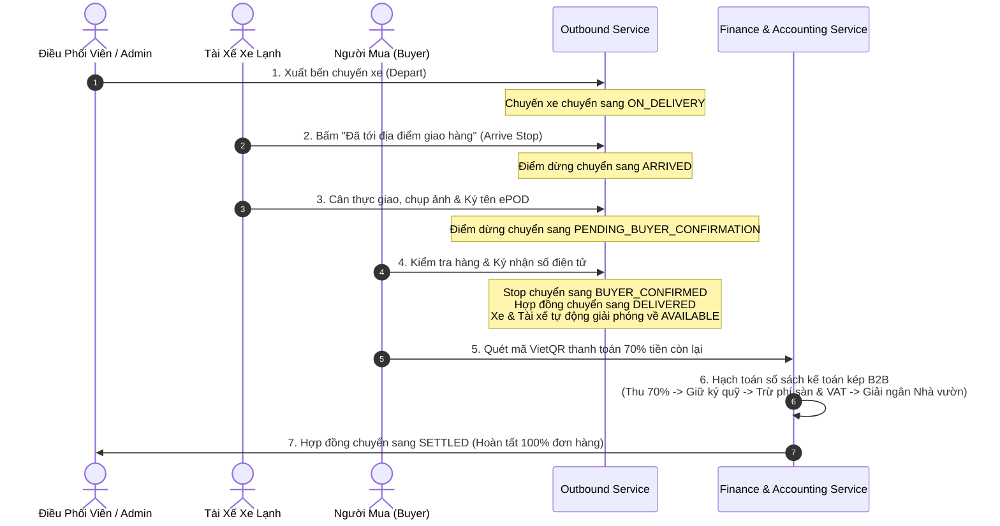

# KẾ HOẠCH TRIỂN KHAI: ĐIỀU PHỐI ĐIỂM DỪNG, KÝ NHẬN SỐ EPOD & QUYẾT TOÁN HỢP ĐỒNG (OUTBOUND LAST-MILE & FINAL SETTLEMENT)

> **DỰ ÁN:** HONA FRESH — Nền tảng B2B kết nối Thương lái và Nhà vườn  
> **MODULE:** Chặng Cuối Giao Hàng Đa Điểm, Ký Nhận Điện Tử (ePOD) & Quyết Toán Hợp Đồng  
> **MÃ KẾ HOẠCH:** `PLAN_OUTBOUND_DELIVERY_AND_FINAL_SETTLEMENT`  
> **PHIÊN BẢN:** 1.0  
> **NGÀY LẬP:** 18/11/2026  
> **ĐỐI TƯỢNG TEST CHÍNH:** Hợp đồng `HD-2026-A14F` (ID: 17, 150 kg Lá É Phú Yên VietGAP, Kho Buyer: Nachy Cosmetics)

---

## A. OVERVIEW — TỔNG QUAN

### 1. Mục tiêu
Hoàn thiện chu trình B2B khép kín từ trạm trung chuyển lạnh (Hub) đến tận kho của Buyer:
1. **Quản lý điểm dừng & Di chuyển**: Xe xuất bến $\rightarrow$ Ghi nhận "Đã tới địa điểm của từng điểm dừng" (`ARRIVED`).
2. **Tài xế lập biên bản bàn giao ePOD (Driver Handover)**: Nhập khối lượng thực giao ($Q_4$), ghi nhận hao hụt/từ chối (nếu có), chữ ký điện tử tài xế, ảnh chụp bàn giao tại dock kho Buyer $\rightarrow$ Chuyển sang `PENDING_BUYER_CONFIRMATION`.
3. **Buyer kiểm đếm & Ký nhận số (Buyer Acceptance)**: Buyer kiểm tra thực tế, ký nhận điện tử $\rightarrow$ Điểm dừng chuyển sang `BUYER_CONFIRMED`, hợp đồng chuyển sang `DELIVERED`, tự động đóng chuyến xe khi hoàn tất các điểm dừng và giải phóng xe/tài xế về `AVAILABLE`.
4. **Thanh toán nốt 70% & Quyết toán (Final Settlement)**: Buyer thanh toán 70% tiền còn lại (sau khi trừ 30% cọc đã trả và điều chỉnh theo khối lượng $Q_4$ thực nhận) qua VietQR $\rightarrow$ Hệ thống tự động hạch toán kế toán B2B (TK 112, 3388, trừ phí sàn TK 5113, VAT TK 3331, giải ngân Payout cho Nhà vườn) $\rightarrow$ Hợp đồng hoàn tất 100% (**`SETTLED` - Xong đơn**).

### 2. Kết quả mong muốn
- Tại màn hình **Điều phối giao Buyer** (`/admin/outbound-dispatch` Tab 2: "Danh sách chuyến Outbound"):
  - Xem danh sách chuyến xe và mở rộng danh sách điểm dừng chi tiết.
  - Nút **"Xuất bến (Depart)"** chuyển chuyến xe sang `ON_DELIVERY`.
  - Tại từng điểm dừng (Stop), có nút:
    - **"Đã tới địa điểm (Arrive Stop)"** $\rightarrow$ Stop sang `ARRIVED`.
    - **"Tài xế bàn giao ePOD"** $\rightarrow$ Mở modal ký tên, nhập tải trọng thực giao $\rightarrow$ Stop sang `PENDING_BUYER_CONFIRMATION`.
    - **"Buyer xác nhận nhận hàng"** $\rightarrow$ Mở modal Buyer ký nhận $\rightarrow$ HĐ sang `DELIVERED`.
    - **"Thanh toán nốt 70% & Hoàn tất"** $\rightarrow$ Modal VietQR thanh toán phần còn lại $\rightarrow$ HĐ sang `SETTLED`.
- Đồng thời tích hợp trực tiếp trên **Buyer Portal** (`/portal/buyer`) để Buyer nhận thông báo đơn hàng đến kho, bấm ký nhận và quét QR thanh toán 70%.

---

## B. CURRENT ARCHITECTURE — CẤU TRÚC HIỆN TẠI & TÁI SỬ DỤNG

1. **Backend Entities**:
   - `OutboundDeliveryTrip`: Chuyến xe Outbound (`trip_code`, `status`, `total_loaded_weight_kg`, `total_stops`).
   - `OutboundDeliveryStop`: Điểm dừng (`trip_id`, `contract_id`, `stop_sequence`, `status`, `arrived_at`, `driver_submitted_at`, `buyer_confirmed_at`, `actual_delivered_weight_kg`, `rejected_weight_kg`, chữ ký, ảnh chụp).
   - `B2bContract`: Trạng thái `status`, `fulfillment_status`, `epod_delivered_weight_kg`, `remaining_amount`, `remaining_payment_status`.
   - `Shipment`: Bảng shipment tương thích (`delivered_weight_kg`, `delivered_at`, `status`).
2. **Backend Services & Controllers đã có nền tảng**:
   - `OutboundDeliveryExecutionService.java`: Đã có các hàm `driverDepartTrip`, `driverArriveStop`, `driverSubmitEpod`, `buyerConfirmEpod` với đầy đủ logic kiểm tra, tự động tạo khiếu nại nếu có hao hụt, và tự động hoàn tất chuyến xe khi tất cả stop xong.
   - `BuyerWorkflowService.java`: Đã có `finalPaymentQr(contractId)` và `confirmFinalPayment(contractId)`.
   - `AdminBusinessService.java`: Đã có luồng `transition` hạch toán kế toán đầy đủ cho `DELIVERED` và `SETTLED`.
3. **Frontend Components**:
   - Modal hiển thị lộ trình: `OutboundDispatchManifestModal.tsx`.
   - Console điều phối: `frontend/src/app/admin/outbound-dispatch/page.tsx`.

---

## C. IMPLEMENTATION SCOPE — PHẠM VI TRIỂN KHAI

### 1. Frontend
1. **Cập nhật Tab 2 "Danh sách chuyến Outbound" trên `/admin/outbound-dispatch/page.tsx`**:
   - Hiển thị danh sách chuyến xe với thẻ card/bảng trực quan: Mã chuyến, biển số xe, tài xế, tiến độ điểm dừng (ví dụ `1/1 điểm hoàn tất`).
   - Nút hành động theo trạng thái chuyến xe:
     - `ASSIGNED` $\rightarrow$ Nút: **"Xuất Bến Khởi Hành"** (`/depart`).
     - `ON_DELIVERY` $\rightarrow$ Danh sách các điểm dừng (Stops) với từng nút thao tác theo luồng:
       1. Nếu stop `ASSIGNED`: Nút **"Đã Tới Địa Điểm"** (`/arrive`).
       2. Nếu stop `ARRIVED`: Nút **"Tài Xế Bàn Giao ePOD"** (Mở Modal nhập kg thực giao, ảnh hàng hóa, chữ ký số).
       3. Nếu stop `PENDING_BUYER_CONFIRMATION`: Nút **"Buyer Ký Nhận Hàng"** (Mở Modal Buyer kiểm tra & ký xác nhận).
       4. Nếu HĐ đã `DELIVERED`: Nút **"Thanh Toán Nốt 70% & Hoàn Tất Đơn"** (Mở Modal VietQR thanh toán nốt tiền, hạch toán và chuyển sang `SETTLED`).
       5. Nút **"Xem Hóa Đơn & Chứng Từ B2B"** (Mở popup xem bản in hóa đơn chi tiết).
2. **Modal tương tác nghiệp vụ chuyên biệt**:
   - `DriverEpodModal`: Cho phép nhập khối lượng thực nhận, ghi nhận hao hụt, canvas vẽ chữ ký tài xế, upload/chọn ảnh chụp bàn giao.
   - `BuyerConfirmEpodModal`: Cho phép Buyer ký tên số điện tử, xác nhận đủ 150 kg Lá É nguyên vẹn.
   - `FinalSettlementPaymentModal`: Hiển thị chi tiết quyết toán tài chính: Giá trị hàng hóa thực nhận, tiền cọc 30% đã trả, số tiền 70% còn lại phải thanh toán, mã VietQR thanh toán tự động (MB Bank, nội dung `TT70 HD-2026-A14F`), nút "Xác nhận đã thanh toán 70%".
3. **Đồng bộ trên Buyer Portal (`/portal/buyer`)**:
   - Thêm widget / card "Chuyến hàng đang giao đến kho" để tài khoản Buyer cũng có thể trực tiếp ký nhận và thanh toán nốt 70%.

### 2. Backend
1. **Mở rộng `AdminOutboundDispatchController.java`**:
   - Cung cấp các endpoint quản trị thuận tiện cho Admin / Điều phối viên thực hiện thao tác nhanh (hỗ trợ cả tài xế và buyer trên cùng bảng điều khiển):
     - `POST /admin/outbound-dispatch/trips/{tripId}/depart`
     - `POST /admin/outbound-dispatch/stops/{stopId}/arrive`
     - `POST /admin/outbound-dispatch/stops/{stopId}/submit-epod`
     - `POST /admin/outbound-dispatch/stops/{stopId}/buyer-confirm`
     - `GET /admin/outbound-dispatch/contracts/{contractId}/settlement-quote`
     - `POST /admin/outbound-dispatch/contracts/{contractId}/confirm-settlement`
2. **Xử lý hạch toán kế toán kép trong `AdminBusinessService`**:
   - Khi Buyer thanh toán nốt 70%:
     - Bút toán BALANCE: Nợ TK 112 (Tiền gửi ngân hàng) / Có TK 3388 (Phải trả người bán).
     - Bút toán SETTLEMENT: Trừ phí sàn (TK 5113), trừ VAT (TK 3331), giải ngân Payout thực nhận vào ví Nhà vườn (TK 112).
     - Cập nhật trạng thái hợp đồng: `status = 'SETTLED'`, `fulfillment_status = 'SETTLED'`.
3. **Thông báo WebSocket thời gian thực**:
   - Bắn tin nhắn STOMP qua topic `/topic/dispatch` và `/topic/contracts` để giao diện tự động cập nhật ngay khi bấm nút mà không cần tải lại trang.

### 3. Database
- **Không thay đổi Schema**: Toàn bộ cấu trúc bảng `outbound_delivery_trips`, `outbound_delivery_stops`, `b2b_contracts`, `shipments`, `spoilage_claims` và `journal_entries` đã có sẵn đầy đủ các cột cần thiết.

---

## D. API CONTRACT

### 1. Xuất bến chuyến xe
- **Endpoint:** `POST /api/admin/outbound-dispatch/trips/{tripId}/depart`
- **Response:** `ApiResponse<OutboundDeliveryTrip>` (status = `ON_DELIVERY`, departedAt = `NOW()`)

### 2. Xác nhận đã tới địa điểm của điểm dừng
- **Endpoint:** `POST /api/admin/outbound-dispatch/stops/{stopId}/arrive`
- **Response:** `ApiResponse<OutboundDeliveryStop>` (status = `ARRIVED`, arrivedAt = `NOW()`)

### 3. Tài xế nộp biên bản bàn giao ePOD
- **Endpoint:** `POST /api/admin/outbound-dispatch/stops/{stopId}/submit-epod`
- **Request Body:**
  ```json
  {
    "actualDeliveredWeightKg": 150.00,
    "rejectedWeightKg": 0.00,
    "rejectionReason": "",
    "driverSignatureData": "data:image/png;base64,...",
    "driverNotes": "Giao đủ 10 thùng xốp Lá É, nhiệt độ cuống 3.2°C nguyên vẹn",
    "handoverPhotoUrl": "https://images.honafresh.vn/epod/proof-17.jpg"
  }
  ```
- **Response:** `ApiResponse<OutboundDeliveryStop>` (status = `PENDING_BUYER_CONFIRMATION`)

### 4. Buyer kiểm đếm & Ký nhận số
- **Endpoint:** `POST /api/admin/outbound-dispatch/stops/{stopId}/buyer-confirm`
- **Request Body:**
  ```json
  {
    "buyerSignerName": "Trần Thị Thương (Kho Nachy)",
    "buyerSignerPhone": "0987654321",
    "buyerSignatureData": "data:image/png;base64,...",
    "buyerNotes": "Đã nhận đủ 150 kg Lá É đạt chuẩn VietGAP"
  }
  ```
- **Response:** `ApiResponse<OutboundDeliveryStop>` (status = `BUYER_CONFIRMED`, Hợp đồng `status = 'DELIVERED'`)

### 5. Thông tin mã QR thanh toán 70% còn lại
- **Endpoint:** `GET /api/admin/outbound-dispatch/contracts/{contractId}/settlement-quote`
- **Response:**
  ```json
  {
    "contractId": 17,
    "contractCode": "HD-2026-A14F",
    "totalGoodsAmount": 6750000,
    "depositReceived": 2025000,
    "remainingAmount": 4725000,
    "bank": "MB Bank",
    "accountNumber": "0987654321",
    "transferContent": "TT70 HD-2026-A14F",
    "qrUrl": "https://img.vietqr.io/image/MB-0987654321-compact2.png?amount=4725000&addInfo=TT70%20HD-2026-A14F"
  }
  ```

### 6. Xác nhận thanh toán nốt 70% & Hoàn tất hợp đồng (Settled)
- **Endpoint:** `POST /api/admin/outbound-dispatch/contracts/{contractId}/confirm-settlement`
- **Request Body:**
  ```json
  {
    "reference": "BAL-20261118-001",
    "farmerBankName": "Vietcombank",
    "farmerBankAccount": "0123456789",
    "farmerBankOwner": "NGUYEN VAN NONG"
  }
  ```
- **Response:** `ApiResponse<B2bContract>` (status = `SETTLED`, fulfillment_status = `SETTLED`)

---

## E. BUSINESS FLOW — LUỒNG NGHIỆP VỤ B2B



---

## F. IMPLEMENTATION STEPS — CÁC BƯỚC THỰC HIỆN

1. **Bước 1 — Backend Controller**: Thêm các endpoint quản trị thuận tiện trong `AdminOutboundDispatchController.java` kết nối trực tiếp với `OutboundDeliveryExecutionService` và `AdminBusinessService`.
2. **Bước 2 — Frontend API Service**: Bổ sung các phương thức gọi API trong `fleetDispatchApi.ts` (`departTrip`, `arriveStop`, `submitDriverEpod`, `buyerConfirmEpod`, `getSettlementQuote`, `confirmSettlement`).
3. **Bước 3 — Frontend UI Modals**:
   - Xây dựng Modal ký tên & bàn giao ePOD cho Tài xế (`DriverEpodModal`).
   - Xây dựng Modal ký nhận & kiểm đếm cho Buyer (`BuyerConfirmEpodModal`).
   - Xây dựng Modal VietQR quyết toán 70% tài chính (`FinalSettlementModal`).
4. **Bước 4 — Frontend Tab 2 View**: Cập nhật giao diện Tab 2 "Danh sách chuyến Outbound" trên `/admin/outbound-dispatch/page.tsx` hiển thị đầy đủ các nút hành động theo từng bước trạng thái.
5. **Bước 5 — Kiểm tra tĩnh (Static Verification)**: Biên dịch Java Backend (`gradlew compileJava`), kiểm tra TypeScript Frontend (`tsc --noEmit`).

---

## G. ACCEPTANCE CRITERIA — TIÊU CHÍ HOÀN THÀNH

- [ ] Khi chuyến xe ở trạng thái `ASSIGNED`, bấm "Xuất Bến Khởi Hành" $\rightarrow$ Chuyến xe chuyển sang `ON_DELIVERY`.
- [ ] Tại điểm dừng `ASSIGNED`, bấm "Đã tới địa điểm" $\rightarrow$ Stop ghi nhận `arrived_at` và chuyển sang `ARRIVED`.
- [ ] Tại điểm dừng `ARRIVED`, bấm "Tài xế bàn giao ePOD" $\rightarrow$ Điền 150 kg, ký tên $\rightarrow$ Stop chuyển sang `PENDING_BUYER_CONFIRMATION`.
- [ ] Bấm "Buyer ký nhận hàng" $\rightarrow$ Buyer ký tên xác nhận $\rightarrow$ Stop chuyển sang `BUYER_CONFIRMED`, hợp đồng chuyển sang `DELIVERED`, xe & tài xế tự động trở về `AVAILABLE`.
- [ ] Bấm "Thanh toán nốt 70% & Hoàn tất đơn" $\rightarrow$ Hiển thị đúng số tiền 70% còn lại, bấm xác nhận thanh toán $\rightarrow$ Hợp đồng chuyển sang **`SETTLED`**.
- [ ] Không có lỗi console, không có lỗi giao dịch PostgreSQL.
