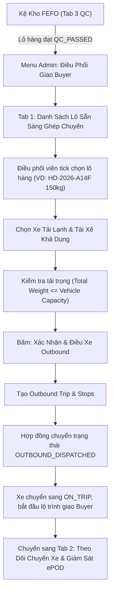

# KẾ HOẠCH TRIỂN KHAI: ĐIỀU PHỐI CHUYẾN XE XUẤT KHO (OUTBOUND DISPATCH) & TÍCH HỢP MENU ĐIỀU HƯỚNG

> **Dự án:** HONA FRESH  
> **Tính năng:** Điều phối chuyến xe giao hàng cho Thương Lái (Outbound Cross-docking Dispatch) & Tích hợp Menu Quản Trị  
> **Phạm vi:** Frontend ReactJS, Backend Spring Boot, PostgreSQL Database  
> **Mã tài liệu:** `PLAN_OUTBOUND_DISPATCH_AND_NAVIGATION.md`  
> **Trạng thái:** **CHỜ NGƯỜI DÙNG PHÊ DUYỆT (STEP 4 - PRESENT PLAN)**

---

## A. OVERVIEW — TỔNG QUAN

### 1. Mục tiêu nghiệp vụ
Xây dựng và hoàn thiện mắt xích **Chặng cuối (Outbound Cross-docking Delivery)** trong chuỗi cung ứng nông sản B2B của HoNa Fresh:
1. Đưa chức năng **"Điều phối giao Buyer (Outbound)"** vào hệ thống Menu Sidebar quản trị (`/admin/layout.tsx`) để điều phối viên có thể truy cập trực tiếp, nhanh chóng.
2. Cho phép Điều phối viên tại Trạm Hub (hoặc Tổng kho) tổng hợp các lô nông sản đã đạt kiểm định (`QC_PASSED`) và đang lưu tại kệ kho FEFO (`AT_HUB_QC`).
3. Thực hiện gom hàng đa điểm (Multi-drop Routing) lên xe tải lạnh chuyên dụng (`fleet_vehicles`), phân công tài xế (`fleet_drivers`), lập lộ trình giao hàng đến các kho Buyer (`buyer_warehouses`).
4. Kích hoạt giám sát hành trình vận chuyển, chuyển trạng thái hợp đồng sang `OUTBOUND_DISPATCHED`, sẵn sàng cho Tài xế giao hàng và Buyer ký nhận điện tử ePOD 2 bước.

### 2. Đối tượng sử dụng
* **Điều phối viên Logistics / Quản trị viên (ADMIN):** Lập kế hoạch gom chuyến, kiểm soát tải trọng thùng lạnh, điều phối xe xuất bến.
* **Tài xế xe lạnh (DRIVER):** Nhận lệnh điều xe trên Portal Tài xế, xem lộ trình và cập nhật tiến độ giao hàng.
* **Thương Lái / Người mua (BUYER):** Theo dõi xe đang đến kho và chuẩn bị tiếp nhận hàng.

---

## B. CURRENT ARCHITECTURE — HIỆN TRẠNG & TÁI SỬ DỤNG

### 1. Thành phần hiện có
* **Frontend:**
  * File giao diện điều phối Outbound đã có khung ban đầu: `frontend/src/app/admin/outbound-dispatch/page.tsx`.
  * Bộ API client: `frontend/src/services/fleetDispatchApi.ts` đã có các hàm Outbound (`getEligibleOutboundContracts`, `confirmOutboundTrip`, `getOutboundTrips`, `cancelOutboundTrip`).
* **Backend:**
  * Controller: `AdminOutboundDispatchController.java` (`/admin/outbound-dispatch/**`).
  * Service nghiệp vụ: `OutboundDispatchService.java` xử lý gom chuyến, kiểm tra quy tắc ONCE, cập nhật xe và tài xế.
  * Models & Repositories: `OutboundDeliveryTrip.java`, `OutboundDeliveryStop.java`, `OutboundDeliveryTripRepository`, `OutboundDeliveryStopRepository`.
* **Database Tables:**
  * `outbound_delivery_trips`: Quản lý chuyến xe xuất kho, mã chuyến (`OUT-...`), tải trọng, nhiệt độ yêu cầu, trạng thái chuyến.
  * `outbound_delivery_stops`: Quản lý từng điểm dừng giao hàng theo hợp đồng, thứ tự giao, kho Buyer, trạng thái ePOD (`PLANNED` $\rightarrow$ `BUYER_CONFIRMED`).
  * `b2b_contracts`: Lưu thông tin xe xuất kho (`outbound_truck_plate`, `outbound_driver_name`, `outbound_dispatched_at`, `outbound_manifest_code`).

### 2. Điểm hạn chế cần khắc phục
1. **Thiếu Menu Sidebar:** Trong `admin/layout.tsx`, danh sách 8 module menu hiện tại chưa có mục cho Outbound Dispatch, người dùng phải gõ URL thủ công.
2. **Lỗi logic lọc QC trong Backend (`OutboundDispatchService.java`):**
   * Code backend đang kiểm tra cứng: `boolean isQcPassed = "PASSED".equalsIgnoreCase(c.getQcStatus());`
   * Trong khi thực tế hệ thống lưu: `qc_status = 'QC_PASSED'` (chuẩn HoNa Fresh). Điều này khiến các lô hàng vừa qua trạm Lab QC (như đơn `HD-2026-A14F`) bị bỏ qua, không hiện lên danh sách đủ điều kiện ghép chuyến!
3. **Cơ chế Dual-routing Backend:** Đảm bảo các endpoint Outbound hoạt động thông suốt với quyền `ROLE_ADMIN` trên cả `AdminOutboundDispatchController` và dự phòng `AdminFleetController`.

---

## C. IMPLEMENTATION SCOPE — PHẠM VI TRIỂN KHAI

### 1. Frontend (`frontend/`)
* **[Sửa] `src/app/admin/layout.tsx`:**
  * Thêm mục Menu:
    ```ts
    {
      id: 'outbound-dispatch',
      name: 'Điều phối giao Buyer',
      href: '/admin/outbound-dispatch',
      icon: Truck, // hoặc Navigation
    }
    ```
  * Vị trí đặt ngay sau module **"Trạm QC & FEFO"** và trước **"Giám sát chuỗi lạnh"**, hình thành chuỗi mắt xích cung ứng chuẩn xác.
  * Cập nhật hàm `isModuleActive` để làm nổi bật (active highlight) menu khi người dùng truy cập `/admin/outbound-dispatch`.
* **[Sửa & Hoàn thiện] `src/app/admin/outbound-dispatch/page.tsx`:**
  * Hoàn thiện 2 Tab điều hành:
    * **Tab 1: Lô Hàng Chờ Ghép Chuyến (Eligible Lots):** Hiển thị các hợp đồng đã đạt QC tại Hub, dung tích khối lượng, kho Buyer đến nhận. Checkbox cho phép chọn nhiều hợp đồng để gom vào 1 chuyến.
    * **Tab 2: Chuyến Xe Outbound Đang Vận Hành:** Theo dõi danh sách xe đang giao hàng, tiến độ các điểm dừng (stops), trạng thái bàn giao ePOD của từng Buyer.
  * Thanh tính toán tải trọng động (Payload Weight Gauge): Cảnh báo nếu tổng tải trọng các lô vượt quá tải trọng xe lạnh được chọn.
  * Modal phân công chuyến xe Outbound: Chọn xe lạnh có nhiệt độ thích hợp (2-4°C cho rau lá, 6-10°C cho củ quả), chọn tài xế khả dụng, sắp xếp thứ tự điểm dừng giao tối ưu lộ trình.

### 2. Backend (`backend/`)
* **[Sửa] `src/main/java/com/btl/webbanrau/service/OutboundDispatchService.java`:**
  * Khắc phục điều kiện lọc QC:
    ```java
    boolean isQcPassed = "QC_PASSED".equalsIgnoreCase(c.getQcStatus()) || "PASSED".equalsIgnoreCase(c.getQcStatus());
    ```
  * Chuẩn hóa kiểm tra vị trí Hub: Kiểm tra theo `c.getHubName()` hoặc `hub.getId()`, đảm bảo lô hàng của đơn `HD-2026-A14F` (Lá É, Hub Đức Trọng) xuất hiện chính xác.
  * Đảm bảo tính toán khối lượng đủ điều kiện `qualifiedWeightKg` lấy chuẩn xác từ `c.getInboundNetWeightKg()` hoặc `hub_inspections`.
* **[Kiểm tra & Đồng bộ] `src/main/java/com/btl/webbanrau/controller/AdminOutboundDispatchController.java`:**
  * Đảm bảo các route:
    * `GET /admin/outbound-dispatch/eligible-contracts?hubId={id}`
    * `POST /admin/outbound-dispatch/confirm-trip?hubId={id}`
    * `GET /admin/outbound-dispatch/trips?hubId={id}`
    * `POST /admin/outbound-dispatch/trips/{id}/cancel`

### 3. Database
* Tái sử dụng 100% schema hiện hữu (`outbound_delivery_trips`, `outbound_delivery_stops`, `b2b_contracts`, `fleet_vehicles`, `fleet_drivers`).
* Không thay đổi cấu trúc bảng, không chạy migration mới.

---

## D. API CONTRACT

| Method | Endpoint | Quyền | Mục đích |
|---|---|---|---|
| `GET` | `/api/v1/admin/outbound-dispatch/eligible-contracts?hubId=2` | `ADMIN` | Lấy danh sách lô hàng đạt QC đang nằm tại kệ kho mát chờ giao Buyer |
| `GET` | `/api/v1/admin/dispatch/vehicles?warehouseId=2&status=AVAILABLE` | `ADMIN` | Lấy danh sách xe tải lạnh sẵn sàng xuất bến tại Hub |
| `GET` | `/api/v1/admin/dispatch/drivers?warehouseId=2&status=AVAILABLE` | `ADMIN` | Lấy danh sách tài xế xe lạnh sẵn sàng nhận chuyến |
| `POST` | `/api/v1/admin/outbound-dispatch/confirm-trip?hubId=2` | `ADMIN` | Phân công chuyến xe Outbound, tạo stops và cập nhật HĐ |
| `GET` | `/api/v1/admin/outbound-dispatch/trips?hubId=2` | `ADMIN` | Lấy danh sách các chuyến xe Outbound của Hub |
| `POST` | `/api/v1/admin/outbound-dispatch/trips/{id}/cancel` | `ADMIN` | Hủy chuyến điều xe Outbound và hoàn trả tài nguyên |

---

## E. BUSINESS FLOW — LUỒNG NGHIỆP VỤ LIÊN TỤC



---

## F. IMPLEMENTATION STEPS — CÁC BƯỚC THỰC HIỆN

1. **Bước 1 (Backend):** Sửa điều kiện lọc `isQcPassed` trong `OutboundDispatchService.java` để nhận diện `QC_PASSED`.
2. **Bước 2 (Frontend Menu):** Cập nhật `frontend/src/app/admin/layout.tsx` để bổ sung menu item **"Điều phối giao Buyer"** (`/admin/outbound-dispatch`) vào vị trí chuẩn trong Sidebar.
3. **Bước 3 (Frontend Outbound UI):** Hoàn thiện trải nghiệm người dùng tại `frontend/src/app/admin/outbound-dispatch/page.tsx` (Thanh chọn Hub, thẻ tóm tắt KPI Outbound, giao diện gom chuyến và bảng hành trình).
4. **Bước 4 (Biên dịch & Kiểm tra tĩnh):** Chạy `compileJava` cho Backend và `tsc --noEmit` cho Frontend.
5. **Bước 5 (Kiểm thử thực tế luồng HD-2026-A14F):**
   * Sau khi tiếp nhận kho và QC Pass tại trạm Hub Đức Trọng, lô `HD-2026-A14F` (150 kg Lá É) lập tức xuất hiện trong mục Điều Phối Giao Buyer.
   * Ghép chuyến thành công và ghi nhận mã chuyến Outbound.

---

## G. RISKS & CONSIDERATIONS

* **Ràng buộc quy tắc ONCE:** Mỗi hợp đồng chỉ được nằm trên tối đa 1 chuyến xe Outbound đang hoạt động. `OutboundDispatchService` đã có hàm `existsActiveByContractId` để ngăn ngừa điều xe trùng lặp.
* **Tải trọng xe lạnh:** Khi chọn nhiều hợp đồng, hệ thống Frontend và Backend đều phải kiểm tra tải trọng tối đa của xe lạnh (`capacityKg`), ngăn chặn tình trạng quá tải thùng lạnh làm ảnh hưởng đến độ lạnh của rau củ.

---

## H. ACCEPTANCE CRITERIA — ĐIỀU KIỆN NGHIỆM THU

1. **Menu Sidebar:** Menu Admin hiển thị rõ ràng mục **"Điều phối giao Buyer"** kèm icon xe tải, click vào chuyển hướng chính xác đến `/admin/outbound-dispatch`, menu được highlight active chuẩn.
2. **Danh sách đủ điều kiện:** Lô hàng `HD-2026-A14F` sau khi đạt QC Pass hiển thị chính xác tại Hub Đức Trọng với khối lượng thực tế 150 kg và địa chỉ kho nhận của Buyer.
3. **Gom chuyến & Điều xe:** Thao tác chọn xe, chọn tài xế và ấn **"Xác Nhận & Điều Xe Outbound"** thành công, mã chuyến xe mới được sinh ra (`OUT-...`).
4. **Trạng thái hợp đồng:** Hợp đồng được tự động cập nhật sang `status = 'OUTBOUND_DISPATCHED'`, sẵn sàng cho chặng giao hàng và ký nhận ePOD.
