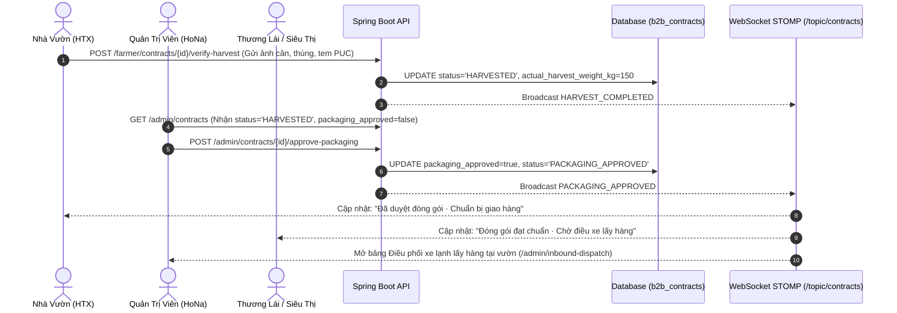

# KẾ HOẠCH TRIỂN KHAI: LƯU TRỮ TRẠNG THÁI DUYỆT ĐÓNG GÓI VÀO DATABASE BACKEND ĐỒNG BỘ 3 ROLE (ADMIN, BUYER, FARMER)

> **Mã kế hoạch:** `PLAN_PERSIST_PACKAGING_APPROVAL_TO_DATABASE`  
> **Dự án:** HoNa Fresh B2B  
> **Mục tiêu:** Lưu trữ chính thức và vĩnh viễn trạng thái duyệt quy cách đóng gói (`packaging_approved`) vào Database PostgreSQL/MySQL ở Backend Spring Boot, đồng bộ API và giao diện hiển thị cho cả 3 Role (Admin, Thương Lái / Buyer, Nhà Vườn / Farmer).

---

## A. OVERVIEW (TỔNG QUAN)

- **Tên chức năng:** Lưu trữ trạng thái duyệt đóng gói B2B vào Database và đồng bộ 3 Role.
- **Mục tiêu:** 
  - Khắc phục triệt để việc chỉ lưu trạng thái duyệt ở Client `localStorage`.
  - Khi Admin bấm *"Xác nhận đạt chuẩn & Mở bảng điều phối"* hoặc *"Duyệt đóng gói"*, hệ thống gọi API Spring Boot để cập nhật cột `packaging_approved = true` và `status = 'PACKAGING_APPROVED'` vào bảng `b2b_contracts` trong Database.
  - Cả 3 Role (Admin, Farmer, Buyer) khi tải dữ liệu từ bất kỳ thiết bị, máy tính hoặc trình duyệt nào đều hiển thị chính xác trạng thái:
    - **Admin:** *"Đã duyệt đóng gói"* kèm nút điều phối xe.
    - **Farmer (Nhà Vườn):** *"Biên bản đóng gói đã được HoNa duyệt · Sẵn sàng giao cho xe lạnh"*.
    - **Buyer (Thương Lái):** *"Đóng gói đạt chuẩn kiểm định · Đang điều xe lạnh HoNa đến lấy hàng"*.
- **Phạm vi nghiệp vụ:** Toàn bộ vòng đời hợp đồng B2B giai đoạn sau thu hoạch (giữa mốc Nông dân nộp nghiệm thu `HARVESTED` và mốc Điều phối xe `PICKUP_DISPATCHED`).

---

## B. CURRENT ARCHITECTURE (HIỆN TRẠNG)

1. **Database Schema (`b2b_contracts`):**
   - Đã có các trường: `actual_harvest_weight_kg`, `harvest_proof_image_url`, `package_count`, `package_type`, `qr_code_data`, `harvested_at`, `pickup_truck_plate`, `fulfillment_status`.
   - **Chưa có:** Cột `packaging_approved` (BOOLEAN) và `packaging_approved_at` (TIMESTAMPTZ).
2. **Backend (Spring Boot):**
   - State machine `AdminBusinessService.transition()` chuyển trực tiếp từ `HARVESTED` sang `PICKUP_DISPATCHED`.
   - Chưa có endpoint API riêng `@PostMapping("/admin/contracts/{id}/approve-packaging")`.
   - `B2bContract.java` (Entity) và `B2bContractResponse.java` (DTO) chưa có trường `packagingApproved`.
3. **Frontend (ReactJS / Next.js):**
   - Đang dựa vào `localStorage` (`hona_packaging_approved_codes`) và WebSocket STOMP. Nếu chuyển sang máy tính khác hoặc xóa cache thì dữ liệu trên Server trả về vẫn là `HARVESTED` chưa duyệt.

---

## C. IMPLEMENTATION SCOPE (PHẠM VI TRIỂN KHAI)

### 1. Database
- **File tạo:** `backend/src/main/resources/db/migration/V24__add_packaging_approved_fields.sql`
- **Nội dung:**
  ```sql
  ALTER TABLE b2b_contracts ADD COLUMN IF NOT EXISTS packaging_approved BOOLEAN DEFAULT FALSE;
  ALTER TABLE b2b_contracts ADD COLUMN IF NOT EXISTS packaging_approved_at TIMESTAMPTZ;
  ```

### 2. Backend (Spring Boot)
- **Model / Entity:**
  - File: `backend/src/main/java/com/btl/webbanrau/model/B2bContract.java`
  - Bổ sung:
    ```java
    @Column(name = "packaging_approved")
    private Boolean packagingApproved;

    @Column(name = "packaging_approved_at")
    private LocalDateTime packagingApprovedAt;
    ```
- **DTO Response:**
  - File: `backend/src/main/java/com/btl/webbanrau/dto/response/B2bContractResponse.java`
  - Bổ sung:
    ```java
    private Boolean packagingApproved;
    private LocalDateTime packagingApprovedAt;
    ```
- **Service & Controller:**
  - File: `backend/src/main/java/com/btl/webbanrau/controller/AdminBusinessController.java`
    - Thêm endpoint:
      ```java
      @PostMapping("/contracts/{id}/approve-packaging")
      public Object approvePackaging(@PathVariable long id, @RequestBody(required = false) JsonNode n) {
          business.approvePackaging(id, n);
          return ApiResponse.success("Đã duyệt quy cách đóng gói và sẵn sàng điều xe", null);
      }
      ```
  - File: `backend/src/main/java/com/btl/webbanrau/service/AdminBusinessService.java`
    - Bổ sung `PACKAGING_APPROVED` vào ma trận trạng thái `allowed`.
    - Thêm hàm `approvePackaging(long id, JsonNode n)`: Cập nhật `packaging_approved = true, packaging_approved_at = CURRENT_TIMESTAMP, fulfillment_status = 'PACKAGING_APPROVED', status = 'PACKAGING_APPROVED'`.
    - Bắn thông báo Realtime WebSocket và Email tới các bên liên quan (`notifyContractParties`).
  - File: `backend/src/main/java/com/btl/webbanrau/service/FarmerService.java`
    - Bổ sung mapping `.packagingApproved(c.getPackagingApproved())` và `.packagingApprovedAt(c.getPackagingApprovedAt())` trong `mapToContractResponse(B2bContract c)`.

### 3. Frontend (ReactJS / Next.js)
- **Admin Contracts (`frontend/src/app/admin/contracts/page.tsx`):**
  - Khi Admin nhấn *"Xác Nhận Đạt Chuẩn & Mở Bảng Điều Phối Thu Gom"* hoặc *"Điều Phối Nhanh"*, gọi API `await api('admin/contracts/' + target.id + '/approve-packaging', 'POST')`.
- **Admin Inbound Dispatch (`frontend/src/app/admin/inbound-dispatch/page.tsx`):**
  - Tự động nhận diện hợp đồng có `packaging_approved: true` trực tiếp từ database server qua `api('admin/contracts')`.
- **Farmer Portal (`frontend/src/views/FarmerOrderManagementView.tsx`):**
  - Đọc `packaging_approved` từ API `/farmer/contracts`.
  - Hiển thị tiến trình Mốc 2: Badge xanh lá *"Quy cách đóng gói đã được HoNa duyệt"*, thông báo cho chủ vườn chuẩn bị bốc hàng lên xe lạnh.
- **Buyer Portal (`frontend/src/app/portal/buyer/page.tsx`):**
  - Đọc `packaging_approved` từ API hợp đồng.
  - Hiển thị badge: *"Kiểm định đóng thùng đạt chuẩn (Loại 1) · Đang điều xe lấy hàng"*.
- **Modal dùng chung (`frontend/src/components/common/B2bContractViewModal.tsx`):**
  - Nhận diện `contract.packaging_approved || contract.packagingApproved` để hiển thị badge *"Đã duyệt đóng gói"* đồng bộ cho cả 3 Role.

---

## D. API CONTRACT

### Endpoint: Duyệt biên bản đóng gói (Admin)
- **Method:** `POST`
- **URL:** `/api/v1/admin/contracts/{id}/approve-packaging`
- **Headers:** `Authorization: Bearer <ADMIN_TOKEN>`
- **Request Body (Optional):**
  ```json
  {
    "notes": "Quy cách đạt chuẩn 10 thùng xốp dán tem PUC"
  }
  ```
- **Response Structure (200 OK):**
  ```json
  {
    "code": 200,
    "message": "Đã duyệt quy cách đóng gói và sẵn sàng điều xe",
    "data": null
  }
  ```

---

## E. BUSINESS FLOW (LUỒNG NGHIỆP VỤ ĐỒNG BỘ 3 ROLE)



---

## F. IMPLEMENTATION STEPS (CÁC BƯỚC THỰC HIỆN)

1. **Bước 1 (Database):** Tạo file migration `V24__add_packaging_approved_fields.sql`.
2. **Bước 2 (Backend Model & DTO):** Cập nhật `B2bContract.java` và `B2bContractResponse.java`.
3. **Bước 3 (Backend Logic & API):** Cập nhật `AdminBusinessService.java`, `AdminBusinessController.java`, và `FarmerService.java`.
4. **Bước 4 (Frontend Integration):**
   - Gọi API `approve-packaging` trong `frontend/src/app/admin/contracts/page.tsx`.
   - Cập nhật hiển thị trạng thái `packaging_approved` trên cả 3 giao diện: Admin, Farmer, Buyer.
5. **Bước 5 (Static Verification):** Kiểm tra biên dịch Java và TypeScript tĩnh đảm bảo 0 lỗi.

---

## G. RISKS & CONSIDERATIONS

- **Bảo toàn dữ liệu cũ:** Sử dụng `ADD COLUMN IF NOT EXISTS` với giá trị mặc định `DEFAULT FALSE`, không gây ảnh hưởng đến các hợp đồng cũ đã hoàn tất.
- **Tính tương thích:** Vẫn giữ nguyên cơ chế WebSocket realtime để cập nhật ngay lập tức mà không cần F5 trình duyệt.

---

## H. ACCEPTANCE CRITERIA (TIÊU CHÍ NGHIỆM THU)

1. Khi Admin bấm duyệt đóng gói, API backend trả về HTTP 200 và dữ liệu trong bảng `b2b_contracts` có `packaging_approved = true`.
2. Mở trình duyệt khác / tab ẩn danh ở cả 3 Role (Admin, Farmer, Buyer), đơn hàng đều hiển thị trạng thái đã duyệt đóng gói, không bao giờ bị nhảy lại nút *"Xem nghiệm thu & Duyệt đóng gói"*.
3. Đơn hàng hiển thị đầy đủ và chính xác trên trang Điều phối lấy hàng `/admin/inbound-dispatch`.
