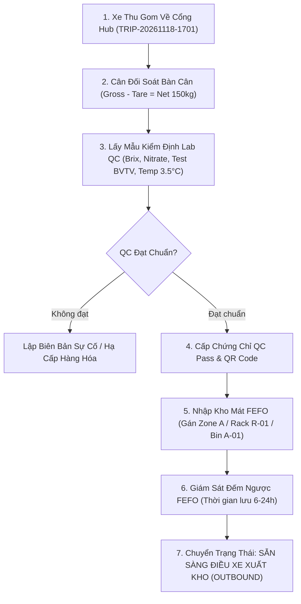

# KẾ HOẠCH TRIỂN KHAI: THIẾT KẾ TRẠM KIỂM ĐỊNH QC & KHO LẠNH FEFO CHUẨN CROSS-DOCKING (HONA FRESH)

> **MÃ KẾ HOẠCH:** `PLAN_QC_STATION_AND_FEFO_WAREHOUSE`  
> **PHIÊN BẢN:** 1.0  
> **NGÀY LẬP:** 18/11/2026  
> **ĐỐI TƯỢNG ÁP DỤNG:** Màn hình `/admin/qc` và phân hệ Quản trị Kho Lạnh & Kiểm định Chất Lượng Trạm Trung Chuyển (Cross-docking Hub)  
> **TRỌNG TÂM THỬ NGHIỆM:** Lô hàng hợp đồng **HD-2026-A14F** (150 kg rau xà lách/cải bắp VietGAP trên chuyến xe `TRIP-20261118-1701`)

---

## A. OVERVIEW — TỔNG QUAN

### 1. Bối cảnh & Mục tiêu nghiệp vụ
HONA FRESH vận hành theo mô hình **B2B Contract Cross-docking** với chuỗi 5 Trạm trung chuyển (Hub) lạnh:
- Hàng thu gom từ rẫy nhà vườn không lưu kho dài ngày mà chỉ lưu tạm **6 đến 24 giờ** tại Hub để thực hiện kiểm định chất lượng (QC Lab), phân loại dung sai hao hụt và chia chọn theo đơn Buyer trước khi chuyển tiếp lên xe Outbound.
- Hiện tại, trang `http://localhost:3000/admin/qc` mới chỉ là danh sách bảng thô sơ, chưa phản ánh được luồng vận hành chuyên nghiệp của một Trung tâm Kiểm soát Kho Lạnh (Cold Storage Control Tower).
- **Mục tiêu:** Nâng cấp toàn diện giao diện `http://localhost:3000/admin/qc` thành **Trạm Kiểm Định Lab QC & Trung Tâm Giám Sát Kho Lạnh FEFO Thực Thụ**, mang đến trải nghiệm trực quan, chuyên nghiệp, kiểm soát chặt chẽ nhiệt độ, thông số an toàn thực phẩm, vị trí lưu trữ kệ (Zone/Rack/Bin) và nguyên tắc xuất hàng ưu tiên hạn dùng FEFO (First-Expired, First-Out).

### 2. Kết quả mong muốn
1. **Control Tower Dashboard:** Hiển thị thời gian thực công suất kho lạnh (kg & m³), tỷ lệ lấp đầy từng Zone, số chuyến xe sắp cập bến, số lô chờ kiểm định QC, và các cảnh báo khẩn cấp về nhiệt độ / hạn lưu kho FEFO.
2. **Tab 1 — Cổng Cân Tiếp Nhận (Inbound Gate & Weighbridge):** Giám sát xe từ rẫy về cổng Hub, đối soát cân tổng (Gross Weight), cân bì (Tare Weight), cân tịnh (Net Weight), nhiệt độ cuống rau và kiểm đếm số lượng thùng thực nhận so với hợp đồng.
3. **Tab 2 — Phòng Lab QC & Chứng Nhận (QC Testing & Certification):** Nhập và thẩm định các chỉ số hóa lý sinh: độ ngọt Brix, tồn dư Nitrate (ppm), test que thử nhanh thuốc bảo vệ thực vật (Pesticide rapid test), độ ẩm cảm quan, phân loại khối lượng Đạt loại 1 / Loại 2 / Phế phẩm. Cấp giấy chứng nhận kiểm định chất lượng (QC Certificate) có mã tra cứu QR Code.
4. **Tab 3 — Sơ Đồ Kho Lạnh 2D & Quản Trị FEFO (Cold Storage Rack/Bin & FEFO Map):** Trực quan hóa bản đồ kho lạnh theo Zone (Zone A: Rau lá 2-4°C, Zone B: Củ quả 6-10°C, Zone C: Trái cây), danh sách kệ Rack và ô Bin. Mỗi ô Bin gắn liền với hợp đồng, khối lượng, nhiệt độ buồng và đồng hồ đếm ngược FEFO (xanh < 6h, vàng 6-18h, đỏ > 18h).
5. **Tab 4 — Lô Sẵn Sàng Xuất Kho (Ready for Outbound Dispatch):** Tổng hợp các lô hàng đã hoàn tất QC và xếp Bin, sẵn sàng để bộ phận Logistics lập chuyến xe xuất kho chặng cuối giao Buyer.

---

## B. CURRENT ARCHITECTURE — HIỆN TRẠNG & TÁI SỬ DỤNG

### 1. Các thành phần Backend hiện có
- `WarehouseReceivingController.java`: Cung cấp API tiếp nhận chuyến xe cổng kho (`/warehouse/receiving/trips`, `/warehouse/receiving/trips/{id}/arrive`, `/warehouse/receiving/trips/{id}/complete`).
- `HubInspection.java` & `HubInspectionRepository.java`: Thực thể lưu kết quả kiểm định chất lượng tại trạm trung chuyển (nhận, đạt, loại bỏ, brix, độ ẩm, ghi chú QC).
- `ColdAsset.java` / `cold_assets`: Lưu trữ thông tin buồng lạnh (`COLD_ROOM`, dung tích, nhiệt độ chuẩn).
- `AdminBusinessService.java`: Phương thức `warehouseInbound` cập nhật hợp đồng, lưu `hub_inspections`, gán Zone/Rack/Bin và ghi nhận các chỉ số `qc_brix`, `qc_nitrate_ppm`, `qc_pesticide_safe`.
- `B2bRealtimeService.java`: Phát socket `/topic/contracts` và `/topic/dispatch`.

### 2. Các thành phần Frontend hiện có
- `frontend/src/app/admin/qc/page.tsx`: Màn hình QC hiện tại (cần tái cấu trúc toàn diện thành Control Console).
- `frontend/src/components/warehouse/WarehouseReceivingConsole.tsx`: Màn hình giao diện tiếp nhận xe tại kho (tái sử dụng các logic tính toán cân nặng và đối soát stop).
- `frontend/src/components/admin/ColdWarehouseInboundModal.tsx`: Modal nhập kho có sẵn các trường đo đạc Brix, Nitrate, Zone/Bin.
- `DEFAULT_OFFICIAL_HUBS`: 5 Hub chính thức phân bổ theo vùng địa lý kinh tế.

---

## C. IMPLEMENTATION SCOPE — PHẠM VI TRIỂN KHAI

### 1. Phía Frontend (`frontend/src/app/admin/qc/page.tsx`)
- Tái cấu trúc trang thành một Console hoàn chỉnh với 4 tab nghiệp vụ:
  - **Tab 1:** `INBOUND_GATE` — Tiếp nhận xe & Cân đối soát tải trọng.
  - **Tab 2:** `QC_LAB` — Trạm kiểm định Lab QC & Cấp chứng nhận chất lượng.
  - **Tab 3:** `FEFO_STORAGE` — Bản đồ phân vùng kho lạnh (Zone/Rack/Bin) & Giám sát đếm ngược FEFO.
  - **Tab 4:** `READY_OUTBOUND` — Danh sách lô đã kiểm định chuẩn, sẵn sàng xuất kho Cross-docking.
- Tích hợp bộ lọc Hub chọn trạm linh hoạt (Mặc định: Hub 2 — Đức Trọng, Lâm Đồng).
- Thiết kế component **Bản đồ kho trực quan (Visual Rack/Bin Layout)** với hiệu ứng đổi màu theo nhiệt độ và thời gian lưu kho FEFO.
- Modal tạo/cấp Chứng chỉ QC Lab chuyên sâu với đầy đủ thông số kỹ thuật nông sản xuất khẩu/siêu thị.
- Đồng bộ WebSocket tức thời với `/topic/contracts` và `/topic/dispatch`.

### 2. Phía Backend
- Tối ưu hóa endpoint tiếp nhận & kiểm định tại `WarehouseReceivingController` và `AdminFleetController`:
  - Bổ sung endpoint lấy danh sách chi tiết các lô hàng đang lưu tại kho Hub theo Zone/Bin và thời gian lưu kho FEFO (`GET /api/v1/warehouse/inventory?warehouseId=...`).
  - Hỗ trợ lưu trữ đầy đủ các chỉ số kiểm định: `brix`, `nitratePpm`, `pesticideSafe`, `coreTemp`, `qualifiedWeightKg`, `rejectedWeightKg`, `qcCertUrl`.
- Tự động chuyển trạng thái hợp đồng sang `AT_HUB_QC` (hoặc `QC_PASSED` / `READY_OUTBOUND`) và cập nhật `pickup_trips` sang `COMPLETED` khi xe đã dỡ hàng xong tại cổng.

### 3. Phía Database
- Tận dụng triệt để các bảng hiện hữu:
  - `b2b_contracts`: Các trường `hub_warehouse_zone`, `hub_rack_bin`, `max_storage_days`, `hub_inbound_at`, `qc_status`, `qc_passed_at`, `qc_cert_url`, `qc_brix`, `qc_nitrate_ppm`, `qc_pesticide_safe`, `inbound_gross_weight_kg`, `inbound_tare_weight_kg`, `inbound_net_weight_kg`.
  - `hub_inspections`: Lưu lịch sử từng đợt kiểm định.
  - `cold_assets`: Danh sách buồng lạnh tại trạm.
  - `pickup_trip_stops` & `pickup_trips`: Giám sát chuyến xe dỡ hàng.
- Không cần tạo bảng mới, đảm bảo tính ổn định và tương thích ngược 100%.

---

## D. API CONTRACT — THỐNG NHẤT GIAO THỨC

### 1. Lấy dữ liệu kho Hub tổng thể & FEFO
- **Endpoint:** `GET /api/v1/warehouse/inventory?warehouseId={hubId}`
- **Response Structure:**
```json
{
  "code": 200,
  "data": {
    "hubId": 2,
    "hubName": "Trạm Trung Chuyển Đức Trọng (Hub Lâm Đồng)",
    "totalCapacityKg": 50000,
    "currentStoredKg": 150,
    "utilizationRate": 0.3,
    "zones": [
      {
        "zoneCode": "ZONE_A",
        "zoneName": "Zone A — Rau Ăn Lá & Thảo Mộc",
        "targetTemp": "2°C - 4°C",
        "currentTemp": "2.8°C",
        "humidity": "92%",
        "racks": [
          {
            "rackCode": "R-01",
            "bins": [
              {
                "binCode": "A-01",
                "contractId": 17,
                "contractCode": "HD-2026-A14F",
                "productName": "Xà Lách Mỡ VietGAP",
                "weightKg": 150.0,
                "packageCount": 10,
                "inboundAt": "2026-11-18T02:30:00",
                "expiryHoursRemaining": 18.5,
                "fefoAlert": "NORMAL",
                "qcStatus": "QC_PASSED"
              }
            ]
          }
        ]
      }
    ]
  }
}
```

### 2. Thực hiện Kiểm định Lab QC & Gán Vị Trí FEFO
- **Endpoint:** `POST /api/v1/admin/contracts/{id}/warehouse-inbound`
- **Request Body:**
```json
{
  "zone": "Zone A (Rau lá 2-4°C)",
  "rackBin": "R-01 / Bin A-01",
  "maxStorageDays": 2,
  "grossWeightKg": 175.0,
  "tareWeightKg": 25.0,
  "netWeightKg": 150.0,
  "brix": 13.2,
  "nitratePpm": 240.0,
  "pesticideSafe": true,
  "coreTemp": 3.5,
  "qcCertUrl": "https://res.cloudinary.com/honafresh/qc/cert-HD-2026-A14F.pdf",
  "qcNotes": "Rau tươi giòn, lá xanh đều không dập, Nitrate 240ppm đạt ngưỡng an toàn rau ăn lá."
}
```
- **Response:** `HTTP 200 OK` kèm kết quả kiểm định và mã chứng chỉ QC.

---

## E. BUSINESS FLOW — LUỒNG NGHIỆP VỤ TRẠM QC & KHO FEFO



1. **Cập bến:** Xe lạnh `TRIP-20261118-1701` chở 150 kg rau từ rẫy Đà Lạt về tới Trạm Đức Trọng. Nhân viên bấm xác nhận xe cập bến.
2. **Cân nhận:** Kiểm tra niêm phong thùng, cân đối soát khối lượng thực nhận (150 kg) và nhiệt độ cuống rau (3.5°C).
3. **Kiểm nghiệm Lab QC:** Đo mẫu Brix, Nitrate và test nhanh thuốc trừ sâu. Xác nhận tỷ lệ loại 1 $\ge 95\%$.
4. **Cấp tem QC:** Cấp chứng nhận `QC-2026-DT-017` dán mã QR lên kiện hàng.
5. **Xếp vị trí FEFO:** Gán kệ Zone A (Kệ R-01, Ô Bin A-01). Hệ thống kích hoạt đồng hồ đếm ngược FEFO 24h.
6. **Sẵn sàng xuất:** Tự động kích hoạt hiển thị lô hàng trên màn hình Điều phối xuất kho Outbound để phân tuyến giao Buyer.

---

## F. IMPLEMENTATION STEPS — CÁC BƯỚC THỰC HIỆN

1. **Bước 1 — Backend Service & Endpoint:**
   - Xây dựng API tổng hợp dữ liệu tồn kho FEFO theo Hub tại `WarehouseReceivingController` hoặc `AdminFleetController`.
   - Đảm bảo khi lưu phiếu kiểm định `warehouseInbound`, trạng thái hợp đồng và thực thể chuyến xe được cập nhật đồng bộ, gửi WebSocket thông báo realtime.
2. **Bước 2 — Thiết kế Giao diện Trung tâm Quản Trị QC & FEFO:**
   - Xây dựng lại [admin/qc/page.tsx](file:///e:/HOCTAP/WWW/BTL_WebBanRau/frontend/src/app/admin/qc/page.tsx) với giao diện Dark/Light hiện đại, chuẩn Logistics Hub (Dashboard Metrics, Hub Selector, 4 Tab nghiệp vụ).
3. **Bước 3 — Triển khai Tab Cổng Cân Tiếp Nhận & Modal Cân Hàng:**
   - Hiển thị danh sách các chuyến xe đang về kho hoặc đã đến cổng. Cho phép nhập trọng lượng cân xe, kiểm tra nhiệt độ.
4. **Bước 4 — Triển khai Tab Phòng Thí Nghiệm QC & Phiếu Chứng Nhận:**
   - Thiết kế giao diện nhập chỉ số Brix, Nitrate, que thử thuốc BVTV, xem hình ảnh mẫu kiểm nghiệm và nút xuất Chứng chỉ QC.
5. **Bước 5 — Triển khai Bản Đồ Kho Lạnh FEFO 2D (Visual Rack/Bin Layout):**
   - Thiết kế trực quan các Zone buồng lạnh (Zone A, B, C), các dãy Rack và từng ô Bin lưu trữ.
   - Hiển thị thông tin lô hàng đang nằm trên kệ kèm thời gian đếm ngược FEFO và màu sắc cảnh báo hạn dùng.
6. **Bước 6 — Thử nghiệm thực tế với Hợp đồng HD-2026-A14F:**
   - Tiếp nhận chuyến xe `TRIP-20261118-1701`.
   - Thực hiện kiểm định QC cho lô hàng `HD-2026-A14F` (150 kg).
   - Đưa vào ô Bin A-01 của Zone A tại Hub Đức Trọng.
   - Kiểm tra kết quả phản ánh trên cả màn hình hợp đồng và màn hình xuất kho Outbound.

---

## G. RISKS & CONSIDERATIONS — ĐÁNH GIÁ RỦI RO

- **Dữ liệu phân vùng kho:** Để tránh làm phức tạp hóa hệ thống WMS quá mức không cần thiết theo nguyên tắc Cross-docking (hàng chỉ nằm tại kho 6-24h), cấu trúc Rack/Bin sẽ được mô hình hóa linh hoạt dựa trên dữ liệu buồng lạnh và vị trí đã có trong `b2b_contracts`, không can thiệp thay đổi cấu trúc bảng database.
- **Tiêu tốn tài nguyên:** Bản đồ kho được vẽ bằng các thẻ CSS Grid / Flexbox tinh gọn, không tải thư viện đồ họa nặng để đảm bảo hiệu năng RAM/CPU theo tôn chỉ `AGENTS.md`.

---

## H. ACCEPTANCE CRITERIA — TIÊU CHÍ NGHIỆM THU

1. Màn hình `http://localhost:3000/admin/qc` hiển thị đầy đủ các chỉ số đo lường kho lạnh và 4 tab chức năng chuyên nghiệp.
2. Có thể chọn trạm trung chuyển (Hub Đức Trọng, Hub Củ Chi,...) và xem đúng sức chứa của từng trạm.
3. Cho phép tiếp nhận chuyến xe `TRIP-20261118-1701` của hợp đồng `HD-2026-A14F` trực tiếp tại cổng Hub.
4. Thực hiện kiểm định QC với đầy đủ các thông số: Brix, Nitrate ppm, test thuốc BVTV, nhiệt độ cuống và xuất chứng chỉ QC.
5. Bản đồ kho lạnh hiển thị rõ ràng vị trí lưu tạm của lô hàng `HD-2026-A14F` trong ô Bin thuộc Zone A kèm đếm ngược thời gian FEFO.
6. Toàn bộ quá trình đồng bộ thời gian thực qua WebSocket STOMP không phát sinh lỗi 500 hay LazyInitializationException.
