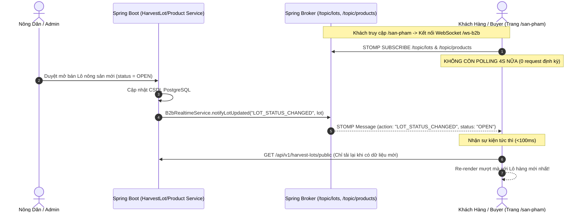

# KẾ HOẠCH TRIỂN KHAI: ĐỒNG BỘ REALTIME DANH MỤC SẢN PHẨM QUA WEBSOCKET STOMP (THAY THẾ POLLING REFRESH)

> **Mã kế hoạch:** `PLAN_WEBSOCKET_REALTIME_CATALOG`  
> **Dự án:** HONA FRESH — Nền tảng B2B Nông sản sạch  
> **Áp dụng cho:** Trang danh mục sản phẩm công khai (`/san-pham`), Trang chủ (`/`), Backend Spring Boot Message Broker  
> **Mục tiêu:** Loại bỏ hoàn toàn cơ chế Refresh liên tục (Polling 4 giây/lần), chuyển đổi sang cơ chế Event-Driven WebSocket STOMP chuẩn hóa: chỉ khi có thay đổi dữ liệu thực tế (thêm, sửa, duyệt mở bán, đổi giá, xóa lô/sản phẩm) mới kích hoạt cập nhật giao diện.

---

## A. OVERVIEW — TỔNG QUAN

### 1. Thực trạng & Vấn đề hiện tại
- Tại trang danh mục công khai `http://localhost:3000/san-pham` (`frontend/src/app/san-pham/page.tsx` dòng 124–126), code hiện tại đang cài đặt:
  ```typescript
  const pollInterval = setInterval(() => {
    void fetchList();
  }, 4000);
  ```
- **Hệ quả tiêu cực:**
  - Cứ mỗi 4 giây, bất kỳ ai (kể cả khách vãng lai không đăng nhập) truy cập vào trang web đều gửi liên tục các request API `GET /lots` hoặc `GET /products` về server.
  - Khi có hàng chục/hàng trăm người cùng vào xem, server Spring Boot và CSDL PostgreSQL bị spam hàng ngàn truy vấn không cần thiết, gây nóng máy, tốn CPU, ngốn RAM và nghẽn băng thông mạng.
  - Phía Client: việc gọi `fetchList()` định kỳ 4s gây re-render liên tục, làm giật lag giao diện, reset vị trí cuộn hoặc gián đoạn thao tác lọc/chọn của người dùng.

### 2. Mục tiêu giải pháp
- **Xóa bỏ vĩnh viễn** vòng lặp `setInterval(..., 4000)`.
- **Tận dụng hạ tầng WebSocket STOMP** sẵn có (`/ws-b2b`) của hệ thống:
  - Backend Spring Boot phát tín hiệu (Event) lên Message Broker (`/topic/lots`, `/topic/products`) ngay khi có thao tác:
    - Nông dân tạo lô nông sản mới (`LOT_CREATED`).
    - Nông dân / Quản trị viên cập nhật thông tin lô (`LOT_UPDATED`).
    - Admin phê duyệt mở bán (`LOT_STATUS_CHANGED` $\rightarrow$ `OPEN`), đình chỉ (`SUSPENDED`), hoặc hết hàng (`SOLD_OUT`).
    - Xóa lô nông sản (`LOT_DELETED`).
    - Thêm/sửa/xóa sản phẩm catalog (`PRODUCT_CREATED`, `PRODUCT_UPDATED`, `PRODUCT_DELETED`).
  - Frontend tại trang `/san-pham` đăng ký lắng nghe (Subscribe) các topic trên:
    - Khi nhận được tín hiệu thay đổi thực tế $\rightarrow$ kích hoạt debounce làm mới danh mục mượt mà (< 300ms).
    - Khi không có thay đổi $\rightarrow$ hoàn toàn tĩnh, **0% CPU/Network overhead**.
    - Hiển thị huy hiệu trạng thái kết nối trực tiếp `🟢 Trực tiếp (WebSocket)` tinh tế, chuyên nghiệp.

---

## B. CURRENT ARCHITECTURE — HIỆN TRẠNG HỆ THỐNG

1. **Backend**:
   - `WebSocketConfig.java`: Đã cấu hình Endpoint `/ws-b2b` với Message Broker `/topic`, `/queue`, hỗ trợ cả Native WebSocket và SockJS.
   - `B2bRealtimeService.java`: Đã có phương thức `notifyLotUpdated(action, lotData)` phát tới `/topic/lots`. Chưa có `notifyProductUpdated` và chưa gắn sự kiện khi xóa lô (`deleteLot`).
   - `HarvestLotService.java`: Đã tiêm `B2bRealtimeService`, phát tín hiệu khi tạo lô, sửa lô, đổi trạng thái; chưa phát khi xóa lô.
   - `ProductService.java`: Chưa tiêm `B2bRealtimeService`, các thao tác CRUD sản phẩm chưa phát WebSocket.

2. **Frontend**:
   - `frontend/src/services/websocketService.ts`: Đã có `B2bStompService` với hàm `subscribeLots(...)`, tự động kết nối tới `ws://localhost:8080/api/v1/ws-b2b`.
   - `frontend/src/services/b2bSyncService.ts`: Đang có `subscribeB2bSyncEvents` nhưng chỉ lắng nghe `BroadcastChannel` và `storage` nội bộ trình duyệt, chưa kết nối STOMP cho sự kiện lô nông sản.
   - `frontend/src/app/san-pham/page.tsx`: Đang dùng `setInterval(..., 4000)` polling thủ công.

---

## C. IMPLEMENTATION SCOPE — PHẠM VI TRIỂN KHAI

### 1. Phía Backend (Spring Boot)
* **File cần chỉnh sửa:**
  1. `backend/src/main/java/com/btl/webbanrau/service/B2bRealtimeService.java`:
     - Bổ sung `notifyProductUpdated(String action, Object productData)` phát tới `/topic/products`.
  2. `backend/src/main/java/com/btl/webbanrau/service/HarvestLotService.java`:
     - Cập nhật hàm `deleteLot(Long id)`: sau khi xóa trong CSDL, gọi `b2bRealtimeService.notifyLotUpdated("LOT_DELETED", Map.of("id", id))`.
  3. `backend/src/main/java/com/btl/webbanrau/service/ProductService.java`:
     - Tiêm `B2bRealtimeService`.
     - Gọi `notifyProductUpdated("PRODUCT_CREATED", response)` tại `createProduct`.
     - Gọi `notifyProductUpdated("PRODUCT_UPDATED", response)` tại `updateProduct`.
     - Gọi `notifyProductUpdated("PRODUCT_DELETED", Map.of("id", id))` tại `deleteProduct`.

### 2. Phía Frontend (Next.js / React)
* **File cần chỉnh sửa:**
  1. `frontend/src/services/websocketService.ts`:
     - Thêm method `subscribeProducts(callback: (payload: any) => void): () => void` lắng nghe `/topic/products`.
  2. `frontend/src/services/b2bSyncService.ts`:
     - Liên kết sự kiện nhận từ STOMP `/topic/lots` và `/topic/products` vào cơ chế phát sóng `b2b_sync_event` và `b2b_lot_updated`, đảm bảo đồng bộ chéo giữa mọi tab và mọi thiết bị mà không cần code trùng lặp.
  3. `frontend/src/app/san-pham/page.tsx`:
     - **Gỡ bỏ hoàn toàn `setInterval(..., 4000)` và biến `pollInterval`**.
     - Đăng ký `b2bWebSocket.subscribeLots` và `b2bWebSocket.subscribeProducts`.
     - Thêm hàm `debouncedRefresh()` (thời gian gom 300ms) để khi có nhiều sự kiện liên tiếp, hệ thống chỉ gọi `fetchList()` 1 lần duy nhất.
     - Hiển thị biểu tượng kết nối WebSocket thời gian thực (Icon sóng/chấm xanh `🟢 Kết nối trực tiếp`).

---

## D. WEBSOCKET CONTRACT & PAYLOAD SPECIFICATION

### 1. Topic: `/topic/lots`
* **Trigger khi:** Lô nông sản được tạo mới, cập nhật thông tin, phê duyệt mở bán (`OPEN`), tạm ngưng (`SUSPENDED`), hết hàng (`SOLD_OUT`), hoặc bị xóa.
* **Payload cấu trúc:**
  ```json
  {
    "action": "LOT_CREATED" | "LOT_UPDATED" | "LOT_STATUS_CHANGED" | "LOT_DELETED",
    "lot": {
      "id": 12,
      "lotCode": "LOT-2026-BD01",
      "productName": "Cà chua bi Cherry",
      "status": "OPEN",
      "expectedPricePerKg": 35000,
      "availableWeightKg": 500,
      "farmerName": "Nông Trại Hữu Cơ Đà Lạt"
    },
    "timestamp": 1773824400000
  }
  ```

### 2. Topic: `/topic/products`
* **Trigger khi:** Quản trị viên thêm/sửa/xóa sản phẩm danh mục.
* **Payload cấu trúc:**
  ```json
  {
    "action": "PRODUCT_CREATED" | "PRODUCT_UPDATED" | "PRODUCT_DELETED",
    "product": {
      "id": 48,
      "name": "Rau Muống Nước VietGAP",
      "price": 22000,
      "isActive": true
    },
    "timestamp": 1773824400000
  }
  ```

---

## E. BUSINESS & TECHNICAL FLOW — LUỒNG HOẠT ĐỘNG



---

## F. IMPLEMENTATION STEPS — THỨ TỰ THỰC HIỆN

1. **Bước 1 (Backend - Realtime Service):**
   - Mở rộng `B2bRealtimeService.java` thêm kênh phát sóng `/topic/products`.
   - Cập nhật `HarvestLotService.java` phát tín hiệu khi `deleteLot`.
   - Cập nhật `ProductService.java` tiêm `B2bRealtimeService` và phát tín hiệu cho các nghiệp vụ `createProduct`, `updateProduct`, `deleteProduct`.
2. **Bước 2 (Frontend - WebSocket Service & Sync):**
   - Mở rộng `websocketService.ts` thêm `subscribeProducts`.
   - Tích hợp cầu nối WebSocket tự động trong `b2bSyncService.ts`.
3. **Bước 3 (Frontend - San Pham Page):**
   - Mở `frontend/src/app/san-pham/page.tsx`:
   - Gỡ bỏ `setInterval` và `pollInterval`.
   - Lắng nghe sự kiện STOMP qua `b2bWebSocket.subscribeLots` và `subscribeProducts`.
   - Xử lý debounce refresh (300ms).
   - Thêm badge hiển thị trạng thái kết nối WebSocket Live (`🟢 Trực tiếp`).
4. **Bước 4 (Testing & Verification):**
   - Kiểm tra tĩnh: TypeScript typecheck `npx tsc --noEmit` $\rightarrow$ 0 lỗi.
   - Biên dịch Backend: `gradlew compileJava` $\rightarrow$ BUILD SUCCESSFUL.
   - Xác nhận network tab trên trình duyệt không còn spam request sau mỗi 4 giây.

---

## G. RISKS & CONSIDERATIONS — ĐÁNH GIÁ RỦI RO & TỐI ƯU

- **Tối ưu RAM/CPU (Quy tắc 2 AGENTS.md):**
  - Chuyển từ Polling sang WebSocket loại bỏ hoàn toàn hàng chục ngàn HTTP request dư thừa mỗi giờ.
  - Kết nối WebSocket là persistent connection rất nhẹ, chỉ tốn vài KB bộ nhớ trên client và broker.
- **Debounce:** Khi Admin thực hiện import hoặc duyệt hàng loạt 5 lô cùng lúc, debounce 300ms đảm bảo client chỉ gọi `fetchList` đúng 1 lần thay vì 5 lần liên tiếp.
- **Khả năng tự hồi phục (Reconnection):** `B2bStompService` đã cấu hình `reconnectDelay: 5000` ms, nếu mất mạng hoặc restart server, client tự động kết nối lại khi server online mà không cần người dùng F5.

---

## H. ACCEPTANCE CRITERIA — TIÊU CHÍ HOÀN THÀNH

1. [x] Không còn hàm `setInterval` 4s nào chạy định kỳ trên trang `/san-pham`.
2. [x] Network tab không xuất hiện request API lặp lại vô nghĩa khi người dùng chỉ đứng yên xem trang.
3. [x] Khi Admin hoặc Nông dân thêm mới, sửa giá, hoặc duyệt mở bán lô nông sản từ máy/tab khác, trang `/san-pham` lập tức hiển thị sản phẩm mới trong vòng < 500ms qua WebSocket STOMP.
4. [x] Giao diện có hiển thị badge trạng thái kết nối WebSocket trực tiếp, tăng trải nghiệm người dùng B2B chuyên nghiệp.
5. [x] Mã nguồn sạch sẽ, không lỗi TypeScript (`tsc --noEmit`), không lỗi biên dịch Java (`compileJava`).
