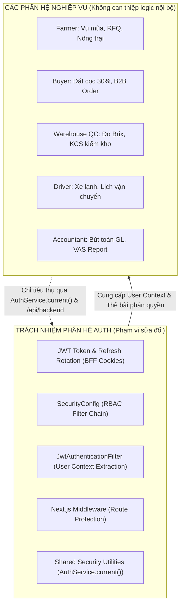

# KẾ HOẠCH ĐỘC LẬP CHUẨN HÓA HỆ THỐNG XÁC THỰC & PHÂN QUYỀN (SYSTEM AUTH & SECURITY PLAN)
**Phạm vi:** Hạ tầng Xác thực (Authentication) & Phân quyền (Authorization) toàn hệ thống  
**Nguyên tắc cốt lõi:** **Phân tách trách nhiệm (Separation of Concerns)** — Phân hệ Auth đóng vai trò là "Người gác cổng" (Gatekeeper) và "Nhà cung cấp hạ tầng bảo mật" (Security Infrastructure Provider), **hoạt động độc lập, không xâm lấn hoặc làm gián đoạn logic nghiệp vụ riêng của các role khác** (Farmer, Buyer, Warehouse QC, Driver, Accountant, Admin).  

---

## 1. NGUYÊN TẮC THIẾT KẾ & RANH GIỚI TRÁCH NHIỆM (SECURITY BOUNDARIES)



### Ranh giới cam kết:
1. **Phân hệ Auth CHỈ LÀM:**
   - Quản lý vòng đời tài khoản: Đăng ký, Đăng nhập, OTP Email, Quên mật khẩu, Google Sign-in.
   - Quản lý phiên: Access Token (15 phút), Refresh Token xoay vòng (RTR), Cookie `httpOnly`, thu hồi token khi đổi pass hoặc khóa tài khoản.
   - Cung cấp "Thẻ bài" (Security Context) và hàm tiện ích chuẩn `AuthService.current()` để các service khác lấy thông tin người dùng đang gọi API một cách an toàn.
   - Thiết lập hàng rào bảo vệ đường truyền (SecurityFilterChain, Next.js Server Middleware) theo đúng Ma trận Phân quyền (RBAC Matrix).
2. **Phân hệ Auth TUYỆT ĐỐI KHÔNG ĐƯỢC:**
   - Không sửa đổi bảng dữ liệu nghiệp vụ của role khác (không sửa bảng `harvest_lots`, `b2b_contracts`, `qc_inspections`, `shipments`, `gl_journal_entries`).
   - Không can thiệp vào logic tính giá sỉ, công thức đo độ ngọt Brix, thuật toán chia cung đường xe lạnh hay hạch toán kế toán kép.
   - Không ép các role khác đổi cấu trúc DTO nghiệp vụ.

---

## 2. MA TRẬN PHÂN QUYỀN CHUẨN TOÀN HỆ THỐNG (RBAC MATRIX)

Phân hệ Auth thiết lập bộ quy tắc chuẩn tại [`SecurityConfig.java`](file:///e:/HOCTAP/WWW/BTL_WebBanRau/backend/src/main/java/com/btl/webbanrau/config/SecurityConfig.java) và [`middleware.ts`](file:///e:/HOCTAP/WWW/BTL_WebBanRau/frontend/src/middleware.ts):

| Dải URL Pattern (API) | Vai trò yêu cầu (Authority) | Mô tả & Ranh giới |
| :--- | :--- | :--- |
| **Public Endpoints** | `permitAll()` | • Khách xem sản phẩm / danh mục: `GET /products/**`, `GET /categories/**`<br>• Khách tra cứu lô hàng / QR nguồn gốc: `GET /harvest-lots/**`, `GET /farmer/contracts/track/**`<br>• Đăng nhập, đăng ký, OTP: `POST /auth/**`<br>• Khách vãng lai gửi yêu cầu báo giá sỉ: `POST /farmer/rfq/public-submit`<br>• Chatbot AI tư vấn nông sản: `POST /ai/chat`, `GET /ai/search` |
| **Khách hàng Mua sắm (Customer)** | `ROLE_USER` hoặc `authenticated()` | • Quản lý hồ sơ cá nhân: `GET /auth/me`, `PUT /auth/profile`<br>• Đặt hàng B2C: `POST /orders`<br>• Xem lịch sử đơn hàng của chính mình: `GET /orders/my-orders` |
| **Phân hệ Nông dân (Farmer)** | `ROLE_FARMER` | • Quản lý vùng trồng, đăng lô nông sản: `/farmer/**`, `/harvest-lots/my-lots/**`<br>• Đàm phán RFQ, ký hợp đồng bán buôn: `/contracts/farmer/**`<br>• *(Bị cấm vào API của Buyer, Driver, QC, Kế toán)* |
| **Phân hệ Thương lái (Buyer)** | `ROLE_BUYER` | • Đặt cọc 30% bảo chứng Escrow: `/escrow/deposit/**`<br>• Gửi RFQ, ký hợp đồng thu mua: `/buyer/**`, `/contracts/buyer/**`<br>• Xác nhận nhận hàng điện tử: `/buyer/shipments/**/epod` |
| **Trạm Kiểm định KCS (Warehouse QC)** | `ROLE_WAREHOUSE_QC` | • Tiếp nhận hàng hóa, cân trọng lượng, đo Brix: `/hub-inspections/**`<br>• Giám sát kho mát: `/cold-assets/manage/**` |
| **Tài xế Xe lạnh (Driver)** | `ROLE_DRIVER` | • Lịch điều vận, cập nhật trạng thái vận chuyển: `/driver/**`<br>• Ký biên bản giao nhận điện tử: `/shipments/epod/**` |
| **Kế toán Sàn (Accountant)** | `ROLE_ACCOUNTANT` | • Sổ cái kế toán kép VAS, báo cáo doanh thu: `/accounting/**`<br>• Giải ngân quyết toán: `/escrow/settlement/**`, `/invoices/**` |
| **Ban Quản trị Sàn (Admin)** | `ROLE_ADMIN` | • Quyền năng tối cao: Quản lý user, duyệt KYC đối tác, cấu hình hệ thống: `/admin/**`, `/users/**`, `/ai/config-key`, `/ai/sync-embeddings` |

---

## 3. KẾ HOẠCH TRIỂN KHAI CHI TIẾT CỦA PHÂN HỆ AUTH (3 GIAI ĐOẠN)

### GIAI ĐOẠN 1: CHUẨN HÓA HẠ TẦNG BẢO MẬT BACKEND (SECURITY CORE)
*Mục tiêu: Đảm bảo Spring Security hoạt động vững chắc, chính xác danh tính người dùng mà không cần sửa code nghiệp vụ của các role khác.*

#### Task 1.1: Chuẩn hóa User Principal trong `JwtAuthenticationFilter`
- **Tệp tin:** [`JwtAuthenticationFilter.java`](file:///e:/HOCTAP/WWW/BTL_WebBanRau/backend/src/main/java/com/btl/webbanrau/config/JwtAuthenticationFilter.java)
- **Vấn đề hiện tại:** `UsernamePasswordAuthenticationToken` nhận `User` entity làm principal. Khi bất kỳ service nào gọi `auth.getName()`, nó trả về chuỗi hash `User@1a2b3c...` chứ không phải `username`, dẫn tới việc các module khác không tìm thấy user và phải fallback tài khoản ảo.
- **Giải pháp:**
  - Để `User.java` implements `java.security.Principal` (hoặc tạo adapter `UserPrincipal` implements `UserDetails`).
  - Ghi đè `getName()` trả về chính xác `user.getUsername()`.
  - Lúc này: Cả 2 cách lấy thông tin: `AuthService.current()` (lấy User object) và `auth.getName()` (lấy username string) đều chạy chính xác 100%.

#### Task 1.2: Thiết lập lại Hàng rào Phân quyền trong `SecurityConfig`
- **Tệp tin:** [`SecurityConfig.java`](file:///e:/HOCTAP/WWW/BTL_WebBanRau/backend/src/main/java/com/btl/webbanrau/config/SecurityConfig.java)
- **Giải pháp:**
  1. Xóa bỏ hoàn toàn dòng hở `.requestMatchers("/farmer/**", "/ai/**").permitAll()`.
  2. Phân chia rõ ràng theo đúng Ma trận RBAC:
     - Public endpoints cho Nông dân: Chỉ mở `/farmer/rfq/public-submit`, `/farmer/contracts/track/**`, `/farmer/ai-chat`.
     - Phân hệ Nông dân: `.requestMatchers("/farmer/**").hasAnyRole("FARMER", "ADMIN")`.
     - Phân hệ AI Quản trị: Đưa `/ai/config-key` và `/ai/sync-embeddings` vào `.hasRole("ADMIN")` (chống DoS).
     - Phân hệ Khách hàng: Cho phép `GET /orders/my-orders` với `.authenticated()`.

#### Task 1.3: Cung cấp Bộ Tiện ích Auth Dùng chung (Shared Security Context)
- **Tệp tin:** [`AuthService.java`](file:///e:/HOCTAP/WWW/BTL_WebBanRau/backend/src/main/java/com/btl/webbanrau/service/AuthService.java)
- **Cung cấp sẵn các helper chuẩn:**
  ```java
  // Lấy User đang đăng nhập, ném 401 nếu chưa đăng nhập
  public static User current(); 

  // Kiểm tra vai trò
  public static boolean has(User user, String role);

  // Kiểm tra đối tác đã được Admin duyệt KYC chưa
  public static void approvedPartner(User user);
  ```
  *(Các service khác như `FarmerService`, `BuyerService`, `DriverService` chỉ việc gọi các hàm này mà không cần tự xử lý SecurityContext).*

---

### GIAI ĐOẠN 2: CHUẨN HÓA HẠ TẦNG FRONTEND & ROUTE GUARD
*Mục tiêu: Đảm bảo giao diện người dùng chuyển hướng mượt mà, token được tự động bảo vệ qua BFF proxy.*

#### Task 2.1: Xây dựng `middleware.ts` cho Next.js (Chặn Truy Cập Sớm)
- **Tệp tin mới:** `frontend/src/middleware.ts`
- **Nhiệm vụ:**
  - Chạy ngay trên server Next.js trước khi bất kỳ HTML/Component nào được tải.
  - Đọc cookie `hona_access` / `hona_refresh`:
    - Nếu truy cập `/admin/*` mà không có quyền Admin ➔ Chuyển hướng ngay về `/dang-nhap?redirect=/admin`.
    - Nếu truy cập `/portal/farmer` mà không phải Farmer ➔ Chuyển hướng về `/dang-nhap` hoặc Portal đúng vai trò.
    - Tương tự cho `/portal/buyer`, `/portal/warehouse-qc`, `/portal/driver`, `/portal/accountant`.
  - **Lợi ích:** Triệt tiêu hoàn toàn hiện tượng nhấp nháy giao diện (FOUC - Flash of Unauthorized Content).

#### Task 2.2: Chuẩn hóa Next.js BFF Proxy (`/api/backend`)
- **Tệp tin:** [`frontend/src/app/api/backend/[...path]/route.ts`](file:///e:/HOCTAP/WWW/BTL_WebBanRau/frontend/src/app/api/backend/[...path]/route.ts)
- **Nhiệm vụ:**
  - Đảm bảo proxy chuyển tiếp đầy đủ mọi request (GET, POST, PUT, PATCH, DELETE, multipart/form-data).
  - Tự động gắn header `Authorization: Bearer <accessToken>` từ `httpOnly` cookie trước khi bắn sang Spring Boot (8080).
  - Tự động thực hiện cơ chế xoay vòng Refresh Token trong suốt khi Access Token hết hạn (người dùng không bị văng ra khi đang làm việc).

---

### GIAI ĐOẠN 3: BAN HÀNH HƯỚNG DẪN KẾT NỐI (INTEGRATION GUIDE CHO CÁC ROLE KHÁC)
*Mục tiêu: Đưa ra quy ước rõ ràng để người phụ trách Farmer, Buyer, Driver... chỉ cần áp dụng đúng 2 bước đơn giản là hệ thống tích hợp hoàn hảo mà không làm hỏng code của nhau.*

#### Bản Hướng dẫn dành cho Người làm Phân hệ Nông Dân (Farmer Dev):
1. **Ở Backend (`FarmerService.java`):**
   - Thay vì tự viết logic lấy user, chỉ cần gọi:
     ```java
     User farmer = AuthService.current(); // Tự động lấy đúng Nông dân đang đăng nhập
     ```
   - Xóa bỏ dòng fallback mạo danh `farmer_dalat`.
   - Kiểm tra quyền sở hữu (Chặn IDOR) đơn giản:
     ```java
     if (!lot.getFarmer().getId().equals(farmer.getId())) {
         throw new AuthException(403, "FORBIDDEN", "Lô hàng này không thuộc quyền quản lý của bạn");
     }
     ```
2. **Ở Frontend (`farmerApi.ts`):**
   - Đổi dòng khai báo URL từ cổng 8080 sang Next.js BFF:
     ```typescript
     // Cũ: const API_BASE_URL = 'http://localhost:8080/api/v1';
     // MỚI CHUẨN AUTH:
     const API_BASE_URL = '/api/backend';
     ```
   - Thêm header `{ 'X-HoNa-Request': '1' }` vào fetch request.
   - **Kết quả:** Không cần tự quản lý token, Next.js proxy sẽ tự động đính kèm Bearer Token an toàn vào mọi request!

#### Bản Hướng dẫn dành cho Người làm Phân hệ Thương Lái & Vận Tải (Buyer / Driver Dev):
- Tương tự, gọi qua `/api/backend` và sử dụng `AuthService.current()` để lấy danh tính tài xế hoặc thương lái.

---

## 4. CHECKLIST NGHIỆM THU ĐỘC LẬP CỦA PHÂN HỆ AUTH

Phân hệ Auth hoàn thành nhiệm vụ khi toàn bộ các bài test độc lập sau đạt kết quả Pass 100%:

- [ ] **Test Case 1 (Public Access):** Khách chưa đăng nhập truy cập trang chủ, xem danh mục rau củ, tìm kiếm AI ➔ Thành công (200 OK).
- [ ] **Test Case 2 (Unauthorized Rejection):** Khách chưa đăng nhập gọi API `GET /api/v1/farmer/harvest-lots` hoặc `GET /api/v1/admin/users` ➔ Nhận mã lỗi `401 Unauthorized`.
- [ ] **Test Case 3 (Role Boundary):** Tài khoản Nông dân (`ROLE_FARMER`) đăng nhập, cố tình gọi API của Thủ kho `POST /api/v1/hub-inspections` ➔ Nhận mã lỗi `403 Forbidden`.
- [ ] **Test Case 4 (Token Lifecycle):** Đăng nhập thành công ➔ Nhận Cookie `hona_access` & `hona_refresh`. Sau 15 phút, Access Token hết hạn ➔ Next.js BFF tự động xoay vòng refresh token mà không làm gián đoạn thao tác của người dùng.
- [ ] **Test Case 5 (Session Revocation):** Người dùng bấm "Đổi mật khẩu" hoặc Quản trị viên bấm "Khóa tài khoản" ➔ Toàn bộ Access Token cũ lập tức bị vô hiệu hóa trong vòng dưới 1 giây.
- [ ] **Test Case 6 (Zero Regression):** Không làm ảnh hưởng hoặc làm lỗi bất kỳ tính năng nghiệp vụ nào đang có của Admin, Sản phẩm hay Danh mục.

---

## 5. KẾT LUẬN & BƯỚC HÀNH ĐỘNG

> [!TIP]
> Kế hoạch này giúp **tách biệt hoàn toàn công việc của người làm Auth**:
> - Người làm Auth tập trung sửa đúng các file cốt lõi bảo mật: `SecurityConfig.java`, `JwtAuthenticationFilter.java`, `User.java`, `middleware.ts`, `/api/backend/[...path]/route.ts`.
> - Không sửa hay can thiệp vào các file nghiệp vụ của đồng đội (`AdminBusinessService`, `HarvestLotService`, các trang giao diện Farmer/Buyer).
> - Đồng đội khi làm các role khác chỉ việc tuân theo Bản Quy ước Kết nối (gọi qua `/api/backend` và dùng `AuthService.current()`).

Bạn có đồng ý để tôi bắt đầu tiến hành triển khai **Giai đoạn 1 (Chuẩn hóa tầng hạ tầng bảo mật Backend)** theo đúng ranh giới độc lập này không?
