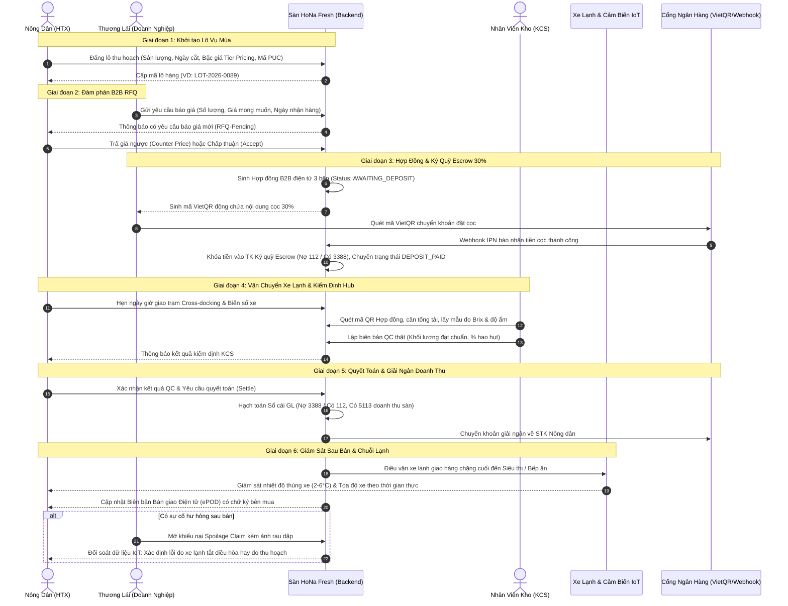
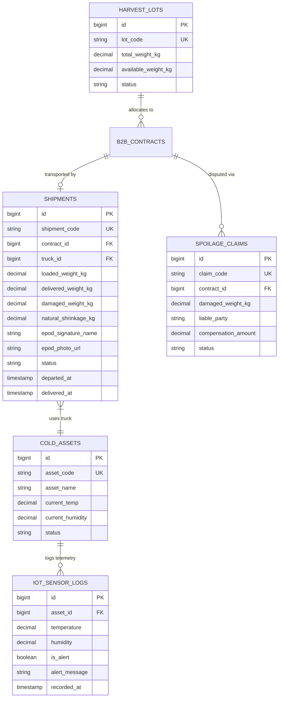
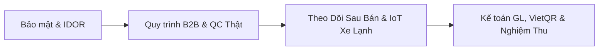

# KẾ HOẠCH TỔNG THỂ PHÁT TRIỂN & CHUẨN HÓA PHÂN HỆ NÔNG DÂN (FARMER PORTAL)
**Dự án:** Sàn Thương mại Điện tử Nông sản B2B/B2C (HoNa Fresh)  
**Tài liệu:** Kế hoạch Kỹ thuật & Nghiệp vụ Tổng thể (Master Technical & Business Plan)  
**Phiên bản:** 2.0 (Bổ sung Phân hệ Theo dõi Lô hàng Sau khi Bán)  

---

## 1. MỤC TIÊU & TẦM NHÌN HỆ THỐNG

> [!IMPORTANT]
> **Tầm nhìn:** Chuyển đổi phân hệ Nông dân từ mô hình **Prototype / Demo** sang **Nền tảng Giao dịch Nông sản B2B Cấp Doanh nghiệp (Enterprise B2B Agricultural Platform)**, vận hành theo tiêu chuẩn sản xuất (Production-ready).

### Mục tiêu Cốt lõi:
1. **Bảo mật & Phân quyền Tuyệt đối (Zero-Trust Multi-Tenancy):**
   - Loại bỏ 100% tài khoản test hardcode và cơ chế bypass đăng nhập.
   - Ngăn chặn hoàn toàn lỗ hổng **IDOR (Insecure Direct Object References)**: Nông dân chỉ được đọc/ghi dữ liệu thuộc quyền sở hữu của chính mình.
   - Phân định rõ 4 vai trò tham gia: `ROLE_FARMER` (Nông dân/HTX), `ROLE_BUYER` (Thương lái/Bếp ăn/Siêu thị), `ROLE_WAREHOUSE_QC` (Thủ kho/Thanh tra KCS), `ROLE_ADMIN` (Ban quản trị sàn).
2. **Minh bạch Tài chính & Bảo chứng Giao dịch (Financial Transparency & Escrow):**
   - Áp dụng cơ chế **Ký quỹ 30% bảo chứng (Escrow Deposit)** qua mã **VietQR Napas247 động**.
   - Quyết toán giải ngân tự động, khấu trừ phí sàn 3% và hạch toán trực tiếp vào **Sổ cái kế toán kép (General Ledger)**.
3. **Kiểm soát Chất lượng & Chuỗi lạnh (Cold-Chain Traceability & Real QC):**
   - Loại bỏ quy trình QC giả lập (mock data); chỉ cho phép nhân viên KCS tại Cross-docking Hub lập biên bản kiểm tra (Brix, độ ẩm, độ dập nát, tỷ lệ hao hụt).
   - Truy xuất nguồn gốc chuẩn PUC (Mã số vùng trồng) và chứng nhận VietGAP/OCOP.
4. **Theo dõi Toàn diện Lô hàng Sau khi Bán (Post-Sale Lot Tracking & Telemetry):**
   - Giám sát toàn bộ hành trình nông sản sau khi xuất vườn: xe lạnh chở đi đâu, nhiệt độ thùng xe IoT (2-6°C), tình trạng giao nhận tại kho người mua (ePOD).
   - Minh bạch phân định trách nhiệm khi có sự cố thối hỏng (Spoilage Claims) để bảo vệ uy tín nhà vườn.
5. **Trải nghiệm Số hóa Chuyên nghiệp (Digital UX & Real Storage):**
   - Lưu trữ media (ảnh lô vụ mùa, chứng chỉ chất lượng) trực tiếp trên Cloudinary.
   - Xuất hóa đơn điện tử KCT (Không chịu thuế) và Bảng kê thu mua nông sản Mẫu 01/TNDN chuẩn pháp lý phục vụ quyết toán thuế.

---

## 2. SƠ ĐỒ QUY TRÌNH NGHIỆP VỤ B2B KHÉP KÍN (END-TO-END WORKFLOW)



---

## 3. THIẾT KẾ ĐẶC TẢ TÍNH NĂNG: THEO DÕI LÔ HÀNG SAU KHI BÁN (POST-SALE TRACKING)

> [!NOTE]
> **Tại sao nông dân cần theo dõi lô hàng sau khi bán?**  
> 1. **Bảo vệ quyền lợi:** Rau củ rất dễ hư hỏng. Nếu trên đường vận chuyển tài xế tắt máy lạnh làm rau héo, người mua sẽ khiếu nại. Log nhiệt độ IoT chứng minh nông dân giao hàng đúng chuẩn.  
> 2. **Kiểm soát sản lượng tồn/bán:** Nông dân theo dõi được lô 10 tấn đã phân bổ cho những hợp đồng nào, còn lại bao nhiêu kg để chào bán tiếp.  
> 3. **Bằng chứng giao nhận (ePOD):** Nông dân biết chính xác hàng đã vào kho người mua lúc mấy giờ, ai ký nhận.

### 3.1. Cây Phân Bổ Sản Lượng (Harvest Lot Allocation Tree)
Mỗi lô thu hoạch được theo dõi theo cấu trúc phân rã:
```
[LÔ GỐC: LOT-2026-0089 - Xà Lách Mỹ Đà Lạt (Tổng: 10,000 kg)]
 ├── [Hợp đồng B2B-01]: 3,000 kg ➔ Siêu Thị Co.opMart HCM (Trạng thái: ĐÃ GIAO - Ký nhận ePOD)
 ├── [Hợp đồng B2B-02]: 5,000 kg ➔ Hệ Thống Bếp Ăn KCN Bình Dương (Trạng thái: ĐANG VẬN CHUYỂN - Xe 49C-123.45, Temp: 3.8°C)
 └── [Sản lượng khả dụng còn lại]: 2,000 kg (Đang mở bán sỉ / Chờ đàm phán RFQ tiếp theo)
```

### 3.2. Giám sát Chuỗi Lạnh Xe Lạnh IoT (Cold-Chain Telemetry)
- Nông dân xem biểu đồ nhiệt độ & độ ẩm thời gian thực được ghi nhận bởi cảm biến IoT gắn trên thùng xe lạnh chở lô hàng.
- Dải nhiệt độ chuẩn quy định: **2.0°C – 6.0°C**. Độ ẩm: **80% – 90%**.
- **Cảnh báo vi phạm (Cold-Chain Breach):** Nếu nhiệt độ vọt lên trên 8°C quá 30 phút, hệ thống tự động gắn cờ cảnh báo đỏ (`is_alert = true`), ghi nhận lỗi thuộc về bên Đơn vị Vận tải (Logistics), miễn trừ trách nhiệm cho nông dân nếu phát sinh khiếu nại hư hỏng sau đó.

### 3.3. Biên bản Bàn giao Điện tử (ePOD - Electronic Proof of Delivery)
Sau khi xe lạnh đến đích và dỡ hàng:
- Hình ảnh chụp nguyên trạng thùng hàng tại cửa kho người mua (`epod_photo_url`).
- Tên người đại diện nhận hàng và chữ ký số ký tay trên màn hình (`epod_signature_name`, `epod_signature_data`).
- Khối lượng bàn giao thực tế so với khối lượng xuất phát, tính toán tỷ lệ hao hụt tự nhiên (`natural_shrinkage_kg`).

### 3.4. Giám sát & Đối Soát Khiếu Nại Hư Hỏng (Spoilage Claims Settlement)
- Nếu người mua phát hiện chất lượng rau không đảm bảo và gửi yêu cầu đền bù (`spoilage_claims`):
  - Nông dân truy cập tab **"Khiếu nại sau bán"** để xem: Khối lượng yêu cầu bồi thường (`damaged_weight_kg`), hình ảnh đối chứng và lý do.
  - Sàn HoNa Fresh đối soát chéo dữ liệu:
    - Nếu biên bản QC tại trạm trước khi xuất xe là ĐẠT, và IoT xe lạnh có cảnh báo đứt gãy chuỗi lạnh ➔ Trách nhiệm thuộc về Đơn vị Vận chuyển / Tài xế xe lạnh. Nông dân vẫn được bảo toàn 100% tiền bán.
    - Nếu do tồn dư thuốc hoặc khâu đóng gói ban đầu sai quy cách ➔ Nông dân cùng sàn thương lượng phương án hỗ trợ.

### 3.5. Tem QR Truy Xuất Nguồn Gốc Lô Hàng Ra Thị Trường (Public Batch QR)
- Hệ thống tự động sinh mã QR công khai cho từng lô hàng đã xuất bán.
- Khi người tiêu dùng cuối tại siêu thị quét mã QR trên bao bì, họ xem được:
  - Tên nhà vườn / Hợp tác xã sản xuất, địa chỉ và mã số vùng trồng PUC.
  - Ngày thu hoạch và ngày hết hạn bảo quản lạnh.
  - Kết quả kiểm định chất lượng KCS (Độ ngọt Brix, độ ẩm, chứng nhận VietGAP).
  - Tỷ lệ đánh giá hài lòng của người tiêu dùng giúp nâng cao uy tín cho thương hiệu nông sản của nhà vườn.

---

## 4. BẢNG DỮ LIỆU & KIẾN TRÚC MIGRATION V6

Tận dụng và liên kết chặt chẽ các bảng dữ liệu đã có trong `V3__admin_business.sql` (`shipments`, `cold_assets`, `iot_sensor_logs`, `spoilage_claims`) với giao diện của Nông dân:



---

## 5. KẾ HOẠCH TRIỂN KHAI CHI TIẾT THEO 4 SPRINT (ĐÃ CẬP NHẬT)

### SPRINT 1: BẢO MẬT & KIỂM SOÁT SỞ HỮU (SECURITY & IDOR HARDENING)
*Mục tiêu: Đảm bảo an toàn 100%, không cho phép truy cập trái phép hoặc can thiệp dữ liệu chéo giữa các nông dân.*

| Mã Task | Hạng mục công việc | Tệp tin can thiệp | Tiêu chuẩn hoàn thành (Definition of Done) |
| :--- | :--- | :--- | :--- |
| **SEC-01** | Khóa Security Filter Chain cho phân hệ Farmer | [`SecurityConfig.java`](file:///e:/HOCTAP/WWW/BTL_WebBanRau/backend/src/main/java/com/btl/webbanrau/config/SecurityConfig.java) | Chỉ cho phép truy cập công khai 3 endpoint: `/farmer/rfq/public-submit`, `/farmer/contracts/track/**`, `/farmer/ai-chat`. Tất cả endpoint còn lại bắt buộc có JWT claim `ROLE_FARMER` hoặc `ROLE_ADMIN`. Request không token trả về `401 Unauthorized`. |
| **SEC-02** | Xóa bỏ Fallback Anonymous User `farmer_dalat` | [`FarmerService.java`](file:///e:/HOCTAP/WWW/BTL_WebBanRau/backend/src/main/java/com/btl/webbanrau/service/FarmerService.java) | `getCurrentFarmer()` lấy thông tin trực tiếp từ `SecurityContextHolder`. Nếu không tìm thấy hoặc người dùng chưa đăng nhập, ném ngoại lệ `AccessDeniedException` hoặc `UnauthorizedException`. |
| **SEC-03** | Rào chắn kiểm tra quyền sở hữu Tenant (Chặn IDOR) | [`FarmerService.java`](file:///e:/HOCTAP/WWW/BTL_WebBanRau/backend/src/main/java/com/btl/webbanrau/service/FarmerService.java) | Bổ sung hàm kiểm tra bản quyền: <br>• `updateHarvestLot`: Kiểm tra `lot.getFarmer().getId() == currentFarmer.getId()`.<br>• `respondToRfq`: Kiểm tra `rfq.getHarvestLot().getFarmer().getId() == currentFarmer.getId()`.<br>• `updateDeliverySchedule` & `settleContract`: Kiểm tra `contract.getFarmer().getId() == currentFarmer.getId()`.<br>Nếu không khớp, ném `AccessDeniedException("Bạn không có quyền thao tác trên tài nguyên này")`. |
| **SEC-04** | Dọn dẹp tài khoản demo trên Frontend | [`page.tsx (portal/farmer)`](file:///e:/HOCTAP/WWW/BTL_WebBanRau/frontend/src/app/portal/farmer/page.tsx) | Xóa nút "Đăng nhập nhanh Farmer", xóa logic hardcode `currentUser.username === 'farmer_dalat'`. Phân quyền dựa 100% vào `currentUser.roles.includes('ROLE_FARMER')`. Nếu chưa đăng nhập, chuyển hướng sang `/login?redirect=/portal/farmer`. |

---

### SPRINT 2: CHUẨN HÓA QUY TRÌNH NGHIỆP VỤ B2B & LOẠI BỎ MOCKING
*Mục tiêu: Đưa toàn bộ quy trình kiểm định QC, giao nhận trạm lạnh và hợp đồng về dữ liệu thật.*

| Mã Task | Hạng mục công việc | Tệp tin can thiệp | Tiêu chuẩn hoàn thành (Definition of Done) |
| :--- | :--- | :--- | :--- |
| **BIZ-01** | Loại bỏ Auto-mocking trong QC Inspection | [`FarmerService.java`](file:///e:/HOCTAP/WWW/BTL_WebBanRau/backend/src/main/java/com/btl/webbanrau/service/FarmerService.java) | Xóa bỏ đoạn code tự tạo bản ghi `QcInspection` giả ("KS. Trần Hữu Phúc, Đạt 98%"). Nếu hợp đồng chưa được kiểm định bởi kho, trả về trạng thái `AWAITING_QC` rõ ràng. |
| **BIZ-02** | Xây dựng API tiếp nhận & kiểm định QC tại trạm | `QcHubController.java`, `QcHubService.java` | Cung cấp API dành riêng cho nhân viên kho (`ROLE_WAREHOUSE_QC`):<br>`POST /api/warehouse/qc-inspect`: Tiếp nhận mã hợp đồng, cân khối lượng thực tế, đo độ Brix, nhập độ ẩm, đính kèm ảnh kiểm định thật và lưu kết quả (`PASSED` hoặc `REJECTED`). |
| **BIZ-03** | Điều kiện ràng buộc Quyết toán Hợp đồng | [`FarmerService.java`](file:///e:/HOCTAP/WWW/BTL_WebBanRau/backend/src/main/java/com/btl/webbanrau/service/FarmerService.java) | Chỉ cho phép gọi `settleContract()` khi:<br>1. Hợp đồng ở trạng thái `AT_HUB_QC` hoặc `DELIVERED`.<br>2. Bản ghi `QcInspection` thực tế tồn tại và kết quả là `PASSED`.<br>3. Số tiền quyết toán tính theo đúng công thức: `netQualifiedWeight * unitPrice * 0.97` (trừ 3% phí sàn). |
| **BIZ-04** | Hợp nhất Sổ cái Kế toán GL Ledger khi Quyết toán | `SettlementService.java`, `AdminBusinessService.java` | Khi nông dân thực hiện quyết toán thành công, hệ thống tự động ghi nhận bút toán kép vào bảng `gl_journal_entries` & `gl_journal_lines`:<br>• Nợ TK 3388 (Tiền giữ hộ thương lái/ký quỹ): Tổng tiền hàng.<br>• Có TK 112 (Tiền gửi ngân hàng chi trả nông dân): Số tiền thực nhận.<br>• Có TK 5113 (Doanh thu hoa hồng dịch vụ sàn 3%): Phí sàn. |

---

### SPRINT 3: PHÂN HỆ THEO DÕI LÔ HÀNG SAU KHI BÁN & IOT CHUỖI LẠNH
*Mục tiêu: Cung cấp đầy đủ công cụ cho nông dân theo dõi sản lượng phân bổ, hành trình xe lạnh IoT và bằng chứng giao hàng ePOD.*

| Mã Task | Hạng mục công việc | Tệp tin can thiệp | Tiêu chuẩn hoàn thành (Definition of Done) |
| :--- | :--- | :--- | :--- |
| **TRK-01** | API Cây Phân Bổ Sản Lượng Lô Thu Hoạch | `FarmerController.java`, `FarmerService.java` | Xây dựng endpoint `GET /farmer/harvest-lots/{id}/allocation`: Trả về chi tiết các hợp đồng con đã mua từ lô này, tỷ lệ phần trăm đã bán, khối lượng đang trên đường giao, khối lượng đã nhập kho và lượng tồn khả dụng còn lại. |
| **TRK-02** | API Giám Sát Chuỗi Lạnh Xe Lạnh IoT | `FarmerController.java`, `FarmerService.java` | Xây dựng endpoint `GET /farmer/harvest-lots/{id}/shipments`: Lấy thông tin chuyến xe chở hợp đồng, vị trí hiện tại, biểu đồ nhiệt độ/độ ẩm từ bảng `iot_sensor_logs` và danh sách cảnh báo vi phạm dải nhiệt 2-6°C. |
| **TRK-03** | API Bằng Chứng Giao Nhận Điện Tử (ePOD) & Khiếu Nại | `FarmerController.java`, `FarmerService.java` | Xây dựng endpoint `GET /farmer/contracts/{id}/delivery-proof`: Lấy ảnh chụp thực tế khi giao hàng (`epod_photo_url`), chữ ký người nhận, tỷ lệ hao hụt tự nhiên và chi tiết khiếu nại thối hỏng (`spoilage_claims`) nếu có. |
| **TRK-04** | API Tem QR Truy Xuất Nguồn Gốc Công Khai | `FarmerController.java`, `PublicTraceController.java` | Cấp mã QR công khai `/trace/lot/{lotCode}` để người tiêu dùng cuối quét xem chứng nhận VietGAP, ngày cắt trộm, độ ngọt Brix và đánh giá phản hồi chất lượng. |

---

### SPRINT 4: TÍCH HỢP VIETQR, HOÀN THIỆN GIAO DIỆN & CHỨNG TỪ THUẾ
*Mục tiêu: Đảm bảo giao diện hiện đại, thanh toán QR động, loại bỏ hoàn toàn mock frontend và xuất chứng từ thuế chuẩn.*

| Mã Task | Hạng mục công việc | Tệp tin can thiệp | Tiêu chuẩn hoàn thành (Definition of Done) |
| :--- | :--- | :--- | :--- |
| **PAY-01** | Sinh mã VietQR Napas247 động cho tiền cọc 30% | `VietQrService.java`, `FarmerController.java` | Tích hợp chuẩn VietQR động (EMVCo payload). Khi thương lái chốt hợp đồng B2B, hệ thống trả về URL hình ảnh mã QR ngân hàng chính xác chứa: Mã BIN ngân hàng sàn, Số tài khoản trung gian ký quỹ, Số tiền cọc 30%, Nội dung chuyển khoản cú pháp duy nhất `B2B <CONTRACT_CODE>`. |
| **PAY-02** | Xử lý Webhook IPN tự động xác nhận đặt cọc | `PaymentWebhookController.java` | Nhận tín hiệu Webhook từ ngân hàng (Casso/SeAPay). Khi giao dịch khớp cú pháp và số tiền cọc, tự động chuyển trạng thái hợp đồng từ `AWAITING_DEPOSIT` sang `DEPOSIT_PAID` và gửi thông báo cho cả nông dân lẫn thương lái. |
| **MED-01** | Tích hợp Cloudinary cho Form đăng Lô vụ mùa | [`ImageUploadField.tsx`](file:///e:/HOCTAP/WWW/BTL_WebBanRau/frontend/src/components/ImageUploadField.tsx), [`page.tsx (portal/farmer)`](file:///e:/HOCTAP/WWW/BTL_WebBanRau/frontend/src/app/portal/farmer/page.tsx) | Thay thế các ô nhập URL text thủ công bằng nút tải ảnh Cloudinary trực quan (kéo thả ảnh, nén ảnh tự động, hiển thị thanh tiến trình tải). |
| **UI-01** | Loại bỏ Cơ chế Silent Mock Fallback | [`farmerApi.ts`](file:///e:/HOCTAP/WWW/BTL_WebBanRau/frontend/src/services/farmerApi.ts) | Xóa bỏ hoàn toàn khối `catch` ghi đè `localStorage` và mock data. Nếu API gặp sự cố hoặc mất mạng, ném lỗi rõ ràng và hiển thị Toast thông báo lỗi để người dùng biết chính xác trạng thái giao dịch. |
| **UI-02** | Thêm Tab "Theo Dõi Lô Hàng Sau Bán" Trên Frontend | [`page.tsx (portal/farmer)`](file:///e:/HOCTAP/WWW/BTL_WebBanRau/frontend/src/app/portal/farmer/page.tsx) | Tích hợp giao diện trực quan: Biểu đồ nhiệt độ xe lạnh IoT thời gian thực, Cây phả hệ phân bổ lô hàng, Modal xem ảnh bàn giao ePOD và tra cứu mã QR truy xuất nguồn gốc. |
| **DOC-01** | Chuẩn hóa Bảng kê Thu mua Mẫu 01/TNDN & Hóa đơn KCT | `FarmerService.java`, `InvoiceModal.tsx` | Nâng cấp chứng từ Bảng kê 01/TNDN theo đúng quy định tại Thông tư 78/2014/TT-BTC (đầy đủ thông tin CMND/CCCD nông dân, địa chỉ vùng trồng, chữ ký điện tử xác nhận của đại diện sàn HoNa Fresh và mã QR tra cứu tính hợp lệ). |

---

## 6. BỘ TIÊU CHUẨN KIỂM THỬ & NGHIỆM THU (TESTING & QA SUITE)



1. **Security & IDOR Test Cases:**
   - [ ] Gửi request không kèm JWT đến `/farmer/harvest-lots` ➔ Nhận mã lỗi `401 Unauthorized`.
   - [ ] Nông dân A gọi `PUT /farmer/harvest-lots/{id_của_Nông_dân_B}` ➔ Nhận mã lỗi `403 Forbidden` (Chặn IDOR).
2. **Post-Sale Tracking Test Cases:**
   - [ ] Nông dân xem chi tiết lô thu hoạch đã bán ➔ Hiển thị cây phân bổ: đúng số lượng đã bán vào Hợp đồng X, số lượng còn lại khả dụng.
   - [ ] Chuyến xe lạnh vận chuyển hợp đồng bị cảnh báo nhiệt độ (>6°C) ➔ Hệ thống ghi nhận log cảnh báo đỏ, không quy trách nhiệm cho nông dân.
   - [ ] Người mua xác nhận nhận hàng thành công ➔ Nông dân xem được ảnh chụp ePOD và chữ ký điện tử của người nhận.
3. **Financial Accounting & VietQR Test Cases:**
   - [ ] Sau khi quyết toán, bảng `gl_journal_entries` phát sinh bút toán kép chuẩn xác Nợ TK 3388 / Có TK 112 và Có TK 5113 (phí sàn 3%).
   - [ ] Bảng kê 01/TNDN hiển thị đúng tên nông dân, số CMND/CCCD và số tiền thực nhận.

---

## 7. ĐỀ XUẤT HÀNH ĐỘNG TIẾP THEO

Toàn bộ phân hệ **Theo dõi Lô hàng Sau khi Bán** đã được tích hợp hoàn chỉnh vào kiến trúc tổng thể.

👉 **Khuyến nghị thực hiện ngay:** Bắt đầu triển khai **Sprint 1 (Khóa Bảo mật, Chặn IDOR & Phân quyền chuẩn)** làm nền tảng vững chắc, sau đó tiến hành lần lượt các Sprint tiếp theo.
